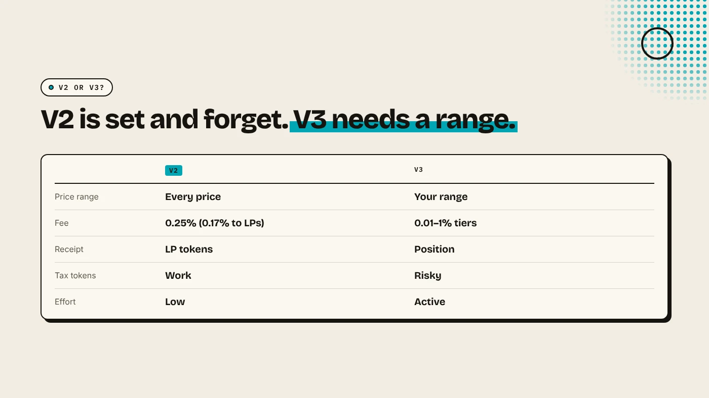
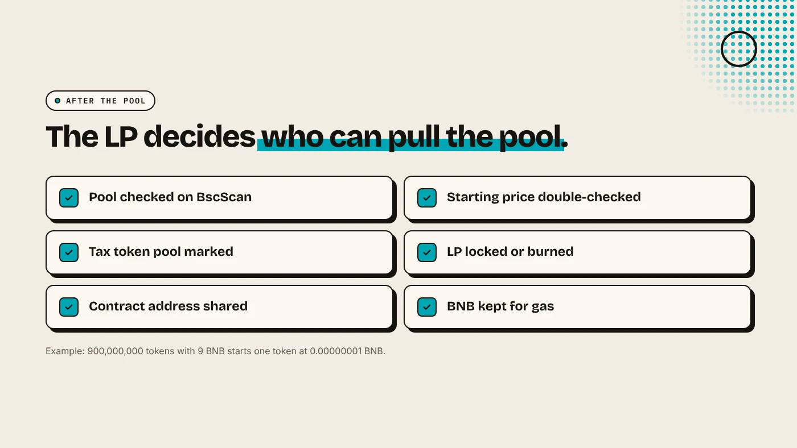

To add liquidity on PancakeSwap for a new token, open Liquidity, choose V2 for a simple full-range pool (or V3 for a price range), select your token by contract address and BNB, enter both amounts, approve your token and confirm. The ratio you deposit sets the first price. You receive LP tokens on V2, or a position on V3, which you should lock or burn.

:::note Key facts
- **V2 fee:** a fixed **0.25%** per trade, of which **0.17%** goes back to liquidity providers (PancakeSwap docs).
- **V3:** fee tiers of **0.01%, 0.05%, 0.25% and 1%**, each with its own price range.
- **V2 gives LP tokens. V3 gives a position** that works like an NFT.
- **Tax tokens:** use **V2**. Fee-on-transfer tokens are a known problem for concentrated-liquidity routers.
:::

:::note Not affiliated
DegenKit is not affiliated with PancakeSwap or BNB Chain.
:::

## V2 or V3 for a new token?

PancakeSwap's interface defaults to V3, and its docs suggest V3 unless a token does not support it. For a brand-new token, many creators still pick **V2**, because:

- a V2 pool covers every price, so it never goes **out of range** when your price moves 10x,
- buyers and scanners understand LP tokens and how to check a lock,
- **tax tokens** work with V2 routers. See [how buy and sell tax works](/blog/how-token-buy-sell-tax-works/).

V3 can earn more fees per dollar if you manage the range, but a new token's price can leave any range quickly.

## How do you add V2 liquidity step by step?

1. **Create the token** on [DegenKit's BNB Chain launcher](/launch/bnb/). The full supply goes to your wallet. See [how to launch a token on BNB Chain](/blog/how-to-launch-a-token-on-bnb-chain/).
2. Open PancakeSwap, go to **Liquidity** and click **Add Liquidity**.
3. Pick **BNB** as one token. For your token, paste its **contract address** into the token search.
4. Switch to **V2** and check the "V2 LP - 0.25 fee tier" label.
5. Enter the amount of your token and the amount of BNB. As the first provider, you set the ratio.
6. Click **Enable** for your token and confirm the approval. See [ERC-20 token approvals explained](/blog/erc20-token-approvals-explained/).
7. Click **Add** and confirm. Your LP tokens appear on the Liquidity page.

## How does the deposit set the price?

In a new pool, the starting price is just BNB divided by tokens. For example, 900,000,000 tokens with 9 BNB starts one token at 0.00000001 BNB. Check the zeros twice. A wrong ratio is the most common launch mistake, and bots buy instantly if the price is too low.

A deeper pool moves less on each trade. With a thin pool, one buy can double the price, and one sell can halve it.

## What about a tax token?

If you created a **Tax Token** on DegenKit, the tax only applies to pools you mark:

1. Add liquidity on **V2** as above.
2. Copy the **pair address** from the transaction on BscScan.
3. Open **My Tokens** on DegenKit, paste it and mark it as a pool.

Until you mark it, trades are not taxed. Our guide to [managing a tax token](/blog/manage-tax-token-renounce-ownership/) covers the controls.

## What should you do with the LP tokens?

Whoever holds the LP tokens can withdraw the pool. To show buyers you will not, lock them in a locker contract with an end date, or burn them by sending them to a dead address. See [how to lock liquidity on Ethereum, Base and BNB Chain](/blog/lock-liquidity-ethereum-base-bnb/).

## What are the risks?

- **Wrong starting price** from a misplaced zero.
- **Impermanent loss** if the price moves a lot.
- **Snipers** in the first blocks after the pool goes live.
- **Unlocked LP** worries buyers and can be withdrawn.

You can lose money in crypto. This is not financial advice.

## FAQ

### How much does it cost to add liquidity on PancakeSwap?

Gas in BNB for the approval and the deposit, which is usually cents on BNB Chain, plus the BNB and tokens you put in.

### Should I pair my token with BNB or USDT?

BNB is the most common pair for new tokens. A stablecoin pair makes the price easier to read in dollars.

### Do I earn fees as a liquidity provider?

On V2, 0.17% of each trade goes back to the pool, shared by LP holders.

## Sources

- [PancakeSwap docs: Liquidity pools](https://docs.pancakeswap.finance/earn/pancakeswap-pools)
- [PancakeSwap docs: How to add or remove liquidity](https://docs.pancakeswap.finance/earn/pancakeswap-pools/liquidity-guide)
- [Uniswap: Token integration issues (v3)](https://developers.uniswap.org/docs/protocols/v3/concepts/unsupported-tokens)

Create the token first on the [DegenKit BNB Chain launcher](/launch/bnb/).
