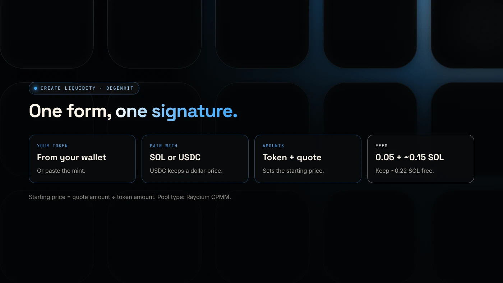
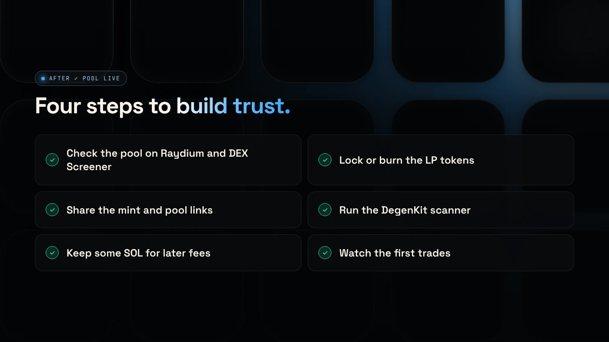

To add liquidity to a Solana token, create a Raydium pool with your token and SOL or USDC: the amounts you deposit set the starting price, and once the pool is live the token can be traded on Raydium and Jupiter. DegenKit's **Create Liquidity** tool does this in one signature for a 0.05 SOL service fee plus Raydium's pool fee.

:::note Key facts
- **Pool type:** Raydium **CPMM** (standard pool), paired with **SOL** or **USDC**.
- **Fees:** 0.05 SOL DegenKit fee plus Raydium's pool fee, shown as about **0.15 SOL** (November 2026).
- **Keep free:** about **0.22 SOL** beyond your deposit, for fees.
- **Starting price** = quote amount ÷ token amount. The form shows it before you sign.
:::

:::note Not affiliated
DegenKit is not affiliated with Raydium. The tool uses Raydium's public pool programs.
:::

## What do you need before you start?

- **Your token**, created and in your wallet. See the [Solana token creator guide](/blog/create-solana-token-without-coding/).
- **Freeze authority revoked.** Most pools and buyers expect it.
- **SOL or USDC** for your side of the pool, plus about 0.22 SOL for fees.
- **A plan for the price.** Decide the starting price and market cap before you open the form.

## How do you add liquidity with DegenKit?

1. Open the [Solana launcher](/launch/solana/), click **Connect wallet** and choose **Create Liquidity**.
2. Pick **Your token** from the list, or paste the mint address. Result: your token balance appears.
3. Choose **Pair with**: **SOL** or **USDC**.
4. Enter **Tokens to add** (or use 25%, 50%, 75%, Max) and the SOL or USDC **to add**. Result: the **Starting price** and **Starting market cap** update.
5. Check the **Raydium pool fee** and **DegenKit service fee**, then click **Create pool** and approve in your wallet.
6. When **✓ POOL LIVE** appears, copy the **pool** ID and open **Trade on Raydium →** or **View chart on DexScreener →**.

## How do you set the starting price?

The starting price is the ratio of your deposit:

**Starting price = SOL (or USDC) amount ÷ token amount**

Example: 800,000,000 tokens with 40 SOL gives 0.00000005 SOL per token. If the total supply is 1,000,000,000, the starting market cap is 50 SOL.

Count the zeros twice. A wrong ratio cannot be fixed without removing liquidity. Our guide on [SOL or USDC for your pair](/blog/sol-or-usdc-liquidity-pair/) explains how each pair affects the dollar price.

## What should you do after the pool is live?

- **Check the pool** on Raydium and DEX Screener: the pair, price and liquidity.
- **Decide on the LP tokens.** Locking or burning them shows buyers the liquidity stays. See [locking liquidity on Solana](/blog/lock-liquidity-on-solana-burn-and-earn/).
- **Share the mint address** and pool link.
- **Run the scanner.** DegenKit's [scanner](/docs/scanner/) shows how buyers will see your token.

## What are the common errors?

- **"Not enough SOL":** keep about 0.22 SOL free beyond your SOL deposit.
- **Using USDC without SOL:** fees are still paid in SOL.
- **Token not listed:** paste the mint address. Only tokens in the connected wallet can be added.
- **Freeze authority still active:** revoke it first in **Authorities**.

## What are the risks?

- **Price risk.** If your token falls, the value of your pool share falls.
- **Impermanent loss** when the price moves. See [what a Raydium liquidity pool is](/blog/what-is-a-raydium-liquidity-pool/).
- **Thin pools** swing a lot on small trades.
- **Unlocked LP** can be withdrawn, which buyers see as a risk.

You can lose money in crypto. This is not financial advice.

## FAQ

### How do I add liquidity to a Solana token?

Create a Raydium pool with your token and SOL or USDC. The deposit ratio sets the starting price, and the token becomes tradable once the pool is live.

### How much does it cost to create a Raydium pool?

On DegenKit, a 0.05 SOL service fee plus Raydium's pool fee, shown as about 0.15 SOL, as of November 2026. Your deposit is separate.

### Can I remove liquidity later?

Yes, unless you lock or burn the LP tokens. See [removing liquidity from a Raydium pool](/blog/how-to-remove-liquidity/).

## Sources

- [Raydium docs: Choosing a pool type](https://docs.raydium.io/user-flows/choosing-a-pool-type)
- [Raydium docs: Pool types](https://docs.raydium.io/raydium/for-liquidity-providers/pool-types)

To open your pool, use [Create Liquidity in the DegenKit Solana launcher](/launch/solana/).
