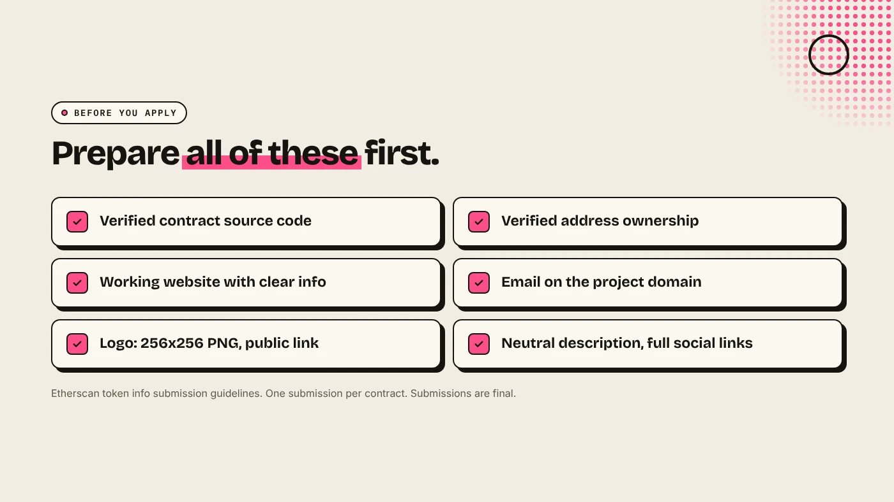
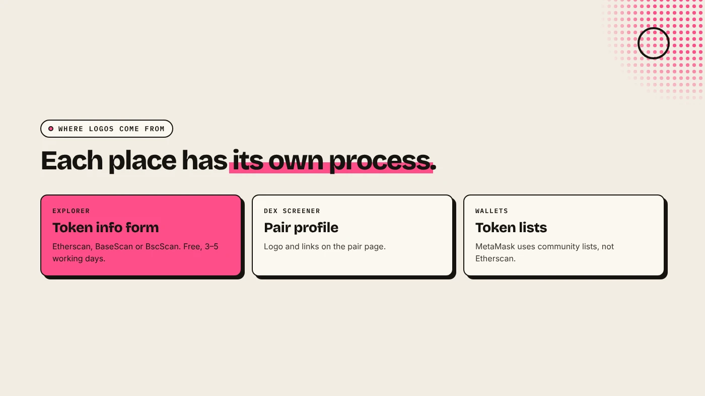

To add a token logo on Etherscan, submit the explorer's official token info form after you verify your contract's source code and your ownership of the address. You need a working website, an email on your project's domain, a 256x256 PNG logo and a neutral description. Etherscan's guide says listing is free and review usually takes 3 to 5 working days.

:::note Key facts
- **Free.** Etherscan "will never ask for payment". Fee requests are likely fraud.
- **Before you apply:** publish the contract's **source code** and **verify ownership** of the address.
- **Logo:** **PNG, 256x256**. **Email:** on the project domain or the official address shown on the website.
- **Review:** usually **3–5 working days**, up to 5–7 in busy periods. One submission per contract.
:::

:::note Not affiliated
DegenKit is not affiliated with Etherscan, BaseScan or BscScan. The requirements below are from Etherscan's guide. BaseScan and BscScan run similar forms. Check each site's own page.
:::

## What does a token page show without a logo?

A new token's explorer page shows the name, symbol, supply and holders, but a blank or default icon and no links. Adding token info gives it a logo, a description, a website and social links. It makes the page look legitimate and helps buyers confirm they have the right contract. It does not change the token itself.

## What do you need before you apply?

Etherscan lists these requirements:

1. **Verified source code** for the token contract.
2. **Verified ownership** of the contract address, through Etherscan's ownership verification.
3. **A working website** with clear information about the project. All links must work.
4. **An email** on the project's domain, or the official primary email shown on the website.
5. **A logo**, PNG at 256x256. The download link must not be private.
6. **A neutral description** without "exaggerated or comparative claims".
7. **Full links** to social profiles, not just usernames.

## How do you submit it?

1. Open the token's contract page on the explorer and check the **Contract** tab shows verified source code.
2. Complete the explorer's **ownership verification** for the address. For tokens created through a factory contract, ask the explorer's support which address they accept as the owner.
3. Open the official **token info** form from your account.
4. Fill in the details, attach or link the logo and submit **once**.
5. Wait. To follow up, reply to the confirmation email rather than submitting again.

Etherscan says submissions are final and cannot be edited, so check every field first.

## What about BaseScan and BscScan?

BaseScan and BscScan are run by the Etherscan team and use similar token update forms. Submit on the explorer for the chain your token lives on. A Base token's page is on BaseScan, a BNB Chain token's on BscScan. If you created the token on DegenKit's [Base](/launch/base/) or [BNB Chain](/launch/bnb/) launcher, the contract address links to the right explorer. See [how to launch a token on Base](/blog/how-to-launch-a-token-on-base/).

## What else gives your token a logo?

- **Wallets** like MetaMask pull logos from community token lists, not from Etherscan. See [how to add a token to MetaMask](/blog/add-token-to-metamask/).
- **DexScreener** lets projects add a logo and links to the pair page. See [DexScreener and CoinGecko listings](/blog/dexscreener-and-coingecko-listing/).

## What are the risks?

- **Paid "listing services".** Etherscan says it never charges and does not accept payment to speed up review.
- **Rejected submissions.** Missing website content or a personal email address are common reasons.
- **Impersonation.** A logo copied from another project can get the token flagged.

You can lose money in crypto. This is not financial advice.

## FAQ

### How much does it cost to add a logo on Etherscan?

Nothing. Etherscan says listing is free, and any request for payment is likely fraud.

### How long does Etherscan take to update token info?

Usually 3 to 5 working days, up to 5 to 7 when requests surge.

### Why was my token info rejected?

Common reasons are unverified source code, an email not on the project domain, a website without clear information, or a description with exaggerated claims.

## Sources

- [Etherscan: Token info submission guidelines](https://info.etherscan.com/token-update-guide)
- [MetaMask Support: How to display tokens in MetaMask](https://support.metamask.io/manage-crypto/tokens/how-to-display-tokens-in-metamask)

Create a token with a fixed supply and no mint function on the [DegenKit launcher](/launch/).
