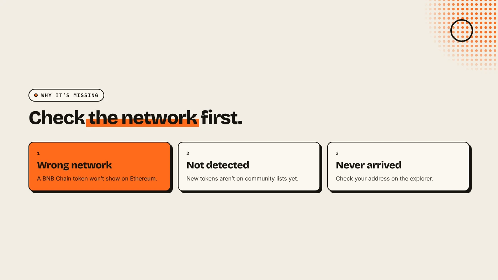
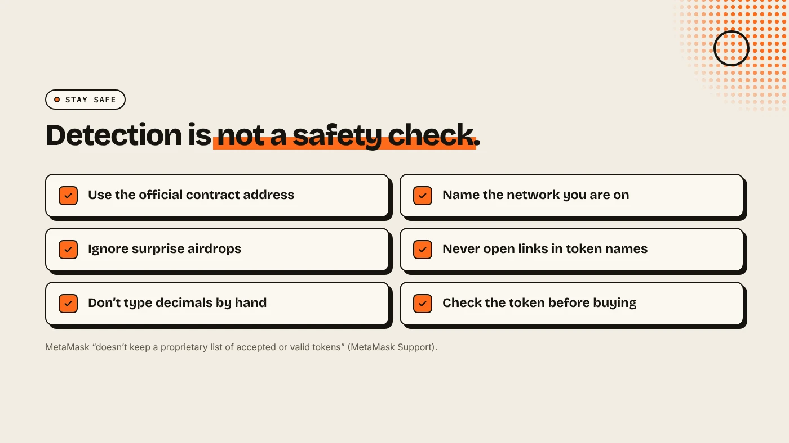

To add a token to MetaMask, select the network the token lives on (Ethereum, Base or BNB Smart Chain), open Manage tokens, choose Add custom token, paste the token's contract address and import it. MetaMask often detects tokens automatically. If a new token is missing, it usually needs adding by address, or your wallet is on the wrong network.

:::note Key facts
- **Steps:** three dots → **Manage tokens** → **Add custom token** → paste address → **Next** → **Import** (MetaMask Support).
- **Auto-detection** is on by default and covers Ethereum, BNB Smart Chain, Base and others.
- **A token can only be added** on a network where its contract is deployed.
- **MetaMask has no list of approved tokens.** Detection is not a safety check.
:::

:::note Not affiliated
DegenKit is not affiliated with MetaMask or Consensys.
:::

## Why is my token not showing in MetaMask?

Usually for one of three reasons:

1. **Wrong network.** A BNB Chain token does not show while MetaMask is on Ethereum. See [ERC-20 vs BEP-20](/blog/erc20-vs-bep20/).
2. **Not detected yet.** New tokens are often not on the community lists MetaMask's detection uses.
3. **It never arrived.** Check your address on Etherscan, BaseScan or BscScan.

MetaMask Support suggests refreshing the asset list first, then adding the token manually.

## How do you add a custom token?

1. **Switch to the right network** with the network selector. For Base or BNB Smart Chain, add the network first if it is not in your list.
2. On the home screen, open the **three dots** in the tokens section and choose **Manage tokens**.
3. Search by name or symbol. If the token is not listed, scroll down and select **Add custom token**.
4. Paste the **contract address**. Symbol and decimals usually fill in on their own.
5. Click **Next**, then **Import**.

The token now appears under your account. Where do you get the address? From the project's official site or X account, or from the creator. If you created the token with DegenKit, the **Contract address** appears after creation and in **My Tokens**.

## What if decimals or symbol look wrong?

If the fields do not fill in, the address may be wrong, on another network, or not a token contract. Do not type values by hand to make it fit. Check the address on the explorer first. Tokens made with DegenKit's EVM Token Creator use 18 decimals.

## Is a token safe because it shows in MetaMask?

No. MetaMask Support says it "doesn't keep a proprietary list of 'accepted' or 'valid' tokens". Detection only means the token appears on a community list. It warns about airdropped and unfamiliar tokens, and about explorer error messages that point to websites, which are likely phishing.

Before you buy or interact, check the token. See [how to spot a honeypot token](/blog/how-to-spot-a-honeypot-token/) and [reading a token page on Etherscan](/blog/read-token-page-etherscan-blockscout/).

## How do token creators make this easier for holders?

- **Publish the contract address** on your site and X, with the network named.
- **Add a logo** on the explorer. See [how to add a token logo on Etherscan, BaseScan or BscScan](/blog/add-token-logo-etherscan/).
- **Get listed** on screeners, which helps tokens reach community lists over time. See [DexScreener and CoinGecko listings](/blog/dexscreener-and-coingecko-listing/).

## What are the risks?

- **Fake tokens** with the same name and symbol.
- **Wrong-network transfers** that look like missing tokens.
- **Phishing links** inside spam token names or explorer messages.

You can lose money in crypto. This is not financial advice.

## FAQ

### How do I add a BEP-20 token to MetaMask?

Switch MetaMask to BNB Smart Chain, then use Manage tokens → Add custom token with the token's contract address.

### Why doesn't MetaMask show my new token automatically?

New tokens are often not on the community lists MetaMask uses. Add it by contract address.

### Can I remove a token from MetaMask?

Yes. Hiding it from your list does not move or delete the tokens. They stay at your address.

## Sources

- [MetaMask Support: How to display tokens in MetaMask](https://support.metamask.io/manage-crypto/tokens/how-to-display-tokens-in-metamask)
- [Trust Wallet: BEP-20](https://trustwallet.com/glossary/bep-20)

Create a token and get its contract address on the [DegenKit launcher](/launch/).
