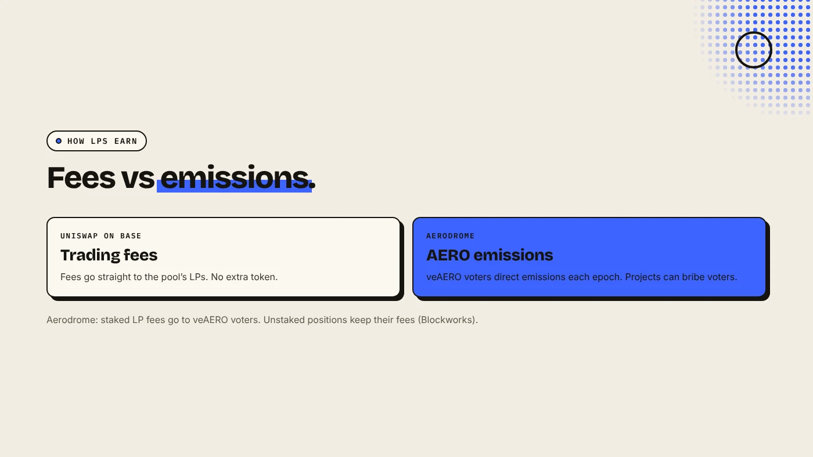
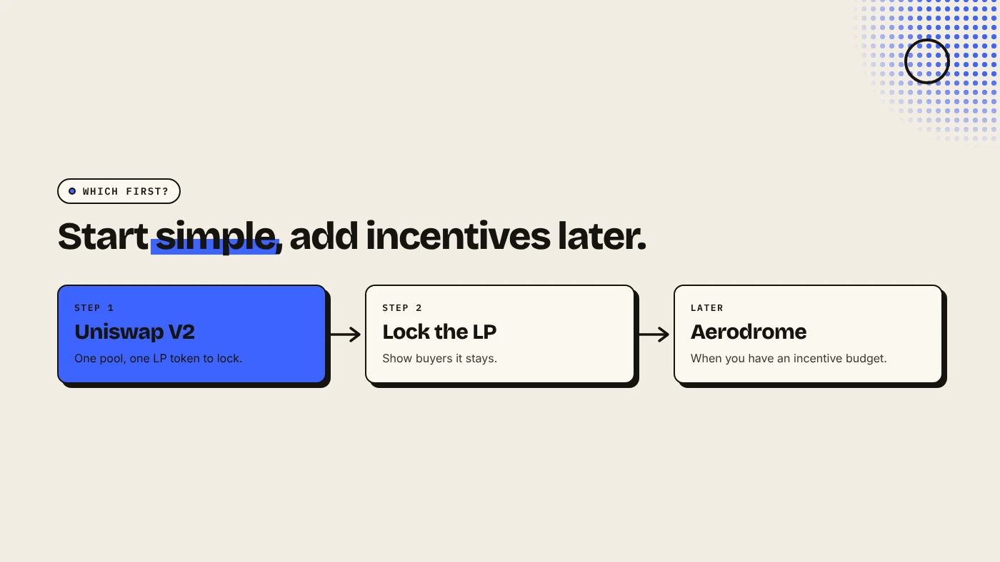

On Base, Uniswap is the simpler place to open a first pool: create a V2 pool with your token and ETH, keep the LP tokens and earn trading fees. Aerodrome is Base's largest DEX by volume and pays most of its rewards in AERO emissions directed by token holders' votes, which suits projects ready to bribe voters for liquidity. Many projects start on Uniswap and add Aerodrome later.

:::note Key facts
- **Aerodrome** launched in **August 2023**, from the team behind Velodrome on Optimism (Blockworks).
- **Base's largest DEX by volume** (CoinPaprika, February 2026).
- **ve(3,3):** AERO holders lock for **veAERO** and vote each epoch where emissions go. Projects can bribe voters.
- **Uniswap v2** has been live on Base since **February 2024** (Uniswap).
:::

:::note Not affiliated
DegenKit is not affiliated with Aerodrome, Uniswap or Base.
:::

## How does Uniswap work on Base?

Uniswap on Base works like Uniswap on Ethereum. You pick a version, deposit two tokens and receive LP tokens (v2) or a position NFT (v3 and v4). Trading fees go straight to the pool's providers. There are no emissions to vote on and no extra token to manage. Our guide to [adding liquidity on Uniswap](/blog/add-liquidity-uniswap-erc20/) walks through it.

For a **tax token**, use **v2**. Uniswap's docs say fee-on-transfer tokens do not work with its v3 routers.

## How does Aerodrome work?

Aerodrome uses the **ve(3,3)** model, which Blockworks describes like this:

- AERO holders lock tokens for up to four years and receive **veAERO**, an NFT with votes and a claim on protocol revenue.
- Each epoch, veAERO holders **vote** to direct AERO emissions to specific pools.
- Projects can **bribe** voters to send emissions to their pool.
- Staked LP fees go to veAERO voters through gauges. **Unstaked** positions keep their trading fees.

Aerodrome offers basic pools for stable and volatile pairs, and **Slipstream**, a concentrated-liquidity module derived from Uniswap V3.

## How do they compare?

| | Uniswap on Base | Aerodrome |
|---|---|---|
| LP earns | Trading fees | AERO emissions if staked, fees if unstaked |
| Pool types | v2, v3, v4 | Basic stable and volatile, Slipstream |
| Extra token | None | AERO and veAERO |
| Attracting liquidity | Your own deposit | Votes and bribes |
| Tax token | v2 works | Check before you add |
| Best for | A first, simple pool | Projects building deep, incentivized liquidity |

## Which should you choose for a new token?

- **Start on Uniswap v2** if you want one pool, one LP token to lock, and no extra mechanics. This is the usual first step after creating a token on [DegenKit's Base launcher](/launch/base/).
- **Add Aerodrome** when your project has a budget for incentives and wants deeper liquidity. Bribes cost money, and emissions only last while voters keep choosing your pool.

Buyers' DEX aggregators route across both, so a token can trade on Uniswap and still be reachable for Aerodrome users.

## What should you do after the pool exists?

- **Lock or burn the LP.** See [how to lock liquidity on Ethereum, Base and BNB Chain](/blog/lock-liquidity-ethereum-base-bnb/).
- **Check the pool on BaseScan** and share the contract address.
- **For a tax token,** mark the pair in **My Tokens** so the tax applies.

For the token itself, see [how to launch a token on Base](/blog/how-to-launch-a-token-on-base/).

## What are the risks?

- **Emissions end.** Liquidity attracted by bribes can leave when rewards stop.
- **Token risk.** AERO's price affects what emissions are worth.
- **Impermanent loss** on any pool.
- **Unlocked LP** on any DEX can be withdrawn.

You can lose money in crypto. This is not financial advice.

## FAQ

### Is Aerodrome better than Uniswap on Base?

It is larger by volume, but more complex. For a first pool, Uniswap v2 is simpler.

### Do I need AERO to add liquidity on Aerodrome?

No. You can add liquidity with your token and ETH. AERO is what staked providers earn and what voters lock.

### Can a token have pools on both?

Yes. Many tokens trade on both, and aggregators route between them.

## Sources

- [Blockworks: Aerodrome Finance](https://blockworks.com/insights/aerodrome-finance)
- [CoinPaprika: What is Base](https://coinpaprika.com/education/what-is-base-complete-guide-to-the-base-blockchain-ecosystem/)
- [Uniswap blog: Uniswap v2 now live across more major chains](https://blog.uniswap.org/uniswap-v2-now-live-across-more-major-chains)
- [Uniswap: Token integration issues (v3)](https://developers.uniswap.org/docs/protocols/v3/concepts/unsupported-tokens)

Create a plain or tax token first on the [DegenKit Base launcher](/launch/base/).
