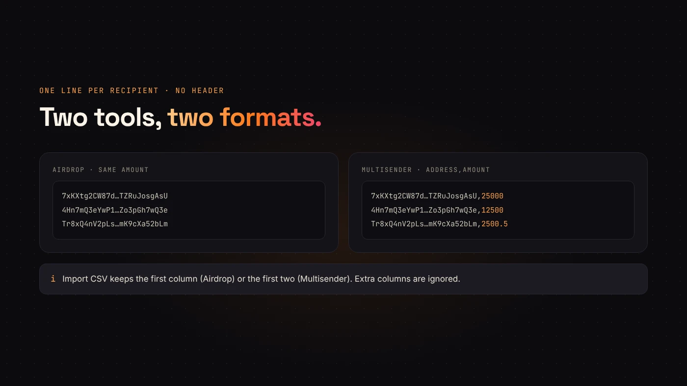
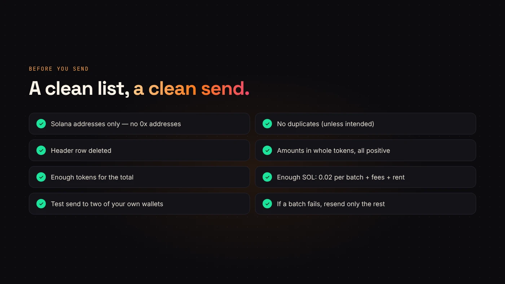

Sending tokens to a few wallets is easy. Sending them to hundreds needs a clean list. DegenKit's **Airdrop** and **Multisender** do the sending; this guide covers the list.

For which tool to use, see [Airdrop vs. Multisender](/blog/airdrop-vs-multisender/). In short: Airdrop sends the **same amount** to everyone; Multisender sends **different amounts** from a list.

## The two list formats

**Airdrop** takes one wallet address per line. You enter the amount once for everyone.

```
7xKXtg2CW87d97TXJSDpbD5jBkheTqA83TZRuJosgAsU
4Hn7mQ3eYwP1tVb8nR6kLs2dJf9cXa5uZo3pGh7wQ3e
```

**Multisender** takes `address,amount` on each line.

```
7xKXtg2CW87d97TXJSDpbD5jBkheTqA83TZRuJosgAsU,25000
4Hn7mQ3eYwP1tVb8nR6kLs2dJf9cXa5uZo3pGh7wQ3e,12500
```

Amounts are in whole tokens. Decimals are allowed, such as `2500.5`.



## Importing a CSV

Both tools have an **Import CSV** button. DegenKit reads each line and keeps:

- for Airdrop, the **first column** (the address);
- for Multisender, the **first two columns** (address and amount).

Extra columns are ignored, and empty lines are skipped.

:::warning Remove the header row
If your spreadsheet has a header such as `address,amount`, delete it before importing. For Multisender, a header row has no valid amount, and DegenKit will stop with "Every recipient needs a positive amount."
:::

## How sending works

DegenKit splits the list into **batches of 8 recipients**. Each batch is one transaction you sign in your wallet.

- If a recipient has no token account for your token yet, DegenKit creates it in the same batch. Your wallet pays that account's rent deposit.
- The **service fee is 0.02 SOL per batch**, not per recipient. 100 recipients means 13 batches and 0.26 SOL in service fees, plus network fees and any new-account rent.
- Batches are sent one after another, with a progress line such as "Batch 3/13".


## If a batch fails

Sending stops at the failed batch. The batches before it have **already been delivered**. Don't resend the whole list: check the last successful transaction on Explorer, remove the recipients already paid and send the rest.

## A clean-list checklist



1. **Solana addresses only.** EVM `0x` addresses won't work.
2. **No duplicates**, unless someone should receive twice.
3. **No header row** in the CSV.
4. **Enough tokens** for the total, and **enough SOL** for fees and new-account rent.
5. **A small test first.** Send to two of your own wallets before the full list.

## Questions people ask

### Is there a maximum list size?

DegenKit sends large lists as several batches. Very large lists simply mean more signatures.

### Can recipients be on another network?

No. Recipients must be Solana wallets, on the same network the launcher is set to.

## Wrap up

Pick the tool, format the list, remove the header, check the totals and send in batches of eight. [Open Airdrop or Multisender on DegenKit](https://degenkit.app/launch/solana/) with your list ready.
