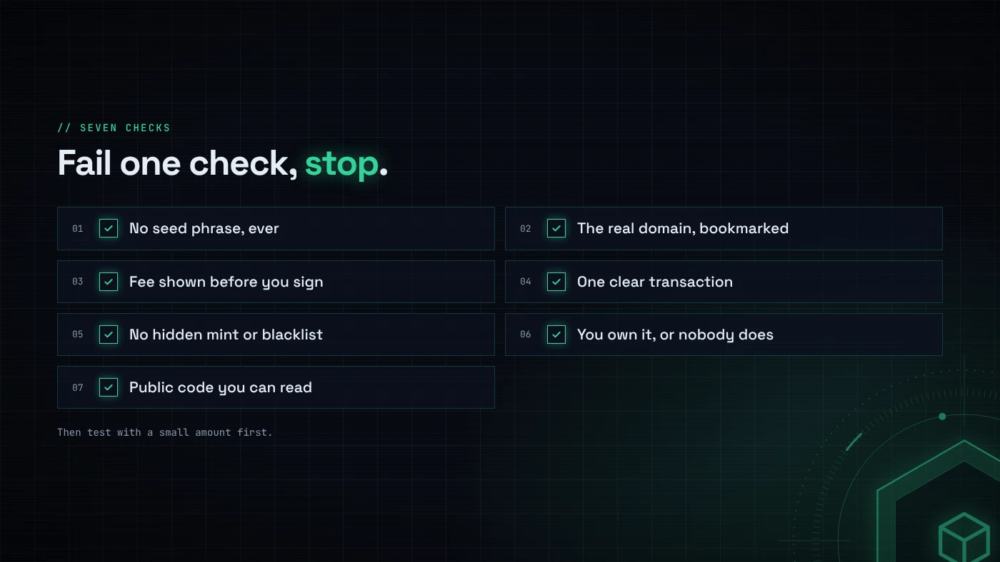
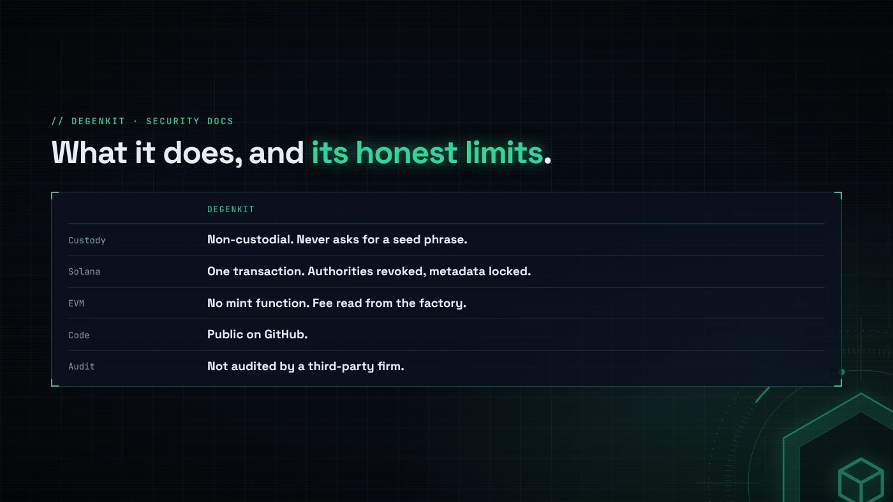

A token generator is safe when it is non-custodial, shows every fee before you sign, creates tokens without hidden owner powers, and has code you can inspect. The risk is not the idea of a generator. It is fake sites that drain wallets, and templates that hide a mint or blacklist function. Seven quick checks separate the two.

:::note Key facts
- **Non-custodial** generators never ask for a seed phrase or private key.
- **Hidden mint functions** can be renamed, hidden behind a proxy or tied to a secret role (Dedaub).
- **Audits cost money:** a simple ERC-20 audit typically costs **$5,000 to $20,000** (Sherlock, 2026).
- **DegenKit:** non-custodial, public code, no mint function on EVM tokens, revoked authorities on Solana. Not audited by a third-party firm.
:::

## What can go wrong with a token generator?

Two kinds of risk:

1. **Risk to you, the creator.** A fake site asks for your seed phrase, or tricks you into signing an approval that drains your wallet.
2. **Risk to your buyers.** The generated token contains hidden powers, such as minting more supply, blocking sells or changing fees, and the tool's owner, or you, can use them later.

## What are the seven checks?

1. **No seed phrase, ever.** A legitimate generator asks you to *sign* in your wallet. It never asks you to *type* your recovery phrase or private key.
2. **The right domain.** Bookmark the real site. Wallet drainers copy well-known tools.
3. **The fee is shown before you sign.** Your wallet prompt should match what the page says.
4. **You understand what you sign.** Creating a token is one transaction. A request for unlimited token approvals during creation is a red flag. See [ERC-20 token approvals](/blog/erc20-token-approvals-explained/).
5. **No hidden powers in the token.** Check the contract for mint, blacklist, pause or fee-change functions. Dedaub notes that hidden mints can be renamed or added later through a proxy upgrade. See [how to spot a honeypot token](/blog/how-to-spot-a-honeypot-token/).
6. **You own it, or nobody does.** After creation, ownership should be your wallet, or renounced. On Solana, mint and freeze authority should be revoked. See [mint authority vs freeze authority](/blog/mint-authority-vs-freeze-authority/).
7. **Public code.** If the generator's code is public, anyone can check what it does.

## How does DegenKit answer these checks?

From DegenKit's [security docs](/docs/security/):

- **Non-custodial.** It never asks for your seed phrase and cannot move your funds.
- **One transaction on Solana** creates the mint, account, supply and metadata, then revokes the authorities. The fee goes to a public fee address.
- **EVM tokens have no mint function.** The service fee is read from the factory contract.
- **Public code** on GitHub at LuncroDev/degenkit-app.
- **Honest limits:** it has not been audited by a third-party security firm. The docs recommend testing with a small amount first.

Read more in [is DegenKit safe?](/blog/is-degenkit-safe/).

## Why does an audit matter, and why do generators rarely have one?

An audit is an independent security review of the code. Sherlock's 2026 pricing reference puts a simple ERC-20 audit at $5,000 to $20,000. A generator that uses one small, fixed template has less code to go wrong than a custom contract. But "no audit" still means you should test small first. Compare the trade-offs in [token generator vs custom smart contract](/blog/token-generator-vs-custom-smart-contract/).

## How do you check a token after creating it?

- **Solana:** paste the mint into a scanner. Mint and freeze should be revoked, metadata locked.
- **EVM:** open the contract on the explorer. Look at the functions and the owner.

See [how to spot rug pull risk](/blog/how-to-spot-rug-pull-risk/) and the [wallet security guide](/blog/wallet-security-for-token-creators/).

## What are the risks?

- **Phishing copies** of real generators.
- **Malicious approvals** that drain wallets later.
- **Unaudited code** on any tool, including DegenKit.

You can lose money in crypto. This is not financial advice.

## FAQ

### Are token generators legit?

Many are. Check that they are non-custodial, show fees, create clean tokens and publish their code.

### Can a token generator steal my crypto?

A fake one can, if you type your seed phrase or approve a malicious contract. A legitimate one cannot move your funds.

### Is DegenKit audited?

No. DegenKit's docs state it has not been audited by a third-party security firm, and its code is public on GitHub.

## Sources

- [Dedaub: Hidden mint functions](https://tokin.dedaub.com/learn/hidden-mint)
- [Sherlock: Smart contract audit pricing 2026](https://sherlock.xyz/post/smart-contract-audit-pricing-a-market-reference-for-2026)
- [DegenKit docs: Security](https://degenkit.app/docs/security/)

Read the security page, then try the [DegenKit token generator](/launch/) with a small amount first. For the full picture, see the [token generator guide](/blog/token-generator/).
