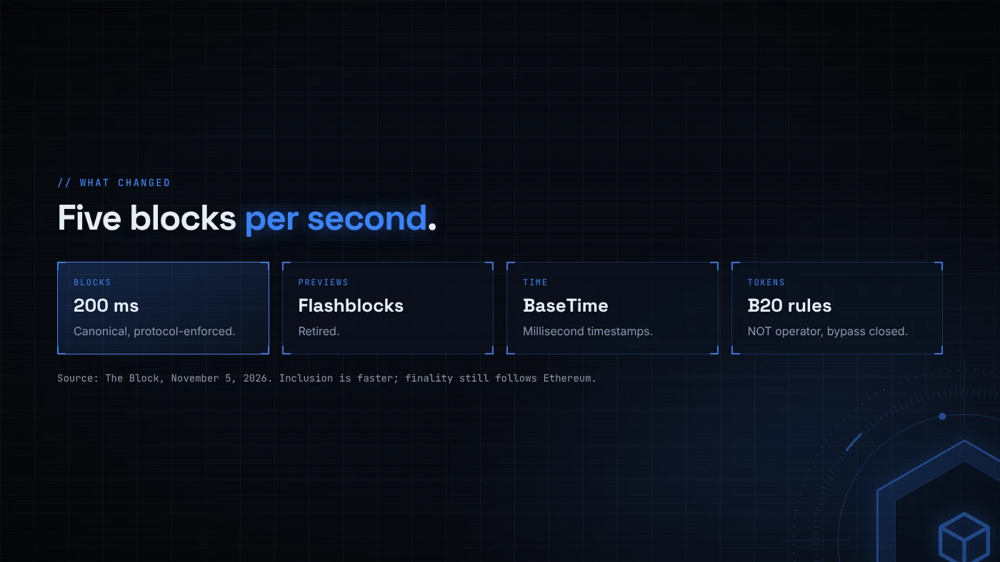
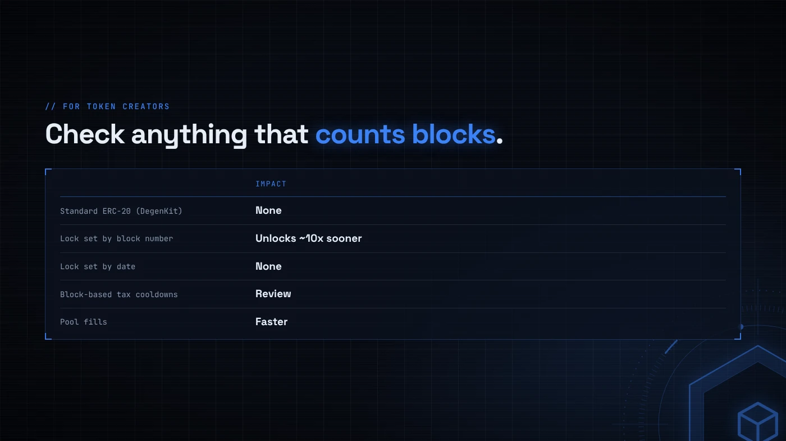

Denim is Base's fourth network upgrade. It went live on mainnet on November 5, 2026 and makes Base produce a full block every 200 milliseconds, five per second, instead of about one every two seconds. Flashblocks, the old preview system, are retired. Contracts can read millisecond time through BaseTime. Users need no action, but apps that count blocks as time should check their logic.

:::note Key facts
- **Live:** mainnet, **November 5, 2026**. Base's fourth upgrade after Azul, Beryl and Cobalt (The Block).
- **Blocks:** about **2 s → 200 ms**, five canonical blocks per second.
- **Retired:** Flashblocks. Apps move to standard canonical block subscriptions.
- **BaseTime:** millisecond timestamps for contracts. `block.timestamp` stays in whole seconds.
:::

## What changed with Denim?

- **200ms canonical blocks.** The protocol, not the sequencer's clock, enforces the interval.
- **Flashblocks retired.** Flashblocks were fast, non-final previews. Now every 200ms update is a real block, readable with standard Ethereum JSON-RPC methods. The `pending` block tag changes.
- **BaseTime.** Contracts can read Unix time in milliseconds. New RPC fields give millisecond timestamps for blocks, transactions and logs.
- **B20 token rules.** Base's compliance-focused token standard gets a NOT operator for policies, closes a transfer-executor bypass, and blocks sends to the token's own address.

Base said the changes make block production "simpler, more consistent, and more reliable".

## Is Base final in 200ms now?

No. Faster blocks mean faster **inclusion**, not finality. On Base, a transaction is "safe" once its batch is posted to Ethereum and "final" once Ethereum finalizes that batch. For most trading this is fine. Bridges and exchanges still wait for safe or final status.

## Who needs to change something?

| Who | What to check |
|---|---|
| Users and holders | Nothing |
| Apps using Flashblocks | Move to canonical block subscriptions |
| Contracts that count blocks as time | Timelocks, vesting, cooldowns, TWAPs |
| Indexers and explorers | Handle 10x more blocks |
| B20 issuers | Review transfer and compliance policies |

The block-count issue is the big one. A KuCoin analysis gives the example that 100 blocks used to take about 200 seconds and now take about 20.

## What does Denim mean for token creators on Base?

- **Standard ERC-20 tokens are unaffected.** A DegenKit Base token has a fixed supply and no time-based logic, so nothing changes.
- **Liquidity locks and vesting** set in block numbers on third-party tools now unlock about ten times sooner than planned. Locks set by date are unaffected. Check your lock tool. See [locking liquidity on Ethereum, Base and BNB](/blog/lock-liquidity-ethereum-base-bnb/).
- **Faster fills** on Aerodrome and Uniswap pools. See [Aerodrome vs Uniswap on Base](/blog/aerodrome-vs-uniswap-base/).
- **Tax tokens** that use block-based cooldowns should be reviewed. See [tax tokens on BNB Chain and Base](/blog/tax-token-bnb-chain-base/).

## How does Base compare with other fast chains now?

BNB Chain is adding millisecond timestamps too, in its Jenner hard fork. See [BNB Chain Jenner hard fork](/blog/bnb-chain-jenner-hardfork/). Solana runs 200ms slots and about 150ms target finality since Alpenglow. Base's finality still depends on Ethereum.

## How do you check a lock or vesting contract after Denim?

1. Open the lock or vesting contract on BaseScan and find the unlock condition.
2. If it compares against `block.number`, work out the new unlock time at five blocks per second.
3. If it compares against `block.timestamp`, nothing changed.
4. Tell holders if an unlock moved earlier than you announced.

## What are the risks?

- **Block-based timelocks** may expire much sooner than intended.
- **Indexers and bots** built for 2-second blocks may lag or miscount.
- **Scams** using "Base upgrade" claims. No token migration exists.

You can lose money in crypto. This is not financial advice.

## FAQ

### What is the Base Denim upgrade?

Base's fourth network upgrade, live since November 5, 2026. It produces a full block every 200ms and retires Flashblocks.

### Do I need to do anything with my Base tokens?

No. Balances and tokens are unchanged.

### Does Denim affect my liquidity lock?

Only if the lock is set in block numbers. Then it unlocks about ten times sooner. Locks set by timestamp are unaffected.

## Sources

- [The Block: Base deploys Denim upgrade](https://www.theblock.co/news/ecosystems/2026-11-05-base-deploys-denim-upgrade-on-mainnet-replacing-flashblocks-with-200ms-block-times-434433)
- [KuCoin: Base Denim upgrade, what you need to know](https://www.kucoin.com/news/insight/ETH/6af1bf204fd70f00078e8b4a)
- [Base docs](https://docs.base.org/)

Create a token on Base with the [DegenKit token generator](/launch/).
