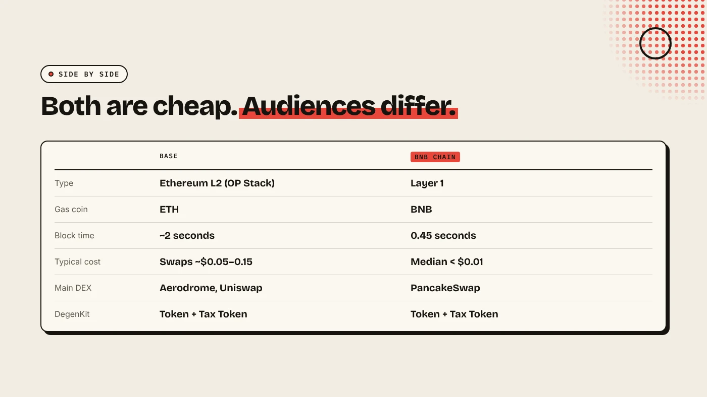
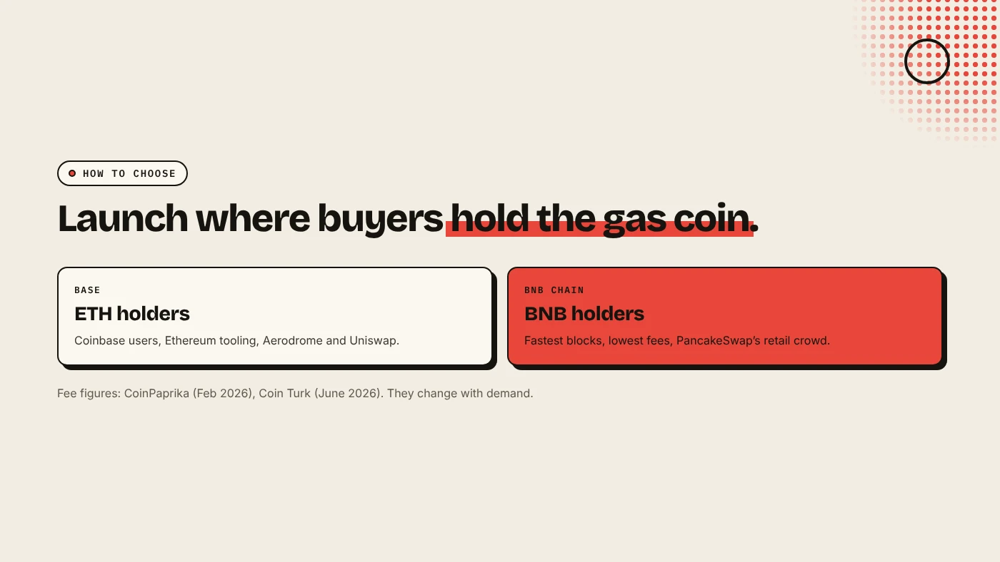

Base and BNB Chain are both low-fee EVM chains where a token launch costs cents in gas. Choose Base for Ethereum-style tooling, ETH as gas and a Coinbase-adjacent audience. Choose BNB Chain for very fast blocks, PancakeSwap's large retail audience and BNB as gas. On DegenKit, both support plain and tax tokens with the same flow.

:::note Key facts
- **Base:** Ethereum L2 on the **OP Stack**, launched **August 9, 2023**, gas in **ETH**, about **2-second** blocks (CoinPaprika).
- **BNB Chain:** its own L1, gas in **BNB**, **0.45-second** blocks since January 2026 (Yahoo Finance).
- **Fees:** Base swaps around **$0.05–$0.15** (Feb 2026). BNB Chain median below **$0.01** (June 2026).
- **DEXs:** Aerodrome and Uniswap on Base. PancakeSwap on BNB Chain.
:::

:::note Not affiliated
DegenKit is not affiliated with Base, Coinbase, BNB Chain, Aerodrome, Uniswap or PancakeSwap.
:::

## How do they compare side by side?

| | Base | BNB Chain |
|---|---|---|
| Type | Ethereum L2 (OP Stack) | Layer 1 |
| Gas coin | ETH | BNB |
| Block time | About 2 seconds | 0.45 seconds |
| Typical cost | Swaps ~$0.05–0.15 | Median below $0.01 |
| Token standard | ERC-20 | BEP-20 |
| Main DEX | Aerodrome, Uniswap | PancakeSwap |
| Explorer | BaseScan | BscScan |
| DegenKit tools | Token Creator, Tax Token | Token Creator, Tax Token |

CoinPaprika's figures for Base are from February 2026. Coin Turk's BNB Chain median is from June 2026. Both change with demand.

## Why launch on Base?

- **Ethereum tooling.** Same ERC-20 standard, same wallets, and ETH as gas. Holders bridge from Ethereum or withdraw from Coinbase.
- **Security model.** As an Ethereum L2, Base settles to Ethereum.
- **Ecosystem.** Aerodrome is Base's largest DEX, and Uniswap is live there too. See [Aerodrome vs Uniswap on Base](/blog/aerodrome-vs-uniswap-base/).
- **No native token.** Base uses ETH for gas, so buyers need no extra coin.

See [how to launch a token on Base](/blog/how-to-launch-a-token-on-base/).

## Why launch on BNB Chain?

- **Speed and cost.** 0.45-second blocks since the Fermi hard fork, and a minimum gas price cut to 0.05 gwei.
- **Retail audience.** PancakeSwap has long been home to many small-cap BEP-20 tokens.
- **Simple pools.** PancakeSwap V2 gives LP tokens and works with tax tokens. See [adding liquidity on PancakeSwap](/blog/add-liquidity-pancakeswap/).

See [how to launch a token on BNB Chain](/blog/how-to-launch-a-token-on-bnb-chain/).

## How do you choose?

- **Where are your buyers?** If they hold ETH and use Coinbase, choose Base. If they hold BNB and trade on PancakeSwap, choose BNB Chain.
- **Which coin will you pair?** You need ETH on Base or BNB on BNB Chain for gas and for the pool.
- **Do you need a tax?** Both support DegenKit's Tax Token. See [creating a tax token on BNB Chain or Base](/blog/tax-token-bnb-chain-base/).

Our broader [blockchain comparison](/blog/which-blockchain-to-launch-token/) adds Solana, Ethereum and Robinhood Chain.

## What are the risks?

- **Cheap gas, more spam.** Low fees mean many copycat tokens. Always share the contract address.
- **Thin pools** move fast on either chain.
- **Wrong-network transfers.** Base and BNB Chain use the same address format.

You can lose money in crypto. This is not financial advice.

## FAQ

### Is Base cheaper than BNB Chain?

Both are cheap. Reported BNB Chain median fees are below $0.01. Base swaps were reported at $0.05 to $0.15 in early 2026.

### Can I launch the same token on Base and BNB Chain?

You can create a token with the same name on each, but they are separate tokens with separate supplies.

### Which wallet works for both?

MetaMask and most EVM wallets work on both. Add each network and switch between them.

## Sources

- [CoinPaprika: What is Base](https://coinpaprika.com/education/what-is-base-complete-guide-to-the-base-blockchain-ecosystem/)
- [Yahoo Finance: BNB Chain hits 0.45s block times](https://finance.yahoo.com/news/bnb-chain-hits-0-45s-151727992.html)
- [Coin Turk: BNB transaction fees fall below $0.01](https://en.coin-turk.com/bnb-transaction-fees-fall-below-0-01-after-four-upgrades/)
- [Blockworks: Aerodrome Finance](https://blockworks.com/insights/aerodrome-finance)

Launch on either chain from the [DegenKit Base launcher](/launch/base/) or the [BNB Chain launcher](/launch/bnb/).
