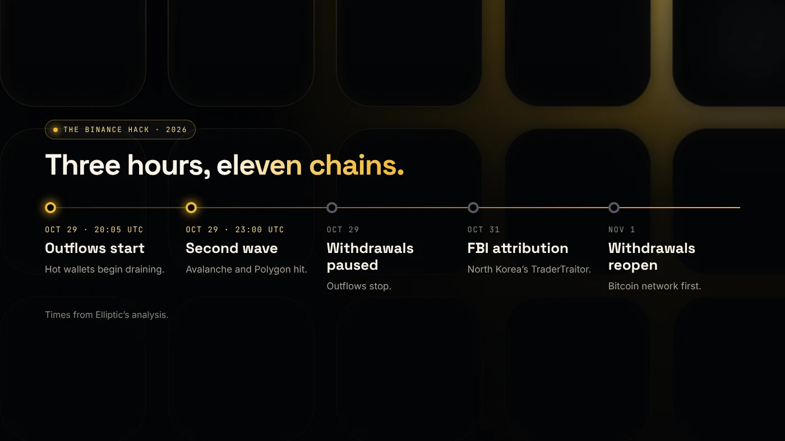
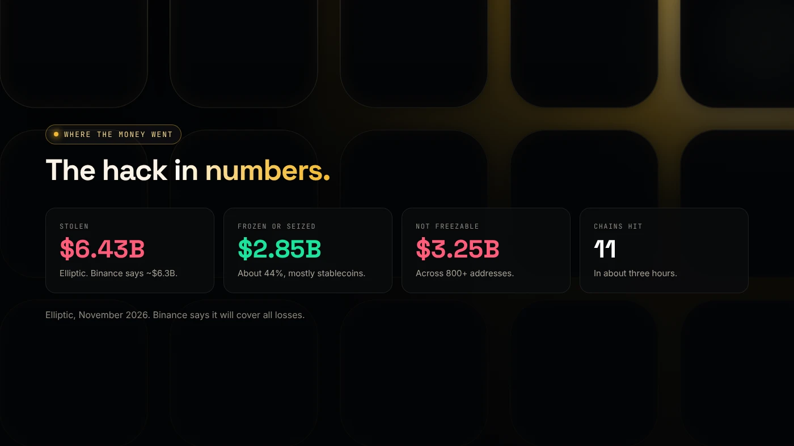

On the evening of **October 29, 2026**, attackers emptied Binance hot wallets on 11 blockchains in about three hours. Binance puts the loss at about **$6.3 billion**. Blockchain analytics firm Elliptic counts **$6.43 billion**, the largest theft in history.

Here's how it worked, where the money went, how Binance responded and what self-custody users can learn from it.

:::note Figures as of November 7, 2026
Investigations are ongoing, so numbers may still change. Main source: [Elliptic's analysis](https://www.elliptic.co/insights/binance-largest-hack-in-history/).
:::

## What happened

The first outflows began at about **20:05 UTC**. A second wave hit Avalanche and Polygon shortly after 23:00 UTC. In all, hot wallets on 11 networks were drained.

The largest share came from Ethereum: **$3.80 billion** across 186 tokens, including 1.9 billion USDT and 823 million USDC. The attackers also took 18,270 BTC, worth about $1.48 billion, and 612.7 million USDT on Tron.

On **October 31**, the FBI attributed the theft to **TraderTraitor**, a North Korean hacking group.

## How it worked

According to Elliptic, the attackers **didn't steal private keys**. They got Binance's own systems to sign transactions for them. Binance first linked the breach to a compromised laptop belonging to a DevOps engineer, then reported further entry points.

The key technique used **EIP-7702**, an Ethereum feature that lets a normal wallet temporarily delegate its behavior to a smart contract. The hot-wallet key signed 50 such authorizations. That let a **sweeper contract** empty one hot wallet, including 1.6 billion USDT. Because the delegation stayed active, it kept sweeping.

## Where the money went

- **$2.85 billion** has been frozen or seized, about 44% of the total, mostly stablecoins frozen by Tether, Circle and other issuers.
- Before the freezes, the attackers swapped about **$786 million** of stablecoins into ETH and TRX at a 12–26% discount.
- About **$3.25 billion** remains in assets that can't be frozen, spread across more than 800 addresses.

## What Binance did

- **Paused withdrawals**, which stopped the outflows.
- Said it will **cover all losses** from its SAFU fund and company money, and set aside more than $6.34 billion.
- **Reopened withdrawals** from November 1, starting with Bitcoin.

BNB fell about 8% on October 29 and hit a low near $682 the next day. It was back above $710 by November 2 ([Bitrue](https://www.bitrue.com/blog/bnb-price-after-binance-hack)).

## Lessons for your own wallet

You can't control an exchange's security, but the same techniques work against individuals:

1. **Read every signature.** The attack worked because valid signatures did something no one intended. Don't sign a message or authorization you don't understand, especially a wallet delegation.
2. **Keep large amounts off exchanges.** Withdrawals were paused for days. Funds in your own wallet weren't.
3. **Separate your wallets.** Use one wallet for creating tokens and testing new sites, and another for holding.
4. **Clean up old approvals.** Unlimited token approvals are another way funds get swept. Check yours with our free [token approval checker](/tools/token-approval-checker/).

Our guide to [wallet security for token creators](/blog/wallet-security-for-token-creators/) goes deeper.

## Wrap up

The Binance hack moved $6.4 billion in three hours using signatures, not stolen keys. Binance says users will be made whole, but the lesson is the same for everyone: understand what you sign and keep long-term funds in your own wallet. [DegenKit](https://degenkit.app/) is non-custodial, so every transaction is signed by you, in your wallet.
