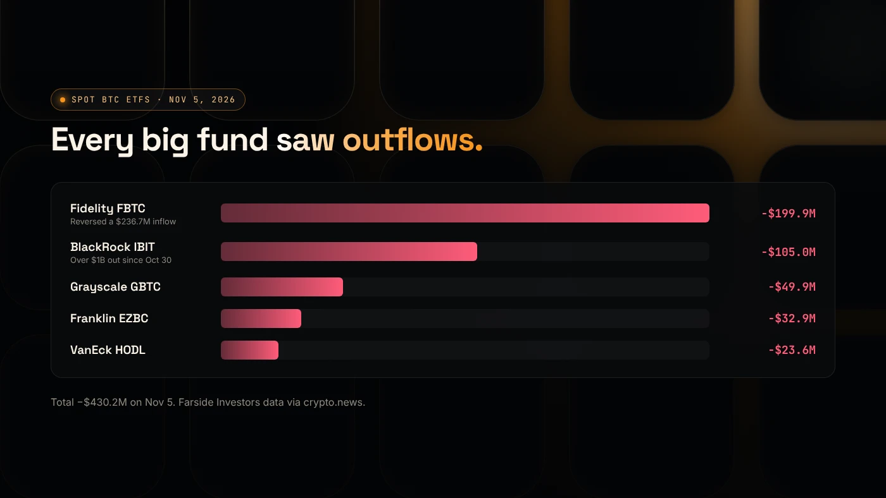
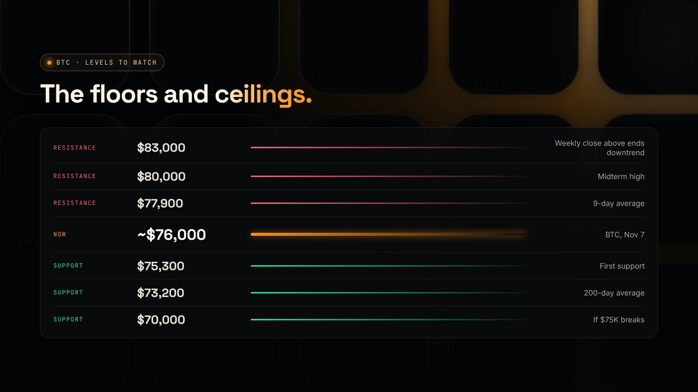

Bitcoin is down because spot Bitcoin ETFs had heavy outflows, tech stocks sold off on doubts about AI spending, and leveraged bets were force-closed. It fell from above $80,000 on November 3, 2026 to about $76,000 on November 5, and was holding near $76,000 on November 7.

:::note Key facts
- Bitcoin was near **$76,000** on November 7, 2026, roughly 40% below its October 2025 high.
- Spot Bitcoin ETFs lost **$430.2 million** on November 5 and **$411.9 million** the next session.
- The first four November sessions totalled about **−$870 million** in ETF flows.
- Bitcoin's share of the crypto market was **59.3%**.
- This is news, not financial advice.
:::

## How much money left Bitcoin ETFs?

Spot Bitcoin ETFs hold real BTC. When investors sell their shares, the funds sell Bitcoin.

On November 5, 2026, the funds had net outflows of $430.2 million, reversing a $74.6 million inflow the day before. By fund, according to Farside data cited by [crypto.news](https://crypto.news/bitcoin-price-today-rebounds-76000-etf-outflows/):

- Fidelity's FBTC: −$199.9 million, reversing a $236.7 million inflow
- BlackRock's IBIT: −$105 million
- Grayscale's GBTC: −$49.9 million
- Franklin Templeton's EZBC: −$32.9 million
- VanEck's HODL: −$23.6 million

The next session added another $411.9 million of outflows ([KuCoin News](https://www.kucoin.com/news/flash/us-spot-bitcoin-etf-sees-411-9m-net-outflow-ethereum-etf-loses-93-3m)).

## Why did Bitcoin fall now?

Four things came together in the same two weeks:

1. **Tech stocks crashed.** The Nasdaq fell 5.5% on November 5 on doubts about AI infrastructure spending. Bitcoin fell 5.3% the same day.
2. **The Fed leaned hawkish.** On October 28, two Fed officials voted to raise rates rather than hold them.
3. **The Binance hack** on October 29 sent Bitcoin below $79,000 and shook confidence. See [the Binance hack explained](/blog/binance-hack-explained/).
4. **Leverage unwound.** About $1.26 billion of positions were liquidated in 24 hours around November 5.

Spot demand also weakened. CryptoQuant data cited by crypto.news shows 30-day net buying on Binance and Coinbase turned negative by November 5. For the full timeline, read [why crypto is crashing](/blog/crypto-crash-november-2026/).

## Which Bitcoin price levels are analysts watching?

These levels come from analysis cited by crypto.news and CryptoTicker on November 3–6, 2026. They show where buyers or sellers appeared before. They are not targets.

- **Resistance:** about **$77,900**, then **$80,000**. CryptoTicker cites a weekly close above **$83,000** as the level that would end the downtrend.
- **Support:** about **$75,300**, then **$73,200**, the 200-day moving average (the average price of the last 200 days), then **$72,000**.
- **If $75,000 breaks:** some analysts point to **$70,000**.

The Money Flow Index, a 0–100 measure of buying and selling pressure, was about 28. Readings below 30 mean heavy selling.

## What would show the selling is easing?

Analysts in these sources watch a few signals:

- **ETF flows** turning positive for several sessions in a row.
- **A daily close above $80,000**, the level Bitcoin lost after the midterm bounce.
- **Tech stocks steadying**, since Bitcoin moved with the Nasdaq this week.
- **A calmer Fed** at its next meeting.

Bitcoin's dominance, its share of the total crypto market, was 59.3% on November 7. A high share means money is staying in Bitcoin rather than moving into smaller coins.

## What does it mean if you are launching a token?

Smaller tokens usually move more than Bitcoin in both directions. When Bitcoin falls 5%, many small tokens fall further, and buyers become more careful.

If you are launching soon, keep your liquidity plan realistic and make the token easy to trust: fixed supply, revoked authorities and a clear holder list. Our [token launch checklist](/blog/token-launch-checklist/) covers the steps, and the [DegenKit token scanner docs](/docs/scanner/) explain how buyers will see your token.

## What are the risks?

- **Further drops.** If $75,000 fails, analysts cite $73,200 and $70,000 as the next areas.
- **Leverage.** Borrowed positions can be wiped out in a single fast move.
- **Exchange risk.** Withdrawals can be paused, as they were on Binance after the hack.

You can lose money in crypto. This is not financial advice.

## FAQ

### Why is Bitcoin down today?

On November 5, 2026, Bitcoin fell 5.3% to about $76,000 as the Nasdaq dropped 5.5% and spot ETFs lost $430.2 million. About $1.26 billion of leveraged positions were liquidated in 24 hours.

### Why is Bitcoin down so much?

It is about 40% below its October 2025 high near $126,000. Steady ETF outflows, a hawkish Fed and weaker spot demand have weighed on it for weeks.

### Will Bitcoin keep going down?

No one knows, and this post makes no prediction. Analysts are watching $75,000 as support and $80,000 as the first level to reclaim.

### Is Bitcoin going down because of the Binance hack?

The hack on October 29 caused a sharp drop below $79,000. The bigger moves since then came from the tech-stock sell-off and ETF outflows.

## Sources

- [crypto.news: Bitcoin price today and ETF outflows](https://crypto.news/bitcoin-price-today-rebounds-76000-etf-outflows/)
- [KuCoin News: $411.9M Bitcoin ETF outflow](https://www.kucoin.com/news/flash/us-spot-bitcoin-etf-sees-411-9m-net-outflow-ethereum-etf-loses-93-3m)
- [CryptoTicker: Why is crypto down today, November 3, 2026](https://cryptoticker.io/en/why-is-crypto-down-today-november-3-2026/)
- [The Currency Analytics: Crypto market cap slides to $2.58T](https://thecurrencyanalytics.com/bitcoin/bitcoin-holds-steady-as-crypto-market-cap-slides-to-2-58t-308173)

To prepare a launch while the market settles, start with the [DegenKit Solana launcher](/launch/solana/).
