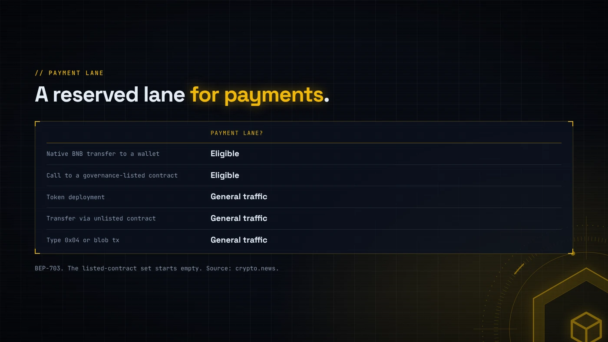
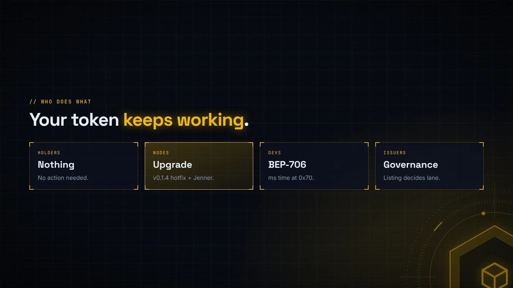

Jenner is BNB Smart Chain's next hard fork, scheduled for December 8, 2026, at 02:30 UTC. It adds Payment Lane, which reserves 5% of each block's gas for eligible payments, millisecond block timestamps for contracts, and a new compliant asset standard called CAS20. It went live on testnet in late October. Users need no action. Node operators must upgrade first.

:::note Key facts
- **Mainnet:** **December 8, 2026, 02:30 UTC**, per the BSC-Reth v0.1.4 release (Coinpaper).
- **Testnet:** live since about **October 28–29, 2026**.
- **Payment Lane (BEP-703):** reserves **5%** of block gas by default, up to **10%** by governance.
- **Millisecond timestamps (BEP-706):** a precompile at address **0x70**. `block.timestamp` stays in seconds.
:::

## What is Payment Lane?

Payment Lane reserves part of every block for simple payments, so transfers keep moving when DeFi traffic spikes. Per crypto.news:

- **Reserve:** 5% of the block gas limit by default. Governance can raise it to 10%.
- **Eligible:** native BNB transfers with a nonzero amount to normal wallets, and transactions sent directly to governance-listed payment contracts.
- **The list starts empty.** Governance adds contracts, such as stablecoins or CAS20 tokens.
- **Not eligible:** contract creation, blob transactions, type 0x04 transactions, and transfers routed through unlisted contracts.
- **No free ride:** payments still pay fees and compete with each other.

## What else is in Jenner?

- **Millisecond timestamps (BEP-706).** A precompile at 0x70 lets contracts read the block time in milliseconds. BNB Chain blocks are sub-second since the Pasteur fork, so seconds were too coarse. Uses include signed quotes, auctions and oracle freshness checks.
- **CAS20.** A new compliant asset standard. BNB Chain says details will come separately.

A forum analysis flagged that BEP-706's sample code could let expired quotes pass if the timestamp call returns no data. Developers using the sample should handle that case.

## What must node operators do?

- **Upgrade the client** before December 8. Follow the Jenner documentation and BSC-Reth release notes.
- **Install the v0.1.4 hotfix.** BNB Chain released it on November 6 for a state-root calculation bug in BSC-Reth. It applies to validators, builders, full nodes and sentries. No database migration is needed.

Ordinary users do not need to do anything, according to BNB Chain.

## What does Jenner mean for token creators?

- **Existing BEP-20 tokens keep working.** Nothing is migrated.
- **Your token is not automatically a "payment".** crypto.news notes a token's name or purpose does not make it eligible. Only governance-listed contracts qualify.
- **Deploying a token is general traffic,** because contract creation is excluded from Payment Lane.
- **DegenKit BNB Chain tokens** are standard fixed-supply contracts, so the fork needs no action from you. See [how to launch a token on BNB Chain](/blog/how-to-launch-a-token-on-bnb-chain/).

## How does Jenner compare with Base and Solana?

Base added millisecond time (BaseTime) in its Denim upgrade on November 5. See [Base Denim upgrade](/blog/base-denim-upgrade/). Solana runs 200ms slots and Alpenglow finality. All three are chasing payments and trading. For choosing a chain for your token, see [Base vs BNB Chain](/blog/base-vs-bnb-chain/).

## What are the risks?

- **Date changes.** Hard fork dates can move if new bugs appear.
- **Unpatched nodes** may fall out of consensus or serve wrong data.
- **Scams** claiming tokens must be "upgraded" for Jenner.

You can lose money in crypto. This is not financial advice.

## FAQ

### When is the BNB Chain Jenner hard fork?

December 8, 2026, at 02:30 UTC, per the BSC-Reth release notes.

### What is BNB Chain Payment Lane?

Reserved blockspace, 5% of block gas by default, for native BNB transfers and governance-listed payment contracts.

### Do BNB holders need to do anything?

No. Only node operators need to upgrade.

## Sources

- [crypto.news: What changes with BNB Chain's Jenner hardfork](https://crypto.news/what-changes-with-bnb-chains-jenner-hardfork/)
- [Coinpaper: BNB Chain node software fix](https://coinpaper.com/38531/bnb-chain-issues-urgent-node-software-fix-over-incorrect-blockchain-state-calculations)
- [ChainCatcher: Jenner and BEP-706](https://www.chaincatcher.com/en/article/2301116)
- [The Defiant: BNB Chain sets Jenner date](https://thedefiant.io/news/blockchains/bnb-chain-sets-jenner-date-post-flags-timestamp-risk)

Create a BEP-20 token with the [DegenKit token generator](/launch/).
