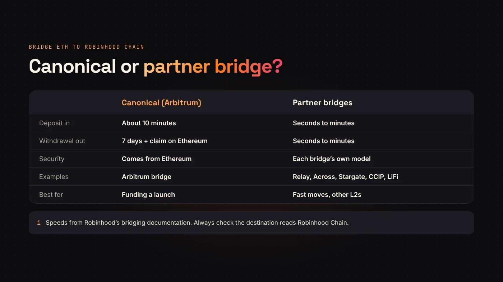
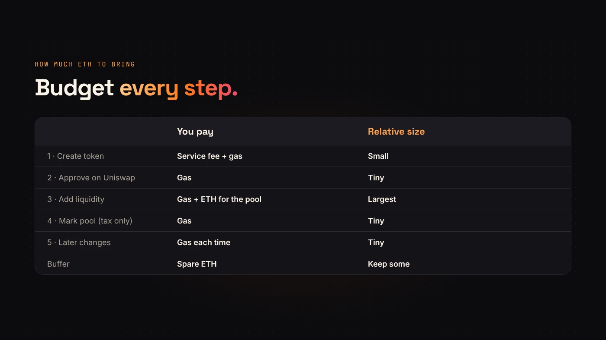

You can't create a token on Robinhood Chain with ETH that is still on Ethereum. Every transaction on Robinhood Chain, from creating the token to adding liquidity, is paid in **ETH on Robinhood Chain**. So the first step of any launch there is getting ETH onto the network.

This guide explains the two kinds of bridge, how long each takes, and how much ETH to bring for a DegenKit launch.

## Why you need to bridge at all

Robinhood Chain is a layer 2 built on Arbitrum. It uses ETH for gas, but it keeps its own balances. Your wallet shows a separate ETH balance for each network, even though the coin has the same name.

If DegenKit says "Not enough ETH in your wallet to cover the fee and gas" while your wallet shows ETH, check the network. The ETH is almost always on Ethereum or another layer 2.

## Option 1: The canonical Arbitrum bridge

[Robinhood's bridging documentation](https://docs.robinhood.com/chain/bridging/) names the **Arbitrum canonical bridge** as the official route between Ethereum and Robinhood Chain. Robinhood says it needs no third-party validators, because its security comes directly from Ethereum.

- **Deposit** (Ethereum → Robinhood Chain): about **10 minutes**.
- **Withdrawal** (Robinhood Chain → Ethereum): a **7-day** challenge period, then a claim transaction on Ethereum that costs Ethereum gas.

The deposit is quick. The withdrawal is slow, and it isn't finished until you claim it on Ethereum.

## Option 2: Partner bridges

Robinhood also lists third-party bridges that settle much faster:

- **Relay** and **Across**: seconds
- **LayerZero / Stargate** and **Chainlink CCIP / Transporter**: minutes
- **LiFi** and **0x**: seconds to minutes, as cross-chain swap aggregators

These are useful when you want to move ETH from another layer 2, or come back from Robinhood Chain without waiting a week. They work differently from the canonical bridge and rely on their own security, so read each one's terms and fees before you use it.

:::warning Check the destination twice
Before you sign, make sure the destination network reads **Robinhood Chain** and the receiving address is your own wallet. A bridge transfer to the wrong network or address usually can't be reversed.
:::

## Step by step with the canonical bridge

1. **Add Robinhood Chain** to your wallet. Our [Robinhood Chain RPC tool](/tools/robinhood-chain-rpc/) does it in one click. Chain ID is **4663**.
2. Open the bridge from the link in Robinhood's documentation. Set the **source** to Ethereum and the **destination** to Robinhood Chain.
3. Enter the amount, review the Ethereum gas for the deposit, and confirm in your wallet.
4. Wait about 10 minutes, then switch your wallet to Robinhood Chain and check the balance.

If the deposit doesn't arrive, Robinhood notes that the funds aren't lost. A deposit whose layer 2 step fails can be redeemed manually from the bridge interface within 7 days.

## How much ETH to bring

Bridge enough for every step of the launch, plus a buffer. A typical DegenKit launch on Robinhood Chain uses these transactions:

1. **Create the token.** The DegenKit service fee plus gas. The fee is read from the contract and shown on the form before you sign.
2. **Approve** your token on Uniswap. Gas only.
3. **Add liquidity.** Gas, plus the ETH you put in the pool.
4. **Mark the pool** (tax tokens only). Gas only.
5. **Later changes**, such as new tax rates or renouncing ownership. Gas each time.

The ETH you put into the pool is usually the biggest number. Gas on a layer 2 is low, but keep some ETH spare so you're never stuck halfway.

## Questions people ask

### Can I send ETH straight from an exchange to Robinhood Chain?

Only if the exchange offers Robinhood Chain as a withdrawal network. If it doesn't, withdraw to Ethereum or a supported layer 2 and bridge from there.

### Is my token address the same on Ethereum and Robinhood Chain?

No. A token created on Robinhood Chain has its own address there. Robinhood's docs also note that bridged ERC-20 tokens get a different address on Robinhood Chain.

### How do I get ETH back to Ethereum?

Through the canonical bridge, which takes about 7 days plus a claim on Ethereum. A partner bridge is faster.

## Wrap up

Bridge ETH to Robinhood Chain first. The canonical bridge is official and takes about 10 minutes in. Partner bridges are faster in both directions. Bring enough for the fee, the gas and your pool, then [launch your token on Robinhood Chain](https://degenkit.app/launch/robinhood/).
