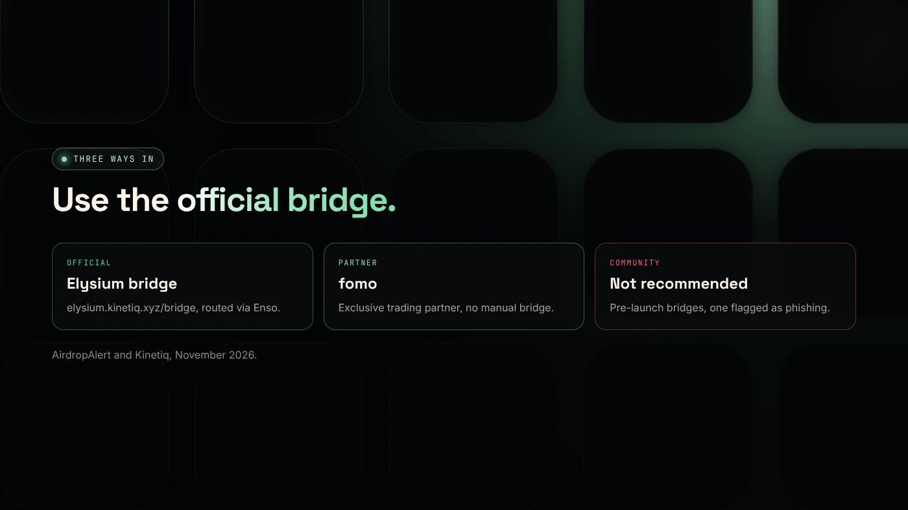
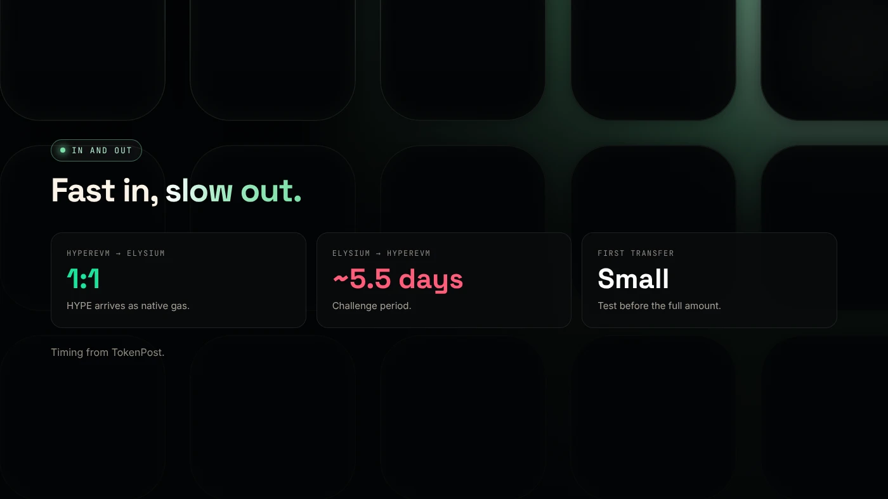

To bridge to Elysium, move HYPE from HyperEVM through the official Elysium bridge at elysium.kinetiq.xyz/bridge: HYPE arrives 1:1 as native gas, with no wrapped token. Coming back to HyperEVM takes longer, because withdrawals go through a challenge period of about 5.5 days.

:::note Key facts
- **Official bridge:** `elysium.kinetiq.xyz/bridge`, linked from Kinetiq's launch release.
- **HYPE moves 1:1** from HyperEVM and is used directly as gas.
- **Any HyperEVM ERC-20** can be bridged to Elysium permissionlessly, per Kinetiq.
- **Withdrawals** to HyperEVM: challenge period of about **5.5 days** (TokenPost).
:::

:::note Not affiliated
DegenKit is not affiliated with Kinetiq, Hyperliquid, Enso or fomo.
:::

## What do you need before you bridge?

- **HYPE on HyperEVM**, Hyperliquid's EVM layer (chain ID 999). HYPE on HyperCore, the trading layer, must first move to HyperEVM.
- **An EVM wallet** with HyperEVM and Elysium added. See [Elysium chain ID and RPC](/blog/elysium-chain-id-rpc-metamask/).
- **A small test amount** for your first transfer.

## How do you bridge HYPE to Elysium?

1. Open the official bridge at **elysium.kinetiq.xyz/bridge**. Type the address yourself or use the link in Kinetiq's release.
2. Connect your wallet and choose **HyperEVM → Elysium**.
3. Enter a small test amount of HYPE and confirm on HyperEVM. Result: HYPE appears on Elysium.
4. Check the balance on the Elysium explorer, then bridge the rest.

Kinetiq says any HyperEVM ERC-20 can bridge the same way, and tokens launched on Elysium can bridge back to HyperEVM and on to HyperCore spot markets ([Kinetiq release](https://www.manilatimes.net/2026/11/09/tmt-newswire/globenewswire/kinetiq-launches-elysium-public-mainnet-a-high-performance-layer-2-built-for-hyperliquid/2465340)).

## Are there other ways in?

According to [AirdropAlert](https://airdropalert.com/blogs/how-to-bridge-to-elysium/):

- **Official bridge** since November 9, with routing through Enso.
- **fomo**, Elysium's exclusive trading partner, which supports the chain without a manual bridge.
- **Community bridges** used before launch. AirdropAlert's own update says they are no longer needed, and MetaMask flagged one as possible phishing.

Zerion says Elysium also launched with canonical and mirror bridges. Use only links from Kinetiq's official channels.

## How long do withdrawals take?

Moving from Elysium **back to HyperEVM** uses a separate process with a **challenge period of about 5.5 days**, according to [TokenPost](https://www.tokenpost.com/news/technology/52986). This is the same idea as the 7-day exit on Arbitrum-based chains such as Robinhood Chain. During the challenge period, funds are in transit.

Plan for that delay. Do not bridge money you may need back quickly.

## How much HYPE should you bridge?

Bridge enough for what you plan to do, plus gas to get out. ElyScreener warns that running out of HYPE can leave you unable to sell a token. Keep a buffer on Elysium.

## What are the risks?

- **Fake bridges.** Look-alike links appear in replies and DMs during launches.
- **New code.** The bridge and chain are days old.
- **Slow exits.** About 5.5 days back to HyperEVM.
- **Wrong network.** Confirm chain ID 99901 before signing.

You can lose money in crypto. This is not financial advice.

## FAQ

### How do I bridge to Elysium?

Use the official bridge at elysium.kinetiq.xyz/bridge to move HYPE from HyperEVM to Elysium. Start with a small test amount.

### Is HYPE wrapped on Elysium?

No. Kinetiq says HYPE moves 1:1 as native gas without a wrapper token.

### How long does it take to withdraw from Elysium?

About 5.5 days back to HyperEVM, because of the challenge period.

## Sources

- [Kinetiq launch release (GlobeNewswire via The Manila Times)](https://www.manilatimes.net/2026/11/09/tmt-newswire/globenewswire/kinetiq-launches-elysium-public-mainnet-a-high-performance-layer-2-built-for-hyperliquid/2465340)
- [TokenPost: Kinetiq launches Elysium mainnet](https://www.tokenpost.com/news/technology/52986)
- [AirdropAlert: How to bridge to Elysium](https://airdropalert.com/blogs/how-to-bridge-to-elysium/)
- [Zerion: What is Elysium](https://zerion.io/blog/what-is-elysium/)

With HYPE on Elysium, you can create a token in one transaction with the [DegenKit Elysium token creator](/launch/elysium/). The same kind of bridge on another chain is covered in [how to bridge ETH to Robinhood Chain](/blog/bridge-eth-to-robinhood-chain/).
