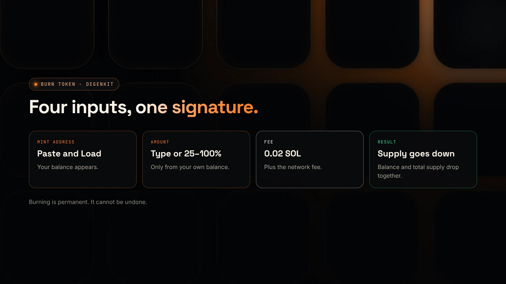
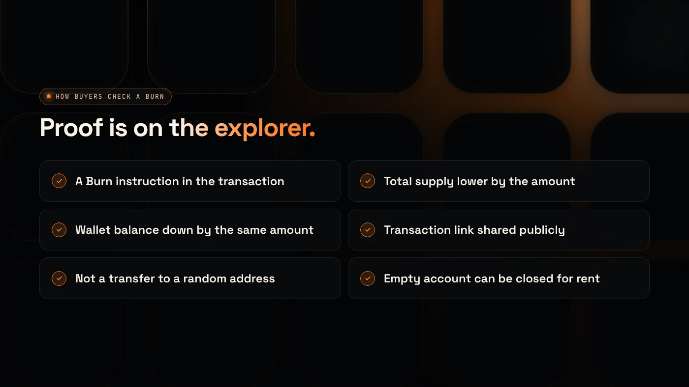

To burn Solana tokens, you sign a burn instruction from the wallet that holds them: the tokens leave your balance and the token's total supply drops by the same amount, permanently. On DegenKit, the **Burn Token** tool does this in one transaction for a 0.02 SOL service fee.

:::note Key facts
- Burning lowers **your balance** and the **mint's total supply** together, according to Solana's docs.
- It is **irreversible**. Burned tokens cannot be recovered.
- Only the **account owner** or an approved delegate can burn tokens from an account.
- DegenKit's burn fee is **0.02 SOL** plus the network fee (as of November 2026).
:::

## What does burning a Solana token do?

Solana's documentation says a burn "reduces the mint's total supply by the same amount" and "permanently decreases a token account balance" ([Solana docs](https://solana.com/docs/tokens/basics/burn-tokens.md)). Unlike sending tokens to a dead address, a real burn removes them from the supply that explorers and trackers show.

Burning is different from **revoking mint authority**. Revoking stops anyone from creating more tokens. Burning destroys tokens that already exist. Many projects do both. See [mint vs freeze authority](/blog/mint-authority-vs-freeze-authority/).

Our explainer on [what burning tokens means](/blog/what-burning-tokens-means/) covers why projects burn and what it does not prove.

## What do you need before you start?

- The **wallet that holds** the tokens. You can only burn from your own balance.
- The token's **mint address**.
- A little **SOL** for the 0.02 SOL fee and the network fee.

## How do you burn tokens with DegenKit?

1. Open the [Solana launcher](/launch/solana/) and click **Connect wallet**.
2. Choose **Burn Token** in the sidebar.
3. Paste the **Token mint address** and click **Load**. Result: **Your balance** shows how many you hold.
4. Enter the **Amount to burn**, or use **25%**, **50%**, **75%** or **Max**.
5. Click **Burn tokens** and approve in your wallet. Result: a confirmation with the transaction link.
6. Open the token on the explorer. Result: **total supply** is lower by the amount burned.

## Should you burn all of your tokens?

Burning everything closes nothing by itself. Your empty token account still holds a small rent deposit. Solana's docs say an account can be closed once its balance is **zero**, and closing sends its lamports, including the rent deposit, to a destination the owner chooses ([Solana docs](https://www.solana.com/docs/tokens/basics/close-account)).

Common reasons to burn:

- **Remove a team or unused allocation** so it can never be sold.
- **Reduce supply** as a public, checkable commitment.
- **Clean up** a test or unwanted token in your wallet.

Burning does not raise the price on its own. A token's price comes from its pool and buyers, not its supply number.

## How can buyers check a burn?

- On the explorer, the burn transaction shows a **Burn** instruction and the amount.
- The token's **total supply** is lower.
- The burning wallet's **balance** dropped by the same amount.

Post the transaction link with your announcement, so anyone can verify it.

## What are the common errors?

- **"No balance":** the connected wallet does not hold that token. Switch wallets.
- **Wrong mint pasted:** check the address before burning. A burn cannot be undone.
- **Burning LP tokens instead of the token:** burning liquidity is a different action. See [locking liquidity on Solana](/blog/lock-liquidity-on-solana-burn-and-earn/).

## What are the risks?

- **Permanent loss.** Burned tokens are gone.
- **Signalling.** A large burn by a team can look like a price promise. Describe it plainly.
- **Fake burns.** Sending to a random address is not a burn. Buyers should check for a real burn instruction.

You can lose money in crypto. This is not financial advice.

## FAQ

### Can I burn Solana tokens?

Yes, from any wallet that holds them. You sign a burn instruction, and the tokens are removed from your balance and the total supply.

### Can burned tokens be recovered?

No. Solana's docs describe burning as permanently decreasing the balance.

### Does burning tokens give back SOL?

Burning itself does not. Closing the empty token account afterwards can return its rent deposit to your wallet.

## Sources

- [Solana docs: Burn tokens](https://solana.com/docs/tokens/basics/burn-tokens.md)
- [Solana docs: Close token account](https://www.solana.com/docs/tokens/basics/close-account)

To burn tokens from your wallet, open **Burn Token** in the [DegenKit Solana launcher](/launch/solana/).
