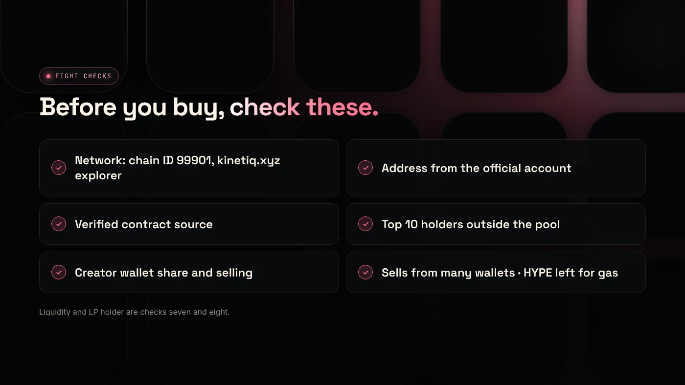
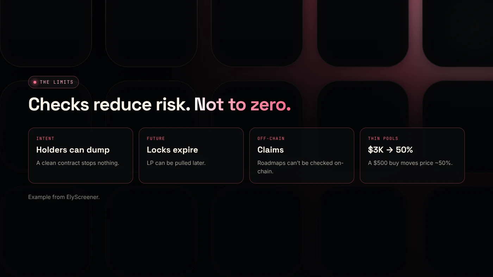

To check an Elysium token before buying, open its contract on the Elysium explorer (elysium.kinetiq.xyz/explorer) and confirm the network, contract address, holders, liquidity, contract controls and whether you can sell. On a chain that is days old, these checks reduce obvious risks, but they cannot make a token safe.

:::note Key facts
- **Explorer:** `elysium.kinetiq.xyz/explorer` (Blockscout). Chain ID **99901**.
- **Gas:** keep **HYPE** on Elysium, or you may not be able to sell.
- ElyScreener's example: **$3,000** of liquidity means a **$500** buy moves the price about **50%**.
- ElyScreener warns that most memecoins on a new chain go to zero.
:::

:::note Not affiliated
DegenKit is not affiliated with Kinetiq, ElyScreener or any Elysium launchpad.
:::

## Why check tokens on a new chain?

In a chain's first days, there are no verified price feeds, few labels and many look-alike tickers ([AirdropAlert](https://airdropalert.com/blogs/how-to-bridge-to-elysium/)). Bots buy in the first block, and first-minute price spikes may not be buyable ([ElyScreener](https://elyscreener.com/learn/elysium-mainnet-day-playbook/)). A few minutes on the explorer avoids the worst traps.

## What should you check? (The checklist)

1. **Network.** The explorer is on kinetiq.xyz and the chain ID is 99901.
2. **Contract address.** Copy it from the project's official account, not from a screener's search box.
3. **Verified contract.** The explorer shows source code.
4. **Holders.** Look at the top 10, excluding the pool. One large wallet can sell into the pool at any time.
5. **Creator wallet.** Is the creator holding a large share, or already selling?
6. **Liquidity.** How much sits in the pool, and who holds the LP? See [liquidity locks](/blog/robinhood-chain-liquidity-lock/), which work the same way on any Uniswap-based chain.
7. **Can you sell?** Look for recent sells from different wallets. If only buys appear, be careful.
8. **Your gas.** Keep HYPE for the sell transaction.

## What do the results mean?

- **Unverified contract:** you cannot see what it does. That is a red flag on any chain.
- **Top non-pool holder above about 20%:** that wallet can move the price a lot. This is a rule of thumb, not a sourced limit.
- **No sells from other wallets:** the token may block selling. That is a classic honeypot. See [what a honeypot token is](/blog/how-to-spot-a-honeypot-token/).
- **LP in a normal wallet:** the creator can withdraw the pool.

## What can these checks not tell you?

- **Intent.** A clean contract does not stop holders from dumping.
- **The future.** Liquidity can be withdrawn and locks can expire.
- **Off-chain claims.** Partnerships and roadmaps cannot be checked on-chain.

## How long should you wait before buying?

There is no rule, but the first minutes of a new token are the riskiest. Bots buy in the first block, prices can spike and fall within a minute, and the creator may still hold most of the supply. Waiting until several different wallets have bought and sold, the holder count is rising and liquidity has settled gives you more information. You will often pay a higher price, but you avoid buying into a spike that is not real. Our guide on [slippage and price impact](/blog/slippage-vs-price-impact/) explains why fast-moving, thin pools cost more than the quoted price.

## How do you protect your wallet?

- Use a **fresh wallet** for new-chain trading, as AirdropAlert suggests.
- Avoid **very high slippage**, which can make you pay bot-inflated prices.
- **Revoke approvals** after trading. Our [token approval checker](/tools/token-approval-checker/) covers Ethereum and Robinhood Chain today. On Elysium, review approvals on the explorer.
- Never use bridge, airdrop or support links from replies or DMs.

## What are the risks?

- **Total loss** of what you buy.
- **Honeypots** that cannot be sold.
- **Fake tokens** with copied names.
- **Running out of HYPE** for gas.

You can lose money in crypto. This is not financial advice.

## FAQ

### How do I check if an Elysium token is safe?

You cannot prove it is safe. You can check the network, verified contract, holders, liquidity and recent sells on the Elysium explorer to avoid obvious traps.

### Where is the Elysium block explorer?

At elysium.kinetiq.xyz/explorer, a Blockscout explorer, according to Chainstack's docs.

### Why can't I sell my Elysium token?

Common reasons are no HYPE left for gas, a honeypot contract or no liquidity in the pool.

## Sources

- [ElyScreener: Elysium mainnet day playbook](https://elyscreener.com/learn/elysium-mainnet-day-playbook/)
- [AirdropAlert: How to bridge to Elysium](https://airdropalert.com/blogs/how-to-bridge-to-elysium/)
- [Chainstack: Elysium tooling](https://docs.chainstack.com/docs/elysium-tooling)

If you are creating rather than buying, the [DegenKit Elysium token creator](/launch/elysium/) makes a fixed-supply token with no owner powers, which passes these checks by design.
