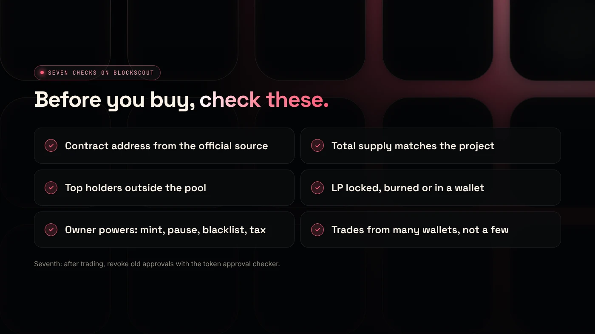
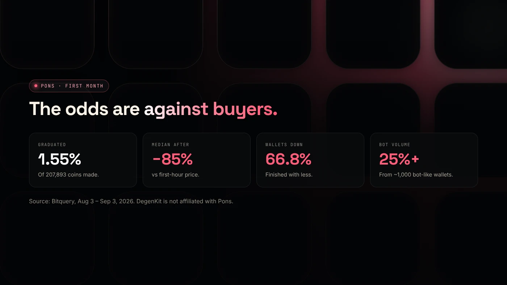

To check a Pons launchpad token for rug risk, open its contract on the Robinhood Chain Blockscout explorer and confirm the contract address, supply, holders, liquidity status and recent trades. The same checks work for any token on Robinhood Chain, and none of them can prove a token is safe.

:::note Not affiliated
DegenKit is not affiliated with Pons. This guide covers how to check tokens from any launchpad on Robinhood Chain.
:::

:::note Key facts
- In Pons' first month, **207,893** coins were made and **1.55%** graduated to a Uniswap pool (Bitquery).
- The median graduated coin traded about **85% below** its first-hour price.
- **66.8%** of trading wallets finished with less money than they started.
- Every check below uses the free [Robinhood Chain explorer](https://robinhoodchain.blockscout.com).
:::

## Why check before you buy?

A **rug pull** is when the people behind a token take the money and leave, usually by withdrawing liquidity or selling a large hidden supply. On launchpads, creation is fast and nearly free, so a large share of coins are short-lived.

Bitquery's study of Pons' first month shows how hard the market is: 314,736 wallets traded a Pons coin, and two in three finished down. Most of the value went to a small number of coins ([Bitquery](https://bitquery.io/investigations/pons-launchpad)). Checks will not change those odds, but they help you avoid the most obvious traps.

## What should you check? (The checklist)

1. **Contract address.** Copy it from the coin's official page or post, not from a search. Names and symbols can be copied.
2. **Supply.** Total supply on Blockscout should match what the project says. Pons coins use a 1 billion supply, Bitquery reports.
3. **Holders.** Look at the top holders. One wallet with a large share, excluding the pool and burn addresses, can sell into the pool at any time.
4. **Liquidity status.** Find the Uniswap pool and check who holds the LP: a locker, a burn address or a normal wallet. See [Robinhood Chain liquidity locks](/blog/robinhood-chain-liquidity-lock/).
5. **Contract controls.** On the contract's **Read contract** tab, look for an owner and functions such as mint, pause, blacklist or tax changes.
6. **Trades.** Recent buys and sells from many different wallets look healthier than a few wallets trading back and forth.
7. **Your approvals.** After trading, revoke approvals you no longer need with the [token approval checker](/tools/token-approval-checker/).

## What does each result mean?

- **Address matches the official source:** you are looking at the right token.
- **Top non-pool holder above about 20%:** that wallet can move the price a lot. It may be a team, an exchange or a buyer, so look at its history.
- **LP in a normal wallet:** the liquidity can be withdrawn. It is not locked.
- **An owner with mint or blacklist powers:** the owner can change the rules. A fixed-supply token with no owner cannot.
- **Volume from a few wallets:** activity may be artificial. Bitquery found about 1,000 bot-like wallets made more than a quarter of Pons trading volume.

Our general guide to [spotting rug pull risk](/blog/how-to-spot-rug-pull-risk/) explains these signals in more depth.

## What can these checks not tell you?

- **Intent.** A clean contract does not stop holders from selling.
- **Future behavior.** A lock can expire and a team can sell later.
- **Off-chain claims.** Websites, partnerships and roadmaps cannot be checked on-chain.
- **Price.** Even honest coins usually fall. Bitquery reports fewer than one in ten graduated Pons coins traded above their opening price.

## What are the risks?

- **Total loss.** Most launchpad coins lose most of their value.
- **Copycat tokens** with the same name and a different address.
- **Malicious approvals.** Fake sites can ask for unlimited token approvals.
- **Bots** can buy in the first seconds and sell into later buyers.

You can lose money in crypto. This is not financial advice.

## FAQ

### How do you know if a token is a rug pull?

You cannot know in advance. Warning signs include unlocked liquidity, a large holder outside the pool, owner powers such as mint or blacklist, and trading from only a few wallets.

### How do I verify a legitimate memecoin?

Check the contract address against the project's official channels, then review supply, holders, liquidity and contract controls on the chain's explorer.

### Is Pons launchpad a rug?

We make no judgment on Pons itself. Individual coins created on any launchpad can be risky, which is why each coin needs its own checks.

## Sources

- [Bitquery: Pons Launchpad growth on Robinhood Chain](https://bitquery.io/investigations/pons-launchpad)
- [BingX Learn: How the Pons launchpad works](https://bingx.com/en/learn/article/what-is-pons-crypto-and-how-does-pons-robinhood-launchpad-work)
- [Robinhood Chain Blockscout explorer](https://robinhoodchain.blockscout.com)

If you are creating your own token instead, the [Robinhood Chain token generator](/launch/robinhood/) makes a fixed-supply token with no owner powers.
