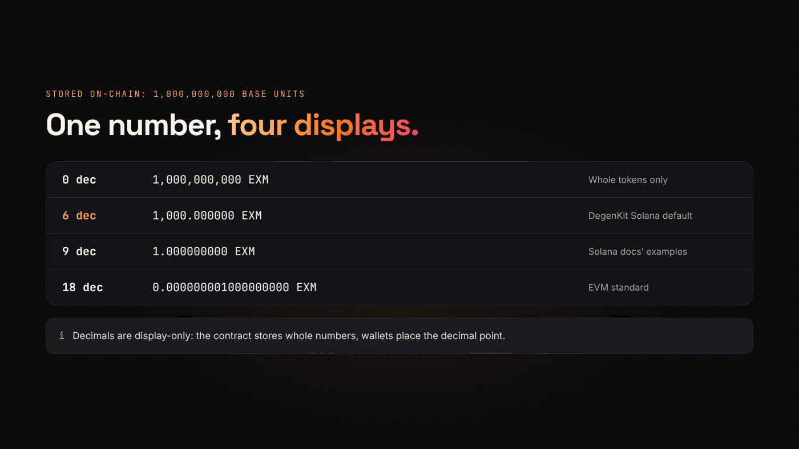
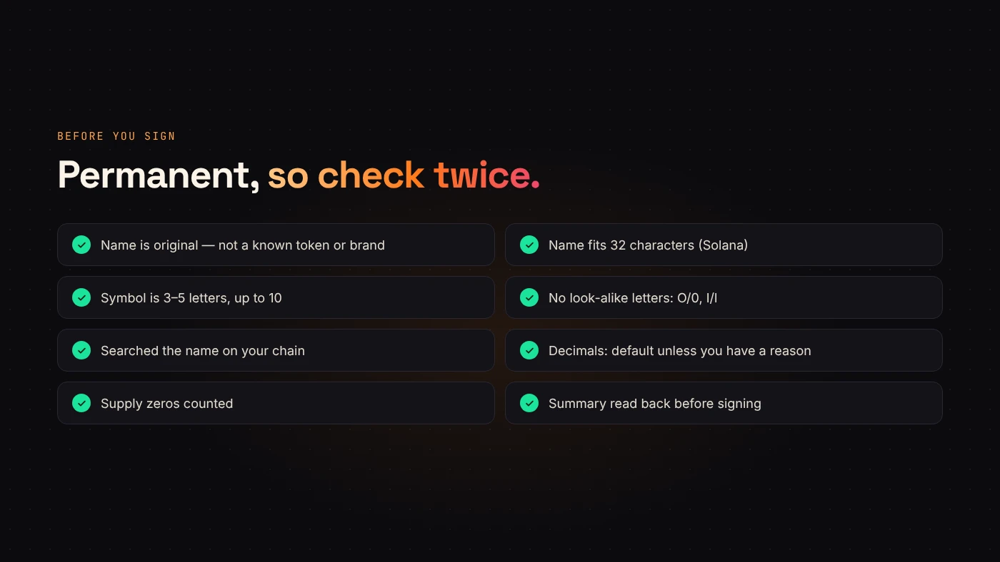

Three fields on the token form are easy to fill in quickly and impossible to change later: **decimals**, **name** and **symbol**. A minute of thought here saves a relaunch.

## What decimals are

Decimals set how finely a token can be divided. [Solana's documentation](https://solana.com/docs/tokens/basics/create-mint.md) defines it as the number of digits to the right of the decimal point. With 6 decimals, the smallest unit is 0.000001 of a token.

[OpenZeppelin's ERC-20 guide](https://docs.openzeppelin.com/contracts/erc20) adds an important point: decimals are only used for display. The contract stores whole numbers, and wallets use decimals to show them. Sending 5 tokens of an 18-decimal token means sending 5 × 10¹⁸ base units.

## What to choose

- **On DegenKit's Solana creator:** any value from 0 to 9. The form starts at 6. Solana's own examples use 9.
- **On DegenKit's EVM creators:** fixed at 18, the ERC-20 default OpenZeppelin recommends.

For most tokens, the default is the right answer. Lower decimals make sense only if your token should never be split finely, such as a ticket-like token. Zero decimals means only whole tokens can move.

## Name and symbol limits

Solana's [Metaplex metadata](https://solana.com/docs/tokens/metaplex) allows a name of up to 32 characters and a symbol of up to 10. DegenKit's form enforces the same limits and turns the symbol into capitals.

On DegenKit, Solana metadata is created locked, so these can't be edited later. On EVM networks, name and symbol are fixed in the contract.

## Picking a good name and symbol

- **Make it yours.** Don't copy the name or ticker of a well-known token or brand. Buyers search by name, and look-alikes are a classic scam signal.
- **Make it easy to type.** Avoid letters that look alike, such as O and 0, or I and l.
- **Keep the symbol short.** Three to five letters is easiest to read on charts and in wallets.
- **Check before you sign.** Search the name and ticker on the chain you're launching on to see what's already there.

:::warning Names aren't unique on-chain
Anyone can create a token with any name. What makes yours unique is its mint or contract address. Always publish it.
:::

## Questions people ask

### Do more decimals make a token more valuable?

No. Decimals only change how finely it can be divided and displayed.

### Can I fix a typo later?

Not on DegenKit tokens. Solana metadata is locked at creation and EVM names are in the contract. You'd have to create a new token.

## Wrap up

Keep the default decimals unless you have a reason not to, and choose a name and symbol that are short, original and easy to type. Then [create your token on DegenKit](https://degenkit.app/launch/) and publish its address.
