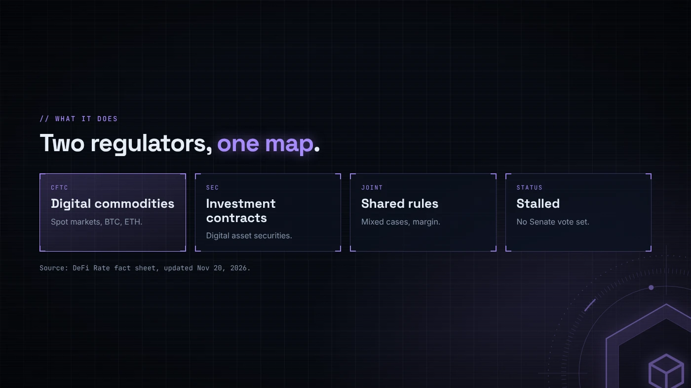
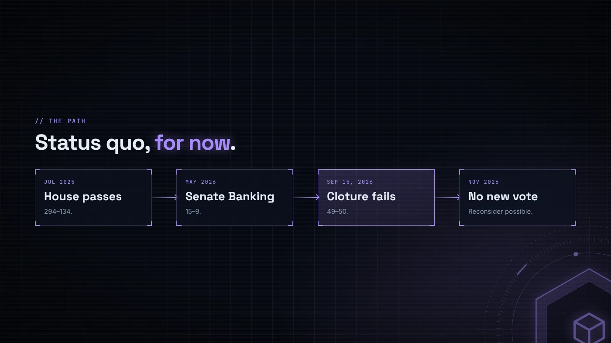

The CLARITY Act, H.R. 3633, would split U.S. crypto oversight between the CFTC, for "digital commodities", and the SEC, for "investment contract assets". It passed the House in July 2025, but on September 15, 2026 the Senate fell short on a procedural vote, 49 to 50. As of November 20, no new Senate vote is scheduled. Prediction markets price a 2026 signing at well under 1%.

:::note Key facts
- **House:** passed **July 17, 2025**, 294–134.
- **Senate Banking:** advanced it **15–9** on May 14, 2026.
- **Senate floor:** cloture on the motion to proceed failed **49–50** on **September 15, 2026**.
- **Now:** no action on the bill record after Sept 15. No vote on the Nov 20 floor schedule (DeFi Rate).
:::

## What would the CLARITY Act do?

- **CFTC:** exclusive jurisdiction over spot markets in "digital commodities", including sufficiently decentralized tokens such as BTC and ETH. It would register exchanges, brokers and dealers.
- **SEC:** keeps "investment contract assets", meaning digital asset securities.
- **Joint rules:** the two agencies would write joint rules on mixed transactions, portfolio margining and conflicts of interest.

The aim is to answer the question every U.S. token project asks: is this token a security or a commodity?

## What happened in the Senate?

On September 15, 2026, the Senate voted 49–50 on cloture for the motion to proceed, short of the 60 votes needed. That was a procedural vote, not final passage. Sen. Thom Tillis entered a motion to reconsider, which keeps the door open. On September 17, seven Democratic senators said they remained committed to bipartisan work, but announced no new vote or text.

The House and Senate versions also differ, so both chambers would need to pass identical text before it reaches the president.

## What do prediction markets say?

DeFi Rate reports, as of November 20–22:

- **Polymarket:** about **0.3–0.4%** for H.R. 3633 being signed into law by December 31, 2026.
- **Kalshi:** about **17%** for broader crypto market-structure legislation becoming law before January 1, 2028.

These are market prices, not forecasts by DegenKit.

## What happens next?

- **Reconsideration:** the Senate could revisit the September vote.
- **New text:** senators could negotiate a revised bill.
- **Agency action:** comments are due on an SEC custody proposal (December 7) and a CFTC advance notice (December 14). Neither enacts CLARITY. See the [December 2026 crypto calendar](/blog/crypto-calendar-december-2026/).

## What does it mean for token creators?

- **No new U.S. framework yet.** The status quo applies, with case-by-case treatment by regulators.
- **How you describe a token matters.** Promising profits from a team's efforts is what securities law looks at. Plain meme or community tokens with no promises carry less of that risk, but no token is free of legal risk.
- **Avoid "investment" language** in marketing. See [how to market a Solana token](/blog/how-to-market-a-solana-token/).
- **Check local rules** wherever you or your buyers are. DegenKit is a tool, not legal advice.

## How does this compare with other regions?

The EU's MiCA rules are already in force for crypto service providers, and EU tax reporting under DAC8 started collecting data in 2026. See [CARF and DAC8 explained](/blog/crypto-tax-reporting-carf-dac8/). The U.S. has passed stablecoin legislation but not a market-structure law.

## What are the risks?

- **Regulatory uncertainty** continues in the U.S.
- **Enforcement** can still happen without new legislation.
- **Headlines** about "passing" often describe procedural steps, not law.

You can lose money in crypto. This is not financial or legal advice.

## FAQ

### Did the CLARITY Act pass?

It passed the House in July 2025. It has not passed the Senate. A September 2026 procedural vote failed 49 to 50.

### Is the CLARITY Act dead?

Not formally. A motion to reconsider was entered, and senators said they want to keep working. No new vote is scheduled.

### Does the CLARITY Act affect tokens outside the U.S.?

It is a U.S. law. Projects serving U.S. users would be affected if it passes.

## Sources

- [DeFi Rate: CLARITY Act fact sheet](https://defirate.com/clarity-act-fact-sheet/)
- [NPR: Senate rejects Clarity Act](https://www.npr.org/2026/09/15/nx-s1-5968711/clarity-act-crypto-senate-vote)
- [American Banker: Market structure bill fails 49–50](https://www.americanbanker.com/news/crypto-market-structure-bill-fails-in-senate-vote-49-50)
- [Latham & Watkins: U.S. crypto policy tracker](https://www.lw.com/en/us-crypto-policy-tracker/legislative-developments)

Create a token with clear, honest settings on the [DegenKit token generator](/launch/).
