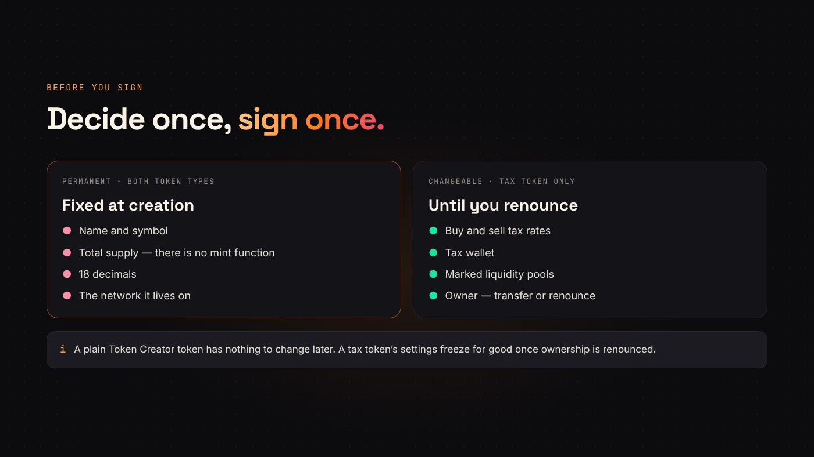
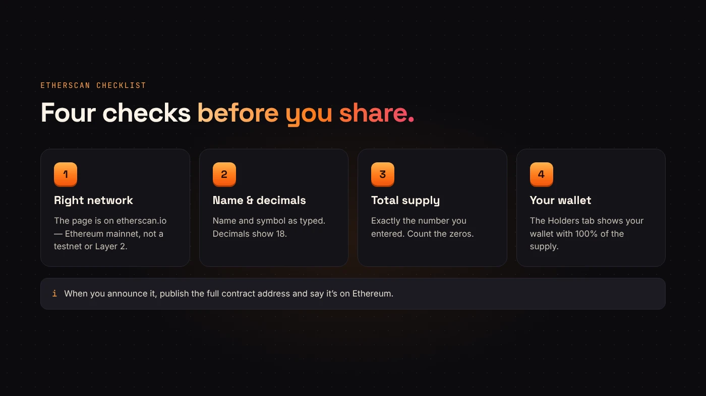

Ethereum is where the ERC-20 standard started, and it is still the network many buyers trust most. Creating a token there no longer needs code. It does need a few decisions made carefully, because the important ones can't be undone.

This guide walks through the whole process on DegenKit's [Ethereum launcher](https://degenkit.app/launch/ethereum/).

## What you need

- An EVM wallet such as MetaMask or Rabby.
- Some **ETH on Ethereum mainnet** for the network fee (gas) and DegenKit's service fee.
- Your token's name, symbol and total supply, written down and checked.
- A decision on whether you want a plain token or a tax token.

Gas on Ethereum changes from minute to minute. Our guide to [Ethereum gas fees](/blog/ethereum-gas-fees-explained/) explains how it is calculated and how to read the estimate in your wallet.

## Step 1: Connect and switch to Ethereum

Open the launcher and connect your wallet. DegenKit is non-custodial: it never sees your keys, and every action is a transaction you sign. If your wallet is on another network, the page asks it to switch to Ethereum.

## Step 2: Choose plain or tax

**Token Creator** makes a standard ERC-20 token. It uses 18 decimals and has no mint function, so the supply you enter is the final supply. The whole supply goes to your wallet.

**Tax Token** works the same way but adds a buy tax and a sell tax that you set, paid in your token to a wallet you choose. Taxes only start once you add liquidity and mark the pool. You can change them later, or freeze them forever by renouncing ownership. Our guide to [managing a tax token](/blog/manage-tax-token-renounce-ownership/) covers every control.

## Step 3: Enter the details

Type the name, symbol and supply. Check the number of zeros twice; there is no way to add or remove supply later. For a tax token, also set the buy and sell rates and the tax wallet.

:::warning Permanent from the first block
Name, symbol and supply can't be edited once the transaction confirms. If something is wrong, the only fix is to create a new token.
:::

## Step 4: Review the fees and sign

DegenKit reads its service fee from the contract and shows it before you sign. Your wallet then shows the network fee estimate. Approve, and the token is created in one transaction.

## Step 5: Check it on Etherscan

DegenKit shows the contract address and a link to Etherscan. Open it and check:

1. The network is Ethereum mainnet.
2. The name, symbol and 18 decimals match.
3. The total supply is correct.
4. Your wallet holds the full supply.

Our guide to [reading a token page on Etherscan and Blockscout](/blog/read-token-page-etherscan-blockscout/) shows where each of these lives.

## After the token exists

The token can't be traded until it has a liquidity pool. On Ethereum that usually means a DEX such as Uniswap. Our guide to [adding liquidity on Uniswap](/blog/add-liquidity-uniswap-erc20/) covers that step, including what tax tokens need.

When you announce the token, always publish the full contract address and say it is on Ethereum. A token with the same name on another network is a different contract.

## Common mistakes to avoid

- **Launching at peak gas.** Ethereum fees swing through the day. Check the estimate in your wallet and wait if it is unusually high. See [Ethereum gas fees explained](/blog/ethereum-gas-fees-explained/).
- **Typos in the name or symbol.** They are permanent once the contract is deployed, so read them twice before you sign.
- **Forgetting liquidity.** A new ERC-20 cannot be traded until a pool exists. Plan how much ETH you will pair with it, then follow [add liquidity on Uniswap](/blog/add-liquidity-uniswap-erc20/).
- **Sharing the wrong address.** Copy the contract address from the explorer, never from a chat message.

ERC-20 is the standard interface that wallets and exchanges expect from a token on Ethereum ([ethereum.org](https://ethereum.org/en/developers/docs/standards/tokens/erc-20/)). Because DegenKit tokens follow it, they show up in any wallet that supports the standard.

:::note Risk
Creating a token does not give it value. Most new tokens never find buyers, and you can lose the ETH you put into gas and liquidity. Start small.
:::

## Questions people ask

### Can I mint more tokens later?

No. DegenKit's Ethereum tokens have no mint function, so the supply is final for everyone, including DegenKit.

### How much does it cost to create an ERC-20 token on Ethereum?

You pay the DegenKit service fee shown on the form plus Ethereum gas for one deployment transaction. Gas varies with network demand, so the total changes from hour to hour.

### Do I need to know Solidity?

No. The token generator deploys a standard ERC-20 contract for you. You only fill in the name, symbol and supply.

### Should I test first?

If you are unsure, rehearse the flow on a cheaper network first, then repeat it on Ethereum with the exact values you want.

## Wrap up

Creating an ERC-20 on Ethereum takes one transaction: connect, choose plain or tax, enter the details, review the fees and sign. The decisions are permanent, so prepare them before you start. [Open the Ethereum launcher](https://degenkit.app/launch/ethereum/) when you are ready.
