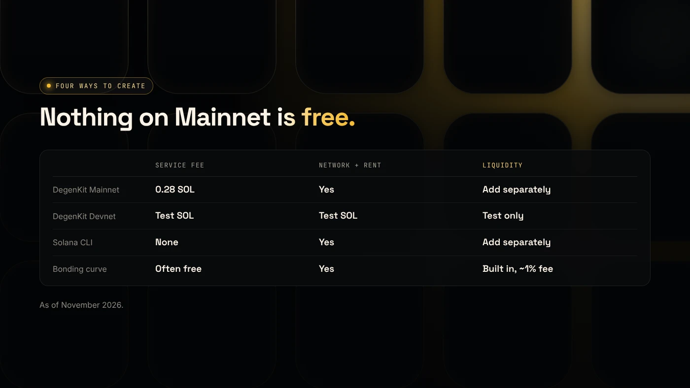
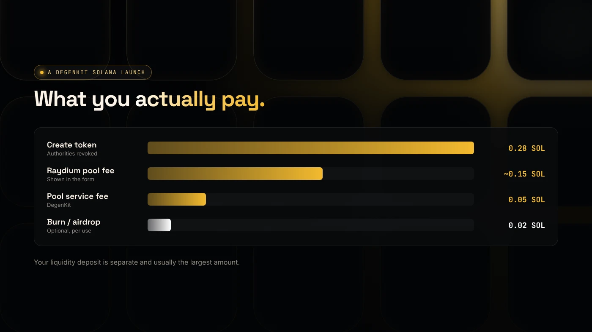

You can create a Solana token for free only on Devnet, Solana's test network, where SOL has no value. On Mainnet, every method costs at least a network fee and refundable rent deposits, and most tools add a service fee. "Free" launchpads usually move the cost into trading fees instead.

:::note Key facts
- **Network fee:** 5,000 lamports (0.000005 SOL) per signature, per Solana's fee docs.
- **Rent:** a refundable minimum balance for each new account (mint, metadata, token account).
- **DegenKit:** 0.28 SOL service fee on Mainnet (as of November 2026). Devnet uses free test SOL.
- **Bonding-curve launchpads** advertise free creation but charge about 1% or more on trades.
:::

## What does it cost to create a Solana token?

Three kinds of cost apply on Mainnet:

1. **Network fee.** [Solana's fee structure](https://solana.com/docs/core/fees/fee-structure) sets a base of 5,000 lamports per signature. One SOL is 1,000,000,000 lamports.
2. **Rent.** Each new account must hold a minimum balance. It is a deposit held in the account, not a payment.
3. **Service fee.** Charged by the tool, if any.

Our breakdown of [Solana fees and rent](/blog/solana-fees-and-rent-explained/) shows where each part goes.

## What are the ways to create a Solana token, and what do they cost?

| Method | Service fee | Network fee and rent | Liquidity | Skills needed |
|---|---|---|---|---|
| DegenKit (Mainnet) | 0.28 SOL | Yes | You add it separately | None |
| DegenKit (Devnet) | Test SOL only | Test SOL only | Test only | None |
| Solana CLI (`spl-token`) | None | Yes | You add it separately | Command line |
| Bonding-curve launchpad | Creation often free | Yes | Built into the curve | None |

The CLI has no service fee, but you set metadata, authorities and distribution yourself. The [Solana mint docs](https://solana.com/docs/tokens/basics/create-mint) show the commands.

## Is a Devnet token really free?

Yes. On Devnet you use test SOL from a faucet, so creation costs nothing real. But a Devnet token **is not a Mainnet token**. It cannot be traded for value, and it does not move to Mainnet. Use Devnet to practise the whole launch. See [rehearsing a Solana launch on Devnet](/blog/rehearse-solana-launch-on-devnet/).

## Why do "free" launchpads exist?

Bonding-curve launchpads such as pump.fun let you create a coin with little or no upfront fee. The cost moves to trading instead. crypto.news reports a 1% fee on every bonding-curve trade on pump.fun ([crypto.news](https://crypto.news/how-meme-coins-are-made-bonding-curves-pump-fun-rug-pulls/)). In exchange, the supply and pricing are fixed by the platform. See [what pump.fun is and how it compares](/blog/what-is-pump-fun/).

## What does the full launch cost on DegenKit?

As of November 2026:

- **Create the token:** 0.28 SOL, with mint and freeze authority revoked in the same transaction.
- **Create a Raydium pool:** 0.05 SOL service fee plus Raydium's pool fee, shown as about 0.15 SOL.
- **Your liquidity:** the SOL or USDC you deposit. This is not a fee, but it is at risk.
- **Optional tools:** burn 0.02 SOL, airdrop or multisend 0.02 SOL per batch.

Our [fees page](/docs/fees/) lists every tool on every network.

## What are the risks of "free" token tools?

- **Hidden costs.** Check what you pay on each trade, not just at creation.
- **Unsafe permissions.** Some tools leave mint or freeze authority with the creator. Check the explorer.
- **Phishing.** Fake "free token creator" sites can ask for wallet approvals that drain funds.

You can lose money in crypto. This is not financial advice.

## FAQ

### How do I create a crypto token for free?

Use Solana Devnet with test SOL, which costs nothing but has no value. On Mainnet, you pay at least the network fee and rent.

### How much does it cost to create a Solana token?

On DegenKit, 0.28 SOL plus the network fee and rent, as of November 2026. With the CLI, only the network fee and rent.

### Is pump.fun free to create a coin?

Creation is low-cost or free, but trades on the bonding curve carry a fee. Check pump.fun's current terms.

## Sources

- [Solana docs: Fee structure](https://solana.com/docs/core/fees/fee-structure)
- [Solana docs: Create a token mint](https://solana.com/docs/tokens/basics/create-mint)
- [crypto.news: How meme coins are made](https://crypto.news/how-meme-coins-are-made-bonding-curves-pump-fun-rug-pulls/)

To create a token on Devnet or Mainnet, use the [DegenKit Solana token creator](/launch/solana/).
