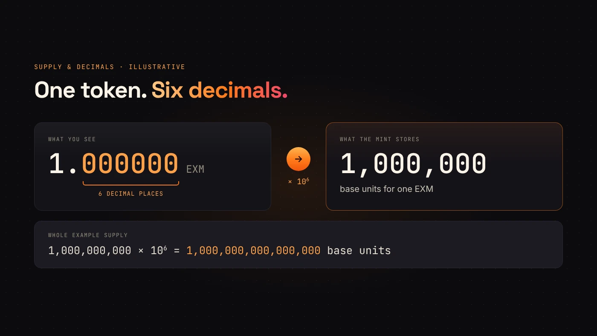
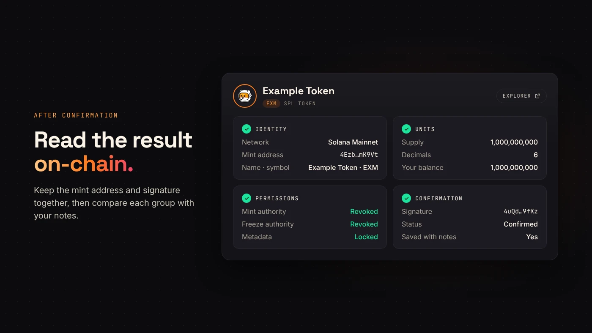

A Solana token creator is a tool that makes an SPL token from a form: you enter a name, symbol, decimals, supply and image, sign one transaction, and the mint, metadata and full supply are created in your wallet. DegenKit's Solana token creator does this for a 0.28 SOL service fee plus network costs, with no code.

:::note Key facts
- **Output:** a standard SPL token (classic Token Program) with on-chain metadata.
- **Cost:** **0.28 SOL** service fee, plus a small network fee and refundable rent deposits (as of November 2026).
- **Defaults:** 6 decimals, 1,000,000,000 supply, mint and freeze authority revoked, metadata locked.
- **Time:** about two minutes with a funded Solana wallet.
- **Custody:** non-custodial. You sign in your own wallet and receive the full supply.
:::

## What does a Solana token creator do?

On Solana, every token is a **mint account** that stores the supply, decimals and authorities, as the [Solana mint documentation](https://solana.com/docs/tokens/basics/create-mint) describes. A token creator builds that account for you, adds the metadata (name, symbol, image) and sends the supply to your wallet.

DegenKit's creator does all of this in **one transaction**: the mint, the metadata, the token account and the distribution. If any part fails, nothing is created and the service fee is not charged.

It does not create a trading market. A new token has no price until someone adds liquidity. See [how to add liquidity to a Solana token](/blog/add-liquidity-solana-token/).

## What do you need before you start?

- **A Solana wallet** such as Phantom, Solflare or Backpack. See [which wallets work with DegenKit](/blog/degenkit-supported-wallets/).
- **SOL** for the 0.28 SOL fee, the network fee and rent. Keep extra for later steps such as liquidity.
- **Your details:** name, symbol, decimals, supply, a short description and a PNG, JPG, WebP or GIF image.

Decimals set how finely a token can be split. With **6 decimals**, one token equals 1,000,000 base units. Supply and decimals do not set any price.

## How do you create the token?

1. Open the [Solana token creator](/launch/solana/) and click **Connect wallet**. Result: your address appears and the button changes from **Connect wallet first**.
2. Choose **Mainnet** for a real token, or **Devnet** to practise with free test SOL.
3. In **Token Creator**, fill in **Token name**, **Symbol**, **Decimals** and **Total supply**. Add a **Description** and use **Add a logo** for the image.
4. Leave **Revoke mint authority** and **Revoke freeze authority** on unless you have a specific reason. Result: no one can mint more or freeze holders.
5. Check the summary and the **0.28 SOL** service fee, then press the button when it reads **Ready to mint — PRESS TO MINT**. Approve in your wallet.
6. When **✓ MINTED** appears, copy the **Contract address** and click **View on Explorer →**.

## Which settings are permanent?

- **Metadata** (name, symbol, image) is always created locked on DegenKit, so it cannot be edited later. Read [Solana token metadata](/blog/solana-token-metadata-explained/) for why that matters.
- **Revoked mint authority** means the supply can never increase. Holders can still burn tokens.
- **Revoked freeze authority** means nobody can freeze holder accounts. Most pools and buyers expect this.
- **Decimals** never change.

Setting an authority to none is permanent, according to [Solana's authority documentation](https://solana.com/docs/tokens/basics/set-authority). Compare the two in [mint vs freeze authority](/blog/mint-authority-vs-freeze-authority/).

## What should you check after creation?

Open the token on the explorer and confirm:

- the **network** (Mainnet or Devnet),
- the **mint address** you will share,
- **decimals** and **supply**,
- your wallet holding **100%**,
- **mint and freeze authority** shown as revoked.

Share the mint address, not just the name. Other tokens can use the same name and symbol.

## What are the common errors?

- **Not enough SOL:** keep the fee plus a buffer for rent and the network fee.
- **Wrong network:** a Devnet token is not a Mainnet token and has no value.
- **Image not showing:** wallets and explorers can take time to index new metadata.
- **Typo in name or symbol:** metadata is locked, so create a new token and share only the correct mint.

## What are the risks?

- **Permanent settings.** Locked metadata and revoked authorities cannot be undone.
- **Liquidity is money at risk.** SOL or USDC you add to a pool can lose value.
- **Phishing.** Only sign on the DegenKit domain, and read what your wallet shows.

You can lose money in crypto. This is not financial advice.

## FAQ

### How do I create a Solana token?

Connect a Solana wallet to a token creator, enter the name, symbol, decimals, supply and image, and sign one transaction. The mint and full supply are created in your wallet.

### How much does it cost to create a Solana token?

On DegenKit, 0.28 SOL service fee plus a small network fee and rent deposits, as of November 2026. See [Solana fees and rent explained](/blog/solana-fees-and-rent-explained/).

### Can I create a Solana token for free?

Only on Devnet, with test SOL that has no value. On Mainnet you always pay at least network fees and rent. See [can you create a Solana token for free](/blog/create-solana-token-free/).

### Can I change my token after creating it?

Not the metadata or decimals on DegenKit, and not the supply once mint authority is revoked.

## Sources

- [Solana docs: Create a token mint](https://solana.com/docs/tokens/basics/create-mint)
- [Solana docs: Set authority](https://solana.com/docs/tokens/basics/set-authority)
- [Solana docs: Fee structure](https://solana.com/docs/core/fees/fee-structure)

When your details are ready, open the [DegenKit Solana token creator](/launch/solana/).
