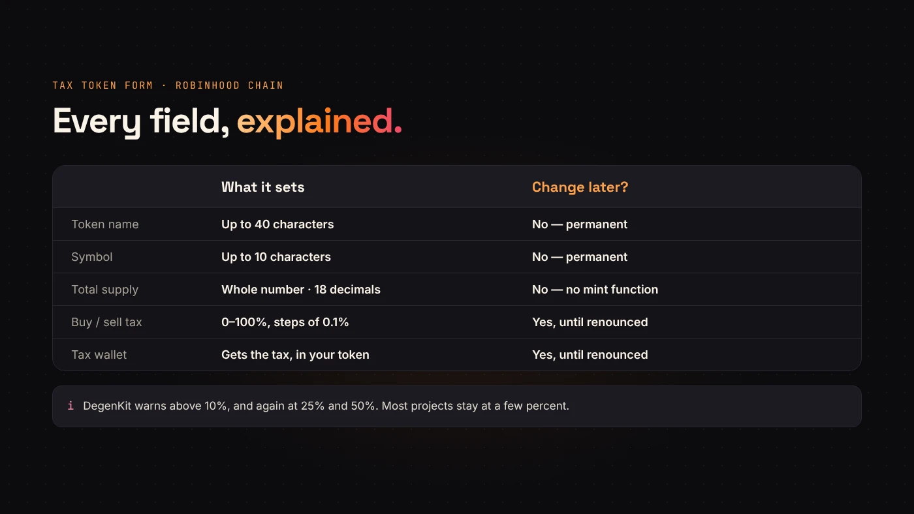
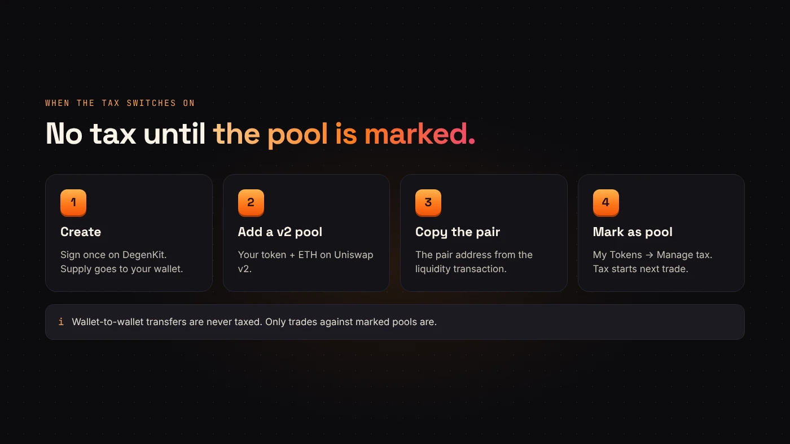

A **tax token** takes a small share of each buy or sell and sends it to a wallet you choose. On Robinhood Chain, DegenKit lets you create one without code, in one transaction signed from your own wallet.

This guide goes through the Tax Token form field by field and explains the step most people miss: the tax doesn't start until you mark your pool. If you're new to how taxes move tokens, read [how buy and sell taxes work](/blog/how-token-buy-sell-tax-works/) first.

## Before you start

- An EVM wallet such as MetaMask, Rabby or Coinbase Wallet.
- **ETH on Robinhood Chain** for the service fee and gas. If it's still on Ethereum, [bridge it first](/blog/bridge-eth-to-robinhood-chain/).
- Your token name, symbol and supply decided. They're permanent.

## Step 1: Open the Tax Token view

Go to the [Robinhood Chain launcher](https://degenkit.app/launch/robinhood/), connect your wallet and approve the switch to Robinhood Chain (chain ID 4663). In the sidebar, choose **Tax Token**.

## Step 2: Fill in the form

- **Token name** — up to 40 characters, such as *Anka Coin*.
- **Symbol** — up to 10 characters, such as *ANKA*.
- **Total supply** — a whole number. The form starts at 1,000,000,000. Decimals are fixed at 18.
- **Buy tax** and **sell tax** — any rate from 0% to 100%, in steps of 0.1%. Set one side to 0% to turn it off.
- **Tax wallet** — the address that receives the tax, paid in your token. Leave it empty to use your own wallet. You can change it later.

## Step 3: Read the warnings

DegenKit warns you as you type when a rate gets high:

- **Above 10%**: buyers tend to avoid high-tax tokens.
- **25% and above**: most buyers will avoid it, and scanners may flag it as unsafe.
- **50% and above**: the token is practically untradable and will be treated as a scam.

These aren't blocks, but they reflect how buyers and scanners react. Most projects stay at a few percent.

:::note What the contract does not have
The Robinhood Chain tax token has **no mint function, no blacklist, no pause and no trading switch**. The owner can change rates, the tax wallet and the marked pools, and nothing else. That's easy to explain to buyers.
:::

## Step 4: Review the fee and sign

The summary lists the network, your wallet, the rates, the tax wallet and the **service fee**. DegenKit reads the fee from the tax factory contract, so the number you see is the number you pay. Your wallet adds the gas.

Check everything, then sign. When it confirms, DegenKit shows the **contract address** and the transaction, each with a copy button and a link to Blockscout.

## Step 5: Add liquidity, then mark the pool

Right after creation, nobody pays tax yet. The tax applies only to trades against a pool you have marked:

1. Add liquidity on Uniswap with your token and ETH. For a tax token, a **v2** pair is the safer choice. See [adding liquidity on Uniswap](/blog/add-liquidity-uniswap-erc20/).
2. Copy the **pair address** from the liquidity transaction on Blockscout.
3. In DegenKit, open **My Tokens → Manage tax**, paste the address and choose **Mark as pool**.

From the next trade, buys and sells against that pool are taxed. Wallet-to-wallet transfers are never taxed.

## After launch

From **My Tokens**, the owner wallet can change the rates, change the tax wallet, add or remove pools, transfer ownership or renounce it. Renouncing freezes all of these forever. Our guide to [managing a tax token](/blog/manage-tax-token-renounce-ownership/) explains each control.

## Questions people ask

### Is the tax paid in ETH?

No. It's paid in your token, to the tax wallet.

### Can I create a tax token with 0% tax?

Yes. You can set both rates to 0% and raise them later, as long as you still own the token.

### Can I change the supply later?

No. There's no mint function, so the supply is final for everyone, including DegenKit.

## Wrap up

Set the name, symbol and supply, pick modest rates, choose the tax wallet and sign once. Then add a v2 pool and mark it so the tax switches on. [Create your tax token on Robinhood Chain](https://degenkit.app/launch/robinhood/).
