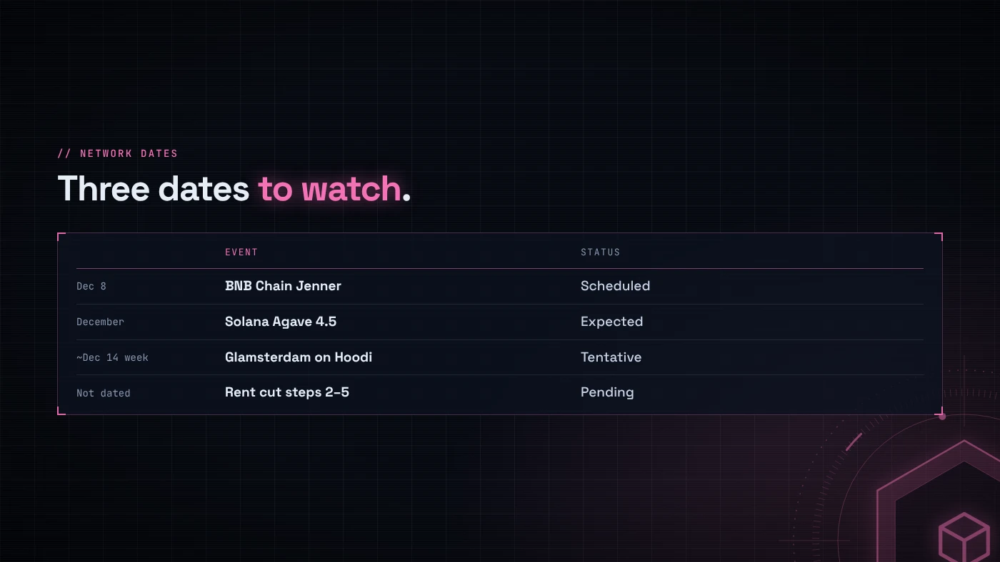
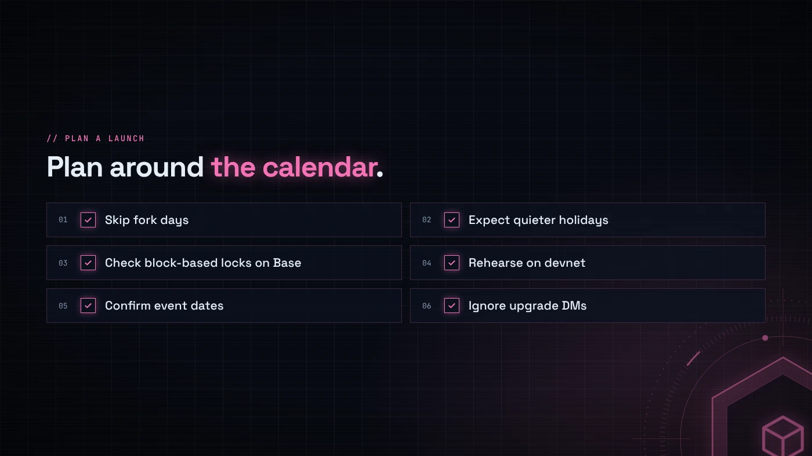

December 2026 has three network events that matter for token creators: BNB Chain's Jenner hard fork on December 8, Solana's Agave 4.5 release with 96 accounts per transaction, and a tentative Glamsterdam rehearsal on Ethereum's Hoodi testnet around December 14. On the rules side, U.S. comment deadlines fall on December 7 and 14. Conferences cluster in Dubai and Abu Dhabi.

:::note Key facts
- **Dec 8, 02:30 UTC:** BNB Chain **Jenner** hard fork, adding Payment Lane and millisecond timestamps.
- **December:** Solana **Agave 4.5**, 64 → **96** accounts per transaction (expected).
- **Week of Dec 14:** tentative **Glamsterdam** rehearsal on Hoodi. Not confirmed.
- **Dec 7 / Dec 14:** SEC custody proposal and CFTC advance notice comment deadlines (DeFi Rate).
:::

## Which network upgrades are in December?

| Date | Network | Event | Status |
|---|---|---|---|
| Dec 8 | BNB Chain | Jenner hard fork | Scheduled |
| December | Solana | Agave 4.5, 96 accounts per tx | Expected |
| ~Dec 14 week | Ethereum | Glamsterdam on Hoodi testnet | Tentative |
| Not dated | Solana | Rent cut steps 2–5 | Pending |

- **Jenner:** reserves 5% of block gas for payments and adds millisecond timestamps. Holders need no action. See [BNB Chain Jenner hard fork](/blog/bnb-chain-jenner-hardfork/).
- **Agave 4.5:** more accounts per transaction helps complex swaps and launch flows. See [upcoming Solana upgrades](/blog/upcoming-solana-upgrades/).
- **Glamsterdam:** mainnet is not expected before mid-January 2027. See [Ethereum Glamsterdam upgrade](/blog/ethereum-glamsterdam-upgrade/).

## Which rule deadlines fall in December?

Per DeFi Rate's CLARITY Act tracker:

- **December 7:** comments due on an SEC custody proposal.
- **December 14:** comments due on a CFTC advance notice of proposed rulemaking.

Neither is a final rule, and neither enacts the CLARITY Act, which stalled in the Senate in September. See [the CLARITY Act status](/blog/clarity-act-status/).

In the EU and in early-adopter CARF countries, 2026 is the first year exchanges collect data for automatic tax reporting. Reports on 2026 activity are due in 2027. See [CARF and DAC8 explained](/blog/crypto-tax-reporting-carf-dac8/).

## Which conferences are in December?

A selection from Alphaday's December listings:

| Dates | Event | City |
|---|---|---|
| Dec 1–2 | Blockchain Life 2026 | Dubai |
| Dec 3–4 | Proof of Talk | Abu Dhabi |
| Dec 7–8 | Bitcoin MENA | Abu Dhabi |
| Dec 7–10 | Abu Dhabi Finance Week | Abu Dhabi |
| Dec 8–10 | CryptoConvergence | Abu Dhabi |
| Dec 10–11 | Global Blockchain Show | Abu Dhabi |
| Dec 25–29 | ETH CALI | Cali, Colombia |

Always confirm dates on each event's own site before booking.

## What should token creators plan around?

- **Avoid launching on fork day.** Wallets, RPCs and explorers can lag for a few hours around a hard fork.
- **Year-end liquidity is thin.** Fewer traders are active over the holidays, so plan for lower volume.
- **Check block-based locks** on Base after the Denim upgrade. See [Base Denim upgrade](/blog/base-denim-upgrade/).
- **Rehearse first.** See [rehearse a Solana launch on devnet](/blog/rehearse-solana-launch-on-devnet/).

## What could change in this calendar?

- **Glamsterdam's rehearsal** depends on a decision at the November 26 Ethereum consensus call.
- **Agave 4.5** could slip into 2027.
- **Jenner's** time could move if new bugs are found. BNB Chain released a node hotfix on November 6.

## What are the risks?

- **Dates move.** Treat every "expected" date as a target.
- **Fork days** bring failed transactions and stale data.
- **Scam messages** often impersonate upgrade notices.

You can lose money in crypto. This is not financial advice.

## FAQ

### What crypto upgrades happen in December 2026?

BNB Chain's Jenner hard fork on December 8 and Solana's Agave 4.5, expected in December. A Glamsterdam rehearsal on Ethereum's Hoodi testnet is tentative.

### Is Glamsterdam in December 2026?

No. Mainnet is not expected before mid-January 2027.

### Should I launch a token on a hard fork day?

It is usually better to wait a day or two until wallets and RPCs settle.

## Sources

- [DeFi Rate: CLARITY Act fact sheet](https://defirate.com/clarity-act-fact-sheet/)
- [Alphaday: Crypto events December 2026](https://alphaday.com/events/december-2026)
- [crypto.news: BNB Chain Jenner hardfork](https://crypto.news/what-changes-with-bnb-chains-jenner-hardfork/)
- [Solana: Network upgrades](https://solana.com/upgrades)

Plan your launch with the [DegenKit token generator](/launch/).
