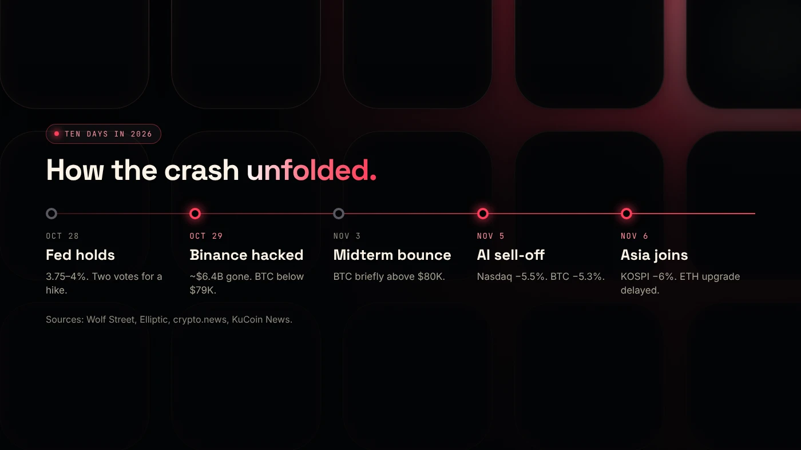
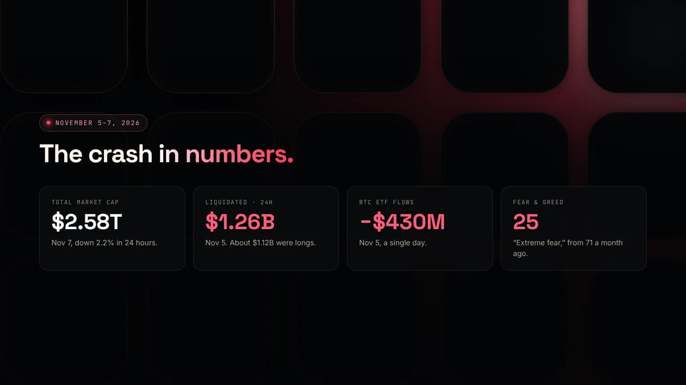

Between October 28 and November 6, 2026, crypto lost a large part of its value in a series of shocks. There was no single cause. A Fed decision, the largest theft in crypto history, US midterm elections and a tech-stock sell-off came one after another, and leveraged traders made every move bigger.

By November 7, the total crypto market was worth about **$2.58 trillion**, according to [The Currency Analytics](https://thecurrencyanalytics.com/bitcoin/bitcoin-holds-steady-as-crypto-market-cap-slides-to-2-58t-308173). The Fear & Greed Index stood at **25, "Extreme Fear"**.

:::note Figures as of November 7, 2026
Prices move every minute. The numbers here come from the sources linked in each section, and this is news, not financial advice.
:::

## The timeline

**October 28 — the Fed holds, but two members want a hike.** The Federal Reserve kept rates at 3.75%–4.00% in a 10–2 vote. Governor Lisa Cook and Cleveland Fed President Beth Hammack voted for a quarter-point **increase**, and Chair Warsh called inflation "too high" ([Wolf Street](https://wolfstreet.com/2026/10/28/fed-holds-rates-but-with-2-dissenters-a-hold-before-the-election-was-expected-dissenters-were-not/)). Markets had hoped for the opposite.

**October 29 — Binance is hacked.** Attackers drained hot wallets on 11 blockchains in about three hours. Binance estimates the loss at about $6.3 billion, and Elliptic puts it at $6.43 billion, the largest theft in history ([Elliptic](https://www.elliptic.co/insights/binance-largest-hack-in-history/)). Binance paused withdrawals. Bitcoin fell below $79,000, and about $628 million of leveraged positions were liquidated within an hour ([CryptoTicker](https://cryptoticker.io/en/why-is-crypto-down-today-november-3-2026/)). We cover the hack in detail in [the Binance hack explained](/blog/binance-hack-explained/).

**October 31 – November 1.** The FBI attributed the theft to North Korea's TraderTraitor group. Binance said it would cover all losses and began reopening withdrawals.

**November 3 — midterm bounce.** Bitcoin briefly climbed back above $80,000 after the US midterm elections, then gave it all back.

**November 5 — the AI sell-off.** The Nasdaq Composite fell 5.5% and the S&P 500 fell 4.3% as investors questioned spending on AI infrastructure ([crypto.news](https://crypto.news/bitcoin-price-today-rebounds-76000-etf-outflows/)). Crypto followed: Bitcoin fell 5.3% to about $76,000, Ether 7.2% to about $2,250, and Solana 6.5% to about $89 ([CryptoTicker](https://cryptoticker.io/en/solana-price-prediction-200-day-line-dex-volume-november-2026/)).

**November 6 — Asia joins in.** South Korea's KOSPI closed 6% lower after a brief trading halt, and Japan's Nikkei fell almost 6%. The same day, Ethereum developers delayed the next upgrade's test-network activation ([KuCoin News](https://www.kucoin.com/news/flash/ethereum-price-drops-6-amid-glamsterdam-upgrade-delay-and-market-sell-off)).

## Why it fell so hard

Every one of these events would have caused a dip on its own. The crash came from three amplifiers:

1. **Leverage.** About $1.26 billion of positions were liquidated in the 24 hours around November 5, roughly $1.12 billion of them longs. Forced selling pushes prices lower, which triggers more liquidations. See [how liquidations turn a dip into a crash](/blog/crypto-liquidations-explained/).
2. **ETF outflows.** US spot Bitcoin ETFs lost $430.2 million on November 5 alone, and Ether ETFs nearly $100 million.
3. **Correlation with tech stocks.** When AI and chip stocks sold off, crypto was treated as one more risky asset and sold with them.

## Where the big coins stand

- **Bitcoin** is holding near $76,000, roughly 40% below its October 2025 high. Read [Bitcoin after the crash](/blog/bitcoin-after-the-crash-november-2026/).
- **Ethereum** is around $2,240, with support near $2,200. Read [where Ethereum is heading](/blog/ethereum-price-outlook-november-2026/).
- **Solana** is sitting right on its 200-day average near $89. Read [Solana at its 200-day line](/blog/solana-200-day-line-november-2026/).

## What to watch next week

- Whether ETF flows turn positive again.
- Whether Bitcoin holds the $75,000 area.
- Any new statement from the Fed on inflation.
- How much of the stolen Binance funds are frozen or moved.

## What it means if you are building

Crashes don't stop launches, but they change the rules: less attention, thinner liquidity and buyers who are more cautious. Our playbook on [launching a token during a crash](/blog/launching-a-token-in-a-bear-market/) covers what to do differently.

## Wrap up

The early-November crash was a stack of shocks: a hawkish Fed, a record hack, a midterm bounce that faded and an AI sell-off, all made bigger by leverage and ETF outflows. If you're planning a launch, [DegenKit](https://degenkit.app/) lets you prepare it now and choose your timing.
