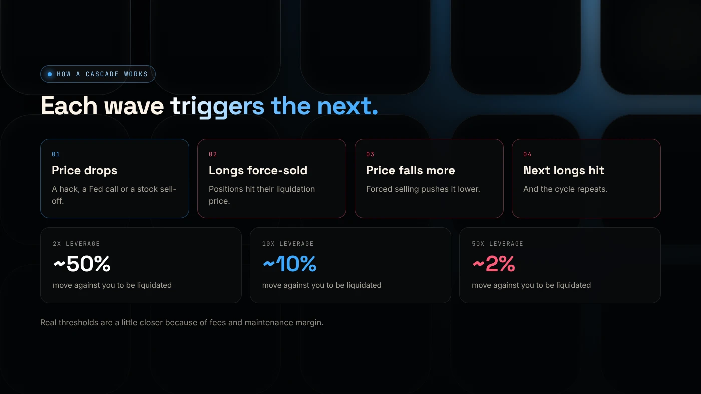
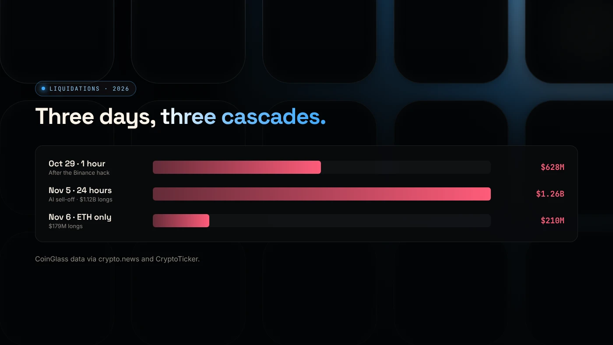

On November 5, 2026, about **$1.26 billion** of crypto trading positions were closed by force in 24 hours, according to CoinGlass data cited by [crypto.news](https://crypto.news/bitcoin-price-today-rebounds-76000-etf-outflows/). About **$1.12 billion** of that was traders betting on prices going up.

Those forced closures are called **liquidations**, and they are why a normal dip so often becomes a crash. Here's how they work.

## What a liquidation is

Many exchanges let traders borrow to make bigger bets. This is **leverage**. With 10x leverage, $1,000 controls a $10,000 position.

The borrowed money has to be protected. If the price moves against the trader far enough to wipe out their own $1,000, the exchange **closes the position automatically**. That's a liquidation. The trader loses their stake, and the exchange sells (or buys) to close the position.

The more leverage, the smaller the move needed:

- **2x** leverage: about a 50% move against you
- **10x**: about 10%
- **50x**: about 2%

In practice it happens a little sooner, because of fees and maintenance margin.

## How a cascade works

1. Something pushes the price down, such as a hack, a Fed decision or a tech-stock sell-off.
2. The most leveraged longs hit their liquidation price and are **sold automatically**.
3. That forced selling pushes the price down further.
4. The next group of longs hits its liquidation price, and the cycle repeats.

No one decides to sell in steps 2 to 4. It's mechanical, which is why prices can fall very fast.

## What happened this time

- **October 29:** about $628 million was liquidated within an hour after the Binance hack ([CryptoTicker](https://cryptoticker.io/en/why-is-crypto-down-today-november-3-2026/)).
- **November 5:** about $1.26 billion in 24 hours as tech stocks fell.
- **November 6:** more than $210 million on ETH alone, with ETH open interest down to about $11.4 billion from about $16 billion in late September ([crypto.news](https://crypto.news/why-is-ethereum-price-down-today-eth-etf-liquidations)).

## Why it matters even if you never use leverage

- **Your token's chart feels it.** When Bitcoin and SOL fall fast, buyers of small tokens pull back too.
- **Wicks hit stop orders.** Fast cascades create sharp, short drops that can trigger sell orders before the price bounces.
- **The end of a cascade can be a turning point.** Once most leverage is gone, there's less forced selling left. Falling open interest is one sign of that.

## Wrap up

Liquidations are forced sales of leveraged positions. In a cascade, each wave of selling triggers the next, which is how the November crash went from a dip to more than $1 billion lost in a day. Read [why crypto crashed](/blog/crypto-crash-november-2026/) for the full timeline. If you're building rather than trading, [DegenKit](https://degenkit.app/) involves no leverage: you create, you own, you sign.
