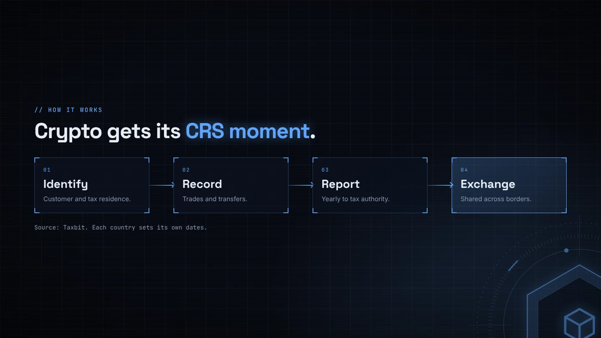
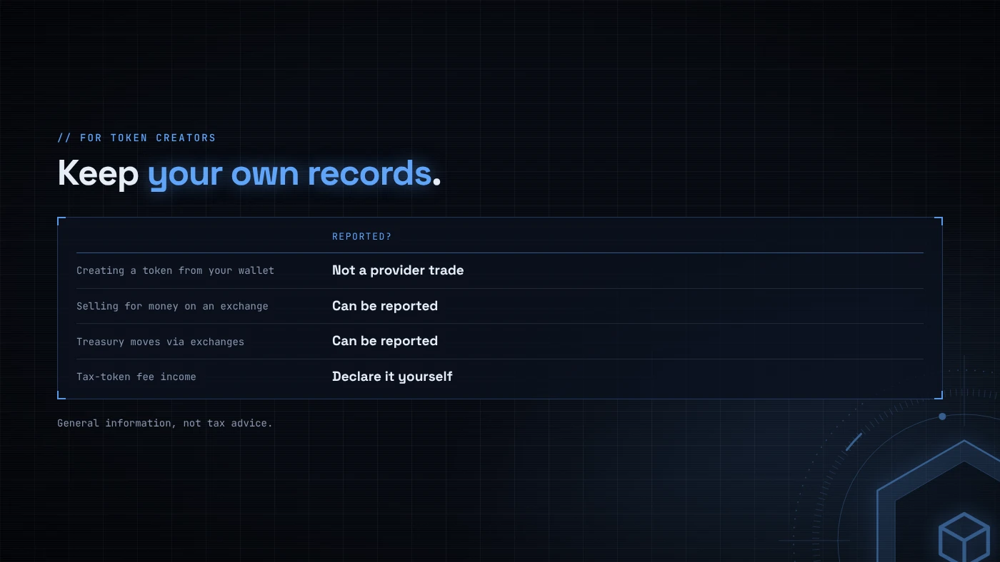

CARF is the OECD's Crypto-Asset Reporting Framework, and DAC8 is the EU's version of it. Both make crypto service providers, such as exchanges and brokers, collect customer details and transactions and report them to tax authorities, which then share them across borders. Data collection started on January 1, 2026 in the EU and early-adopter countries. First reports on 2026 activity are due in 2027.

:::note Key facts
- **Start:** data collection from **January 1, 2026** in the EU (DAC8) and early-adopter CARF countries (Taxbit).
- **First reports:** in **2027**, covering 2026 activity. First cross-border exchanges are also listed for 2027.
- **Who reports:** crypto-asset service providers (CASPs): exchanges, brokers, some wallet providers and intermediaries.
- **DAC8 reach:** includes providers **outside the EU** that serve EU customers.
:::

## What is CARF?

CARF is a reporting standard from the OECD, the same body behind the Common Reporting Standard (CRS) for bank accounts. It asks providers that carry out crypto transactions for customers to:

1. **Identify customers** and their tax residence.
2. **Record transactions:** exchanges between crypto and money, crypto-to-crypto trades and certain transfers.
3. **Report yearly** to their local tax authority.

Tax authorities then exchange the data with each other automatically. Each country sets its own dates, so the timeline differs by jurisdiction.

## What is DAC8?

DAC8 is the eighth update to the EU Directive on Administrative Cooperation. It applies CARF-style reporting across the EU from January 1, 2026. Member states set the exact filing deadlines. Taxbit notes that in Germany, providers must register, and face penalties if they are not ready.

## Which countries are in?

Taxbit's tracker lists 36 countries with CARF or DAC8 obligations, mostly in Europe (29), plus two in the Americas, three in Asia-Pacific and one in Africa. Germany is marked "live now". Turkey is not on that list. Check your own country's tax authority for its timeline.

## What does this mean for crypto users?

- **Your exchange will ask for tax details,** such as tax residence and tax ID, if it has not already.
- **Your trades on that exchange can be reported** to your tax authority, and shared with your country of residence.
- **Keep your own records.** A report from an exchange does not replace your own tax filing.

Taxbit's page does not address self-custody or DeFi. Whether a wallet transfer or an on-chain swap is in scope depends on whether a reporting provider carries it out for you.

## What does it mean for token creators?

- **Creating a token** with your own wallet is not an exchange transaction by a provider.
- **Selling your token for money** through an exchange can be reported.
- **Team and treasury wallets** that move funds through exchanges create reportable activity.
- **Tax tokens** that collect fees create income you may need to declare. See [how token buy and sell tax works](/blog/how-token-buy-sell-tax-works/).

This is general information, not tax advice. Rules differ by country.

## How should you prepare?

- **Update your details** on every exchange you use.
- **Export transaction history** each year, including from exchanges that may close.
- **Track your cost basis** for each token, including tokens you created. The [token tax calculator](/tools/token-tax-calculator/) helps with tax-token fee income, and [DegenKit fees explained](/blog/degenkit-fees-explained/) lists what you paid to create one.
- **Ask a local tax adviser** about your situation.

## What are the risks?

- **Mismatched records** between your filing and an exchange's report can trigger questions.
- **Country rules differ** in dates and scope.
- **Phishing** using "tax verification" messages. Update details only inside the exchange.

You can lose money in crypto. This is not financial or tax advice.

## FAQ

### When does CARF start?

Data collection started on January 1, 2026 in early-adopter countries and the EU, with first reports in 2027. Other countries follow later.

### Does CARF cover self-custody wallets?

CARF targets providers that carry out transactions for customers. The sources used here do not set out how self-custody and DeFi are treated.

### Is Turkey part of CARF?

Turkey is not on Taxbit's list of 36 countries. Check with Turkey's Revenue Administration for current rules.

## Sources

- [Taxbit: CARF and DAC8 explained](https://www.taxbit.com/regulation/carf)
- [Aurum: CARF and DAC8 explained](https://aurum.law/newsroom/CARF-and-DAC8-Explained)
- [Deloitte: Crypto-asset reporting framework](https://www.deloitte.com/lu/en/Industries/banking-capital-markets/perspectives/crypto-asset-reporting-framework.html)

Create a token from your own wallet with the [DegenKit token generator](/launch/).
