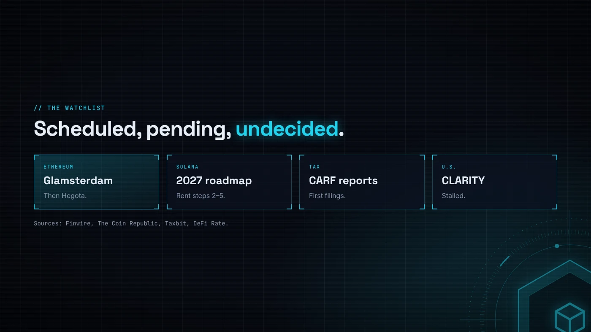
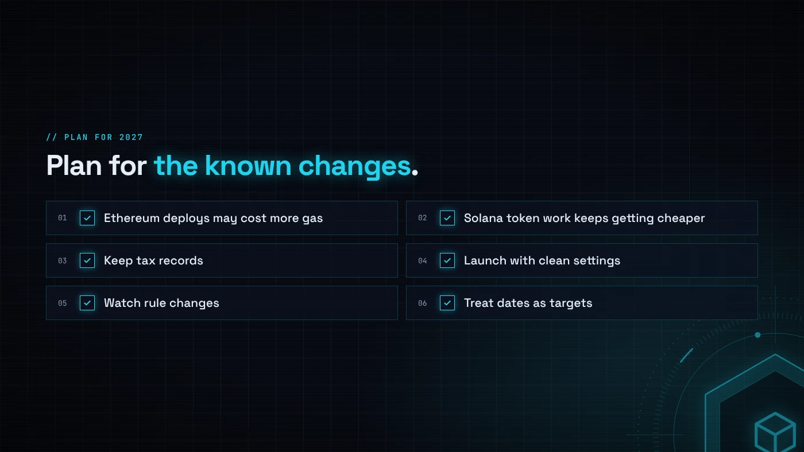

The main things already on the 2027 crypto calendar are Ethereum's Glamsterdam fork, Solana's 2027 roadmap and the rest of its rent cut, the first CARF and DAC8 tax reports, and the open question of U.S. market structure law. Breakpoint 2027 is set for September 8–10 in San Francisco. This list covers what is scheduled or pending, not price predictions.

:::note Key facts
- **Ethereum:** Glamsterdam mainnet **mid-January 2027 at the earliest**, possibly April–May (Finwire).
- **Solana:** 2x compute, 96 accounts per transaction, Alpenglow Next, rent cut steps 2–5. No firm dates.
- **Tax:** first CARF and DAC8 reports on 2026 activity due in **2027** (Taxbit).
- **Events:** Breakpoint 2027, **September 8–10**, San Francisco.
:::

## What is coming for Ethereum?

- **Glamsterdam:** ePBS, block-level access lists and gas repricing. Paused in November 2026 after audits found 200 issues in affected apps. Earliest mainnet mid-January, later if specs change. See [Ethereum Glamsterdam upgrade](/blog/ethereum-glamsterdam-upgrade/).
- **Hegota:** the next fork. Developers are discussing a narrower scope to speed up quantum-resistant cryptography work (Decrypt).

For token creators, Glamsterdam's current specs make contract creation cost more gas on Ethereum mainnet.

## What is coming for Solana?

- **Anza's 2027 roadmap:** double compute, 80% fewer compute units for token account work, 96 accounts per transaction, direct account data access, Alpenglow Next and Constellation. See [Solana's 2027 roadmap](/blog/solana-2027-roadmap/).
- **Rent cut steps 2–5,** toward 90% lower rent. See [the Solana rent cut](/blog/solana-rent-cut-simd-0437/).
- **Rotor,** Alpenglow's second phase, replacing Turbine.
- **Durable nonce deprecation,** with about a six-month migration window.

## What is coming for other chains?

- **BNB Chain:** after Jenner in December 2026, details of the CAS20 compliant asset standard. See [BNB Chain Jenner hard fork](/blog/bnb-chain-jenner-hardfork/).
- **Base:** building on 200ms blocks from the Denim upgrade. See [Base Denim upgrade](/blog/base-denim-upgrade/).
- **Robinhood Chain:** more stock tokens and lending. See [Robinhood Chain in late 2026](/blog/robinhood-chain-2026-update/).

## What is coming in rules and tax?

| Item | 2027 status |
|---|---|
| CARF / DAC8 | First reports on 2026 activity |
| U.S. CLARITY Act | Stalled in the Senate since Sept 2026 |
| U.S. agency rules | SEC custody and CFTC proposals in comment stage |

Kalshi priced about 17% for U.S. market structure legislation becoming law before January 1, 2028, as of November 22 (DeFi Rate). See [the CLARITY Act status](/blog/clarity-act-status/) and [CARF and DAC8 explained](/blog/crypto-tax-reporting-carf-dac8/).

## Which events are already set?

- **Breakpoint 2027:** September 8–10, Pier 48, San Francisco. Solana's first U.S. edition.
- **Pilots due in early 2027:** Akash Compute Forwards (Q1) and Formation Securities' tokenized stock platform on Solana, per Breakpoint and 24/7 Wall St. reports.

## What should token creators plan for?

- **Ethereum deployments** may cost more gas after Glamsterdam if specs hold.
- **Solana token operations** keep getting cheaper.
- **Tax reporting** makes good records essential.
- **Clear, honest token settings** age well whatever the rules become.

## What are the risks?

- **Dates slip.** Most 2027 items have no fixed date.
- **Regulation** can change quickly in either direction.
- **Market conditions** can override technical progress.

You can lose money in crypto. This is not financial advice.

## FAQ

### When is Ethereum's next upgrade?

Glamsterdam, with mainnet no earlier than mid-January 2027, and possibly April or May.

### What is Solana planning for 2027?

Double compute, cheaper token account work, 96 accounts per transaction, Alpenglow Next and Constellation, per Anza's roadmap.

### Will the U.S. pass a crypto law in 2027?

It is undecided. The CLARITY Act stalled in the Senate in September 2026.

## Sources

- [Finwire: Glamsterdam could be delayed to May 2027](https://finwire.io/news/crypto-news/heres-why-ethereums-glamsterdam-upgrade-could-be-delayed-until-may-2027)
- [The Coin Republic: Solana 2027 plans](https://www.thecoinrepublic.com/2026/11/19/solana-developer-lays-out-key-developmental-plans-for-2027-heres-what-to-expect/)
- [Taxbit: CARF and DAC8](https://www.taxbit.com/regulation/carf)
- [DeFi Rate: CLARITY Act fact sheet](https://defirate.com/clarity-act-fact-sheet/)
- [SolanaFloor: Breakpoint 2026 Day 2](https://solanafloor.com/news/solana-breakpoint-2026-day-2-brief)

Get ready for 2027 with the [DegenKit token generator](/launch/).
