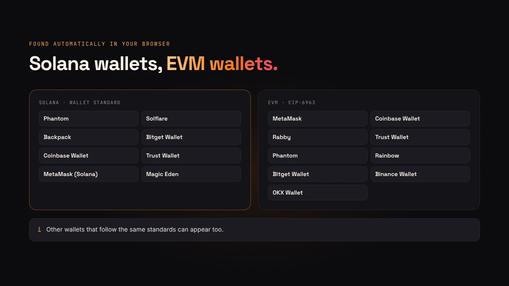
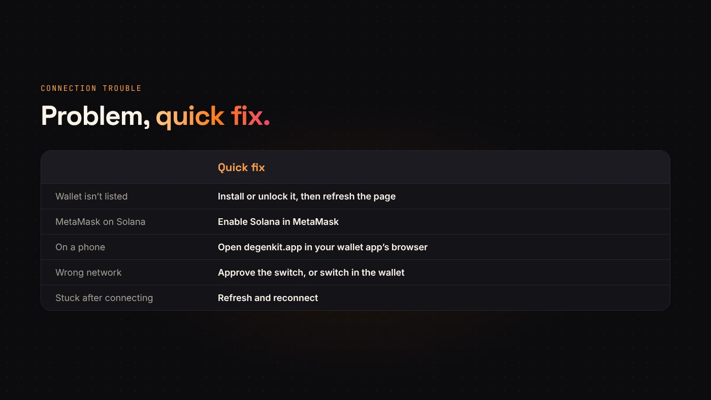

DegenKit never holds your keys, so everything starts with your own wallet. The good news: you don't need a specific one. DegenKit discovers the wallets installed in your browser and lists them for you.

## On Solana

The Solana launcher uses the **Wallet Standard**. [Phantom's developer docs](https://docs.phantom.com/developer-powertools/wallet-standard) describe it as a chain-agnostic set of interfaces that standardizes how wallets attach to the page. Any wallet that supports it can appear in DegenKit's list.

DegenKit's wallet menu recognizes:

- Phantom
- Solflare
- Backpack
- Bitget Wallet
- Coinbase Wallet
- Trust Wallet
- MetaMask (with Solana enabled)
- Magic Eden

If a wallet on the list isn't installed, DegenKit shows a link to install it. For Solflare builds that don't announce themselves in time, DegenKit includes a fallback that still finds them.

## On Ethereum, BNB Chain, Base and Robinhood Chain

The EVM launchers use **EIP-6963**, which the [standard](https://eips.ethereum.org/EIPS/eip-6963) describes as a discovery mechanism that lets a page find multiple injected wallet providers. That means several installed wallets can show up side by side instead of fighting over one slot.

DegenKit's EVM menu recognizes MetaMask, Coinbase Wallet, Rabby, Trust Wallet, Phantom, Rainbow, Bitget Wallet, Binance Wallet and OKX Wallet. Other EIP-1193 wallets can work too.

## Connecting and switching networks

1. Open the launcher for your network and choose **Connect**.
2. Pick your wallet from the list and approve the connection. This shares only your **public address**.
3. On EVM networks, DegenKit checks your wallet's network. If it's different, it asks the wallet to switch — and for networks like BNB Chain, Base or Robinhood Chain, to add them first.
4. On Solana, choose **Mainnet** or **Devnet** in the launcher, and set your wallet to the same network.

## When a wallet doesn't appear or won't connect

- **Wallet not listed.** Make sure the extension is installed and unlocked, then refresh the page. In MetaMask, check that Solana is enabled if you're on the Solana launcher.
- **On a phone.** Mobile browsers don't have wallet extensions. Open degenkit.app inside your wallet app's built-in browser instead.
- **Wrong network.** Approve the switch prompt, or switch manually in your wallet. Check the chain ID before approving a new network.
- **"Stuck" after connecting.** Refresh and reconnect. DegenKit's support page notes this resolves a surprising number of stuck states.

:::tip Use a dedicated launch wallet
Whatever wallet you choose, consider a separate account just for launching. Our [wallet security guide](/blog/wallet-security-for-token-creators/) explains why.
:::

## Questions people ask

### Does connecting cost anything?

No. Connecting only shares your public address. You pay fees only when you sign a transaction.

### Can I use a hardware wallet?

If your wallet app supports a hardware device and appears in DegenKit's list, transactions are signed on the device as usual.

## Wrap up

DegenKit finds standard Solana and EVM wallets automatically, asks to switch networks when needed and never sees your keys. Install a supported wallet, unlock it and [choose your network](https://degenkit.app/launch/).
