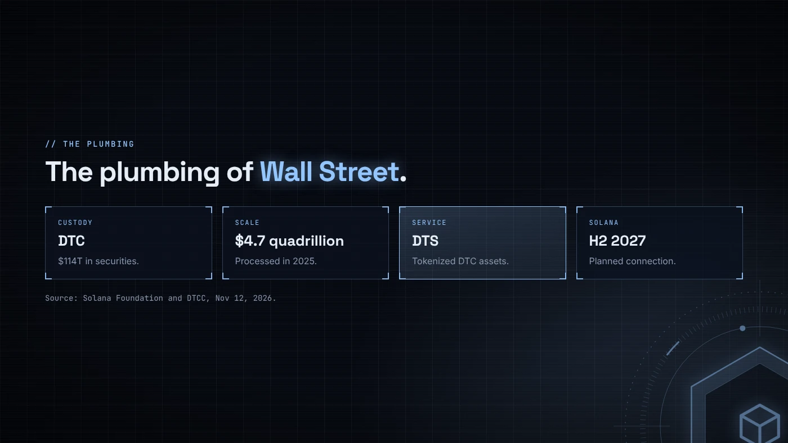
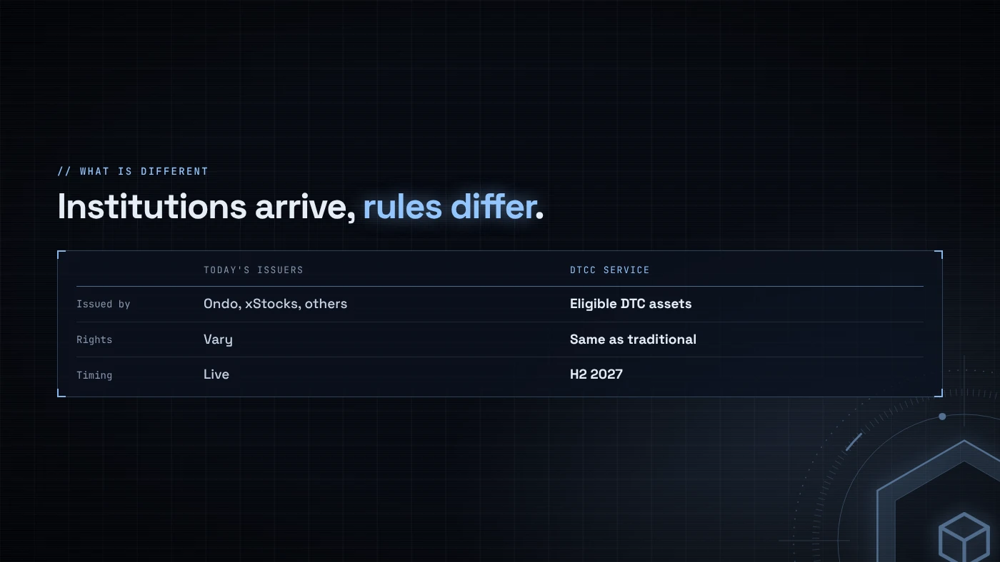

DTCC, the company behind most U.S. securities settlement, announced on November 12, 2026 that its Tokenization Service will connect to Solana in the second half of 2027. Eligible securities held at its depository could then be issued as tokens on Solana, with the same investor protections and ownership rights as traditional holdings. It is one of the largest traditional-finance commitments to Solana so far.

:::note Key facts
- **Announced:** **November 12, 2026** (Solana Foundation, DTCC).
- **Timing:** connection planned for **H2 2027**.
- **Scale:** DTCC subsidiaries processed **$4.7 quadrillion** in securities transactions in 2025. Its depository held securities worth **$114 trillion** from 150+ countries.
- **Rights:** tokenized assets keep the **same protections and ownership rights** as traditional holdings.
:::

## What is DTCC?

The Depository Trust & Clearing Corporation runs the core plumbing behind U.S. stock and bond markets. Its depository, DTC, holds securities on behalf of brokers and banks, and its subsidiaries clear and settle trades. Most investors never see it, but almost every U.S. share trade passes through it.

## What is the DTCC Tokenization Service?

The DTCC Tokenization Service (DTS) makes eligible DTC-custodied assets available as tokens. Per the Solana Foundation's announcement:

- **Full token lifecycle:** issuance, transfer and servicing on-chain.
- **Same safeguards:** tokens keep the same investor protections, ownership rights and regulatory safeguards as traditional securities.
- **Multi-chain:** Solana joins a growing list of supported networks. The announcement does not name the others.

The announcement does not define which assets are eligible.

## Why Solana?

The Solana Foundation cites sub-second finality, low fees and always-on operation. Nick Ducoff, its general manager for institutions, said: "Institutions chose Solana because it already runs real financial activity at scale." Tokenized stocks on Solana passed $1.22 billion on November 19. See [tokenized stocks on Solana](/blog/tokenized-stocks-on-solana/).

## What could change for markets?

The announcement points to:

- **More choice** of where to hold and use securities.
- **Liquidity and collateral mobility,** such as using tokenized securities as collateral on-chain.
- **Capital efficiency** from faster, always-on settlement.

None of this is live. The connection is planned for the second half of 2027.

## How is this different from today's tokenized stocks?

| | Today's issuers | DTCC service |
|---|---|---|
| Who issues | Ondo, xStocks, Securitize and others | Eligible DTC-custodied assets |
| Rights | Vary by product | Same as traditional holdings |
| Timing | Live | H2 2027 |

## What does this mean for token creators?

Not much directly: DTCC tokenizes existing securities, not new tokens. Indirectly, institutional activity can bring more users, wallets and liquidity to Solana, and more attention to clean, verifiable token setups. Your own token is not a security product and should not be marketed as one. See [the CLARITY Act status](/blog/clarity-act-status/).

## What should you watch before 2027?

- **Eligibility rules:** which securities DTCC will make available as tokens on Solana.
- **Participants:** which brokers and banks connect first.
- **Wallet and custody setup:** how investors will hold DTCC-tokenized assets, and whether self-custody is allowed.
- **Other chains:** DTCC calls this a multi-chain strategy, so Solana will not be the only network.
- **Regulatory updates** on tokenized securities in the U.S.

Each of these will decide how much of DTCC's scale actually reaches Solana, and how quickly. Until then, the announcement is a plan with a date, not a live product.

## What are the risks?

- **Timelines slip.** H2 2027 is a plan.
- **Eligibility** is undefined so far.
- **Regulation** of tokenized securities is still evolving.

You can lose money in crypto. This is not financial advice.

## FAQ

### When will DTCC connect to Solana?

In the second half of 2027, per the November 12, 2026 announcement.

### Will DTCC tokens have the same rights as shares?

The announcement says tokenized assets keep the same investor protections and ownership rights.

### Can anyone tokenize stocks through DTCC?

Only eligible DTC-custodied assets, through DTCC's participants.

## Sources

- [Solana: DTCC Tokenization Service to connect with Solana](https://solana.com/news/dtcc-tokenization-service-to-connect-with-solana)
- [DTCC press release](https://www.dtcc.com/press-releases/2026/dtcc-tokenization-service-to-connect-with-solana)
- [The Block: DTCC plans tokenized securities on Solana in H2 2027](https://www.theblock.co/news/business/2026-11-12-dtcc-plans-bring-tokenized-securities-solana-second-half-2027-438559)

Create a token on Solana with the [DegenKit token generator](/launch/).
