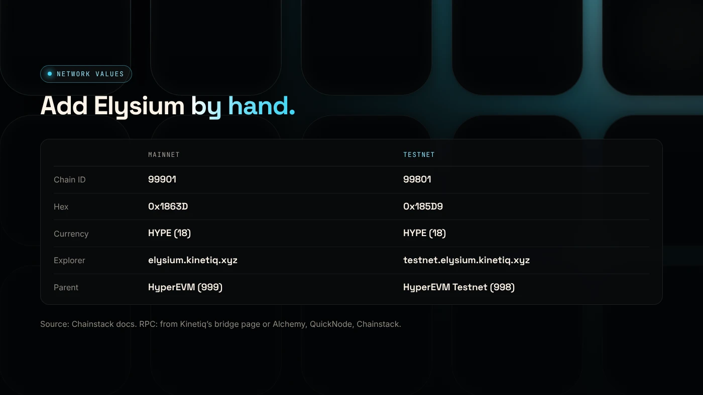
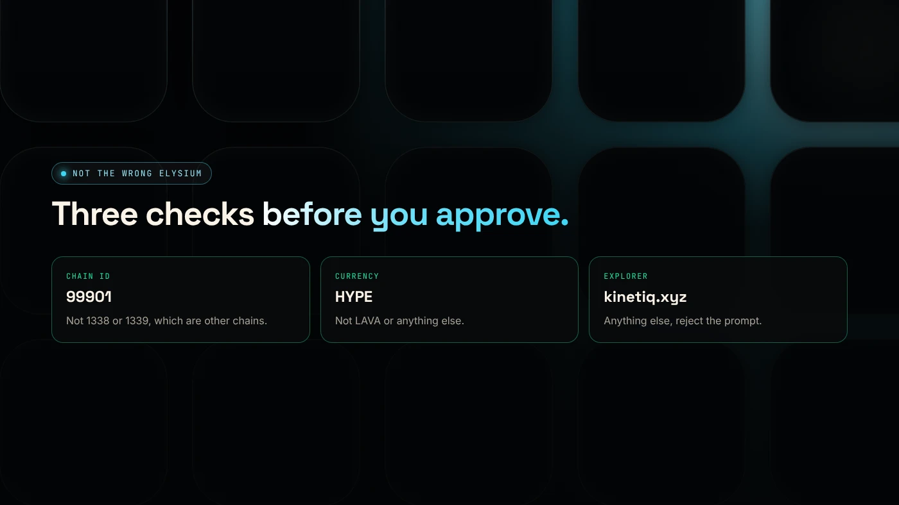

Elysium's mainnet chain ID is 99901 (hex 0x1863D) and its gas token is HYPE with 18 decimals. To add it to MetaMask, enter those values with an RPC URL from Elysium's official bridge page or a known provider, and check that the explorer is elysium.kinetiq.xyz.

:::note Key facts
- **Mainnet:** chain ID **99901** (0x1863D), symbol **HYPE**, 18 decimals.
- **Explorer:** `https://elysium.kinetiq.xyz/explorer` (Blockscout).
- **Testnet:** chain ID **99801** (0x185D9).
- **Parent chain:** HyperEVM, chain ID **999**.
- **Watch out:** chain IDs 1338 and 1339 are unrelated chains also called "Elysium".
:::

:::note Not affiliated
DegenKit is not affiliated with Kinetiq. Values below come from Chainstack's Elysium documentation and Kinetiq's launch release, as of November 10, 2026.
:::

## What are the Elysium network values?

| Field | Elysium Mainnet | Elysium Testnet |
|---|---|---|
| Network name | Elysium Mainnet | Elysium Testnet |
| Chain ID | 99901 | 99801 |
| Chain ID (hex) | 0x1863D | 0x185D9 |
| Currency symbol | HYPE | HYPE |
| Decimals | 18 | 18 |
| Block explorer | elysium.kinetiq.xyz | testnet.elysium.kinetiq.xyz |
| Parent chain | HyperEVM (999) | HyperEVM Testnet (998) |

Source: [Chainstack's Elysium tooling docs](https://docs.chainstack.com/docs/elysium-tooling).

## Where do you get an RPC URL?

An RPC URL is the address your wallet uses to talk to the chain. Kinetiq's launch release points to **elysium.kinetiq.xyz/bridge** for RPC and explorer details. Infrastructure providers including **Alchemy** (Kinetiq's primary provider), **QuickNode** and **Chainstack** offer Elysium endpoints.

Avoid RPC URLs from replies, DMs or unknown sites. A malicious RPC can show fake balances or wrong data.

## How do you add Elysium to MetaMask?

1. Open MetaMask, go to networks and choose **Add a custom network**.
2. Enter **Network name** "Elysium Mainnet", your **RPC URL**, **Chain ID** 99901, **Currency symbol** HYPE and **Block explorer URL** `https://elysium.kinetiq.xyz`.
3. Save and switch to the network. Result: your HYPE balance on Elysium shows (zero until you bridge).
4. Check a recent block on the explorer to confirm the RPC returns live data.

Wallets with built-in Elysium support, such as Zerion, skip the manual step.

## How do you avoid the wrong "Elysium"?

At least two unrelated chains also use the name. Chain IDs **1338** and **1339** belong to another project, and viem's built-in `elysiumTestnet` is that other chain, using the LAVA currency. Chainstack advises developers to define chains 99901 and 99801 manually.

If a wallet prompt shows a different chain ID, a currency other than HYPE, or an explorer outside kinetiq.xyz, reject it.

## How do developers configure Elysium?

For Foundry, Hardhat, viem or ethers, define the chain yourself: chain ID 99901, native currency HYPE with 18 decimals, your RPC URL from a provider, and the explorer at elysium.kinetiq.xyz. Chainstack notes that Multicall3 lives at its usual address on Elysium, and that the explorer exposes a Blockscout API at `elysium.kinetiq.xyz/api` for contract verification. Test against Elysium testnet (99801) first, which has its own faucet and bridge.

## What do you do after connecting?

- **Bridge HYPE** from HyperEVM to pay gas. See [how to bridge HYPE to Elysium](/blog/bridge-hype-to-elysium/).
- **Check any token** on the explorer before buying. See [how to check a new Elysium token](/blog/check-new-elysium-token/).
- **Read the basics** in [what is Elysium chain](/blog/what-is-elysium-chain/).

For other networks, our [Robinhood Chain RPC tool](/tools/robinhood-chain-rpc/) shows how a one-click add-network button works.

## What are the risks?

- **Fake RPCs** can show false balances.
- **Wrong network prompts** from look-alike chains.
- **New infrastructure.** RPC providers and explorers can be slow or briefly unavailable in a chain's first days.

You can lose money in crypto. This is not financial advice.

## FAQ

### What is the Elysium chain ID?

99901 for mainnet (0x1863D in hex) and 99801 for testnet.

### What is the Elysium gas token?

HYPE, bridged 1:1 from HyperEVM, with 18 decimals.

### Is there a public Elysium RPC?

Kinetiq's release points to its bridge page for RPC details. Alchemy, QuickNode and Chainstack offer endpoints.

## Sources

- [Chainstack: Elysium tooling](https://docs.chainstack.com/docs/elysium-tooling)
- [Kinetiq launch release (GlobeNewswire via The Manila Times)](https://www.manilatimes.net/2026/11/09/tmt-newswire/globenewswire/kinetiq-launches-elysium-public-mainnet-a-high-performance-layer-2-built-for-hyperliquid/2465340)
- [Zerion: What is Elysium](https://zerion.io/blog/what-is-elysium/)

Once connected, you can create a token with the [DegenKit Elysium token creator](/launch/elysium/), which asks your wallet to switch to chain ID 99901 for you.
