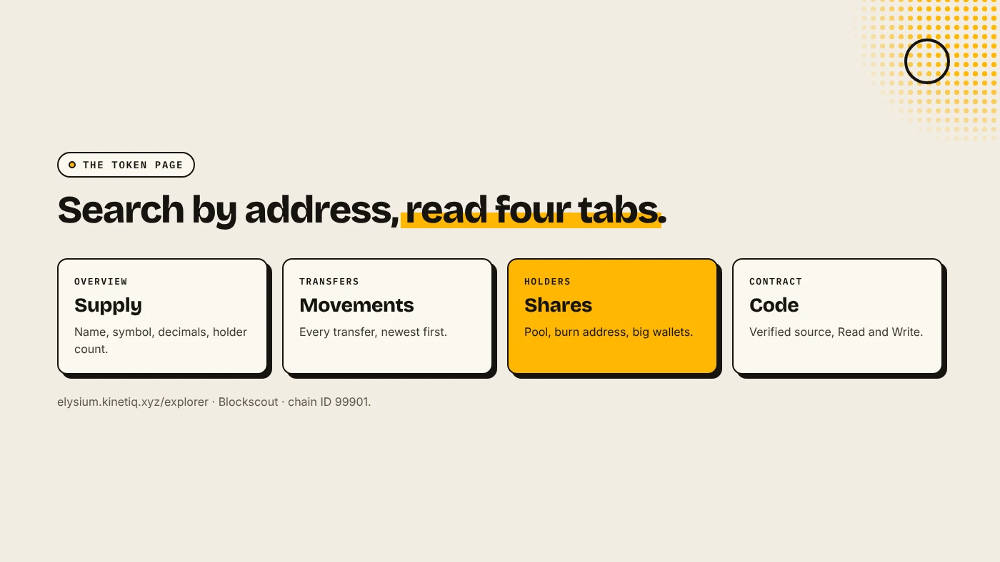
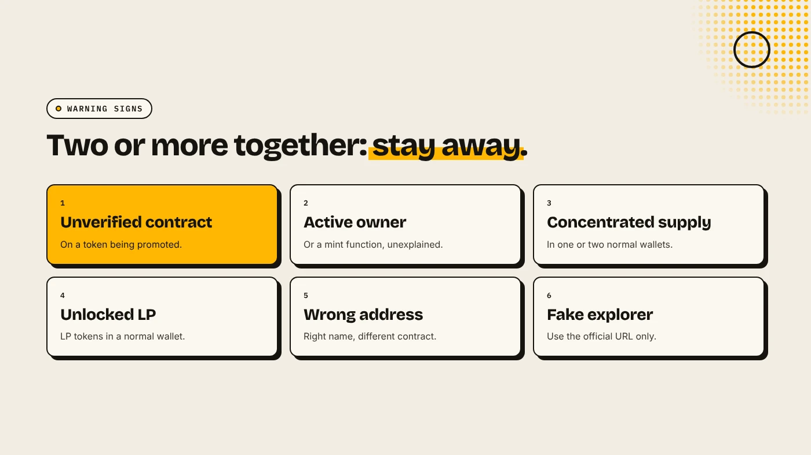

The Elysium explorer is a Blockscout instance at elysium.kinetiq.xyz/explorer. Paste a token's contract address into its search to see the token page: total supply, holders, transfers and the contract itself. On a chain this new, it is the most reliable place to check a token. It shows what is on-chain, not what a project says.

:::note Key facts
- **Explorer:** elysium.kinetiq.xyz/explorer, built on **Blockscout** (Chainstack).
- **Network:** Elysium, chain ID **99901**. Testnet is 99801.
- **Search by contract address**, not by name. Names can be copied.
- **Token logos and links** on Blockscout come from CoinGecko, CoinMarketCap or owner submissions reviewed by Blockscout (Blockscout docs).
:::

:::note Not affiliated
DegenKit is not affiliated with Kinetiq, Blockscout or Chainstack.
:::

## How do you find a token?

1. Get the **contract address** from the project's official X account or site.
2. Open elysium.kinetiq.xyz/explorer.
3. Paste the address into the search and open the **token** result.
4. Check that the page says Elysium and the address matches exactly.

If you are the creator, your contract address appears right after creation on [DegenKit's Elysium launcher](/launch/elysium/).

## What does each part of the token page show?

| Section | What to look at |
|---|---|
| Overview | Name, symbol, total supply, decimals, holder count |
| Transfers | Every movement of the token, newest first |
| Holders | Each wallet's balance and share of supply |
| Contract | Source code if verified, plus Read and Write functions |

Our general guide to [reading a token page on Etherscan or Blockscout](/blog/read-token-page-etherscan-blockscout/) explains each tab in detail. The steps are the same on Elysium.

## What should you check on the Holders tab?

- **The Uniswap pair address** is usually one of the top holders. That is the pool and is expected.
- **A burn address** such as 0x…dEaD holding tokens means those tokens are gone.
- **One normal wallet with a large share** can sell into the pool at any time.
- **For the LP itself**, open the pair contract and check who holds the LP tokens. See [Elysium liquidity lock](/blog/elysium-liquidity-lock/).

## What should you check on the Contract tab?

- **Is the source verified?** A verified contract lets anyone read the code. An unverified one hides it.
- **Read functions** such as `owner` show whether an owner still exists. For a tax token, the buy and sell rates appear here too.
- **Write functions** are for the owner. Never connect your wallet to them unless you are the owner and know what you are doing.

A token made with DegenKit's Token Creator has fixed supply, no owner and no mint function. A Tax Token has an owner until it is renounced. See [the Elysium tax token guide](/blog/elysium-tax-token/).

## What are the warning signs?

- **An unverified contract** on a token that is being promoted.
- **A mint function** or an active owner with no public explanation.
- **Most of the supply in one or two normal wallets.**
- **LP tokens in a normal wallet** instead of a locker or burn address.
- **A token page with the right name but a different address** from the official one.

## What are the risks?

- **New chain.** Explorer data and labels are still sparse.
- **Fake explorers.** Use the official address from Kinetiq or Chainstack's documentation.
- **Logos prove nothing.** Anyone can copy a token's name and image.

You can lose money in crypto. This is not financial advice.

## FAQ

### What is the Elysium block explorer?

A Blockscout explorer at elysium.kinetiq.xyz/explorer for Elysium, chain ID 99901.

### How do I check holders of an Elysium token?

Search the contract address and open the Holders tab.

### Why doesn't my token have a logo on the explorer?

Blockscout takes logos from CoinGecko, CoinMarketCap or owner submissions it reviews. New tokens usually start without one.

## Sources

- [Chainstack: Elysium tooling](https://docs.chainstack.com/docs/elysium-tooling)
- [Blockscout docs: Token info](https://docs.blockscout.com/using-blockscout/overviews/token-info)
- [Kinetiq launch release (GlobeNewswire via The Manila Times)](https://www.manilatimes.net/2026/11/09/tmt-newswire/globenewswire/kinetiq-launches-elysium-public-mainnet-a-high-performance-layer-2-built-for-hyperliquid/2465340)

Create a token with fixed supply and no owner on the [DegenKit Elysium token creator](/launch/elysium/).
