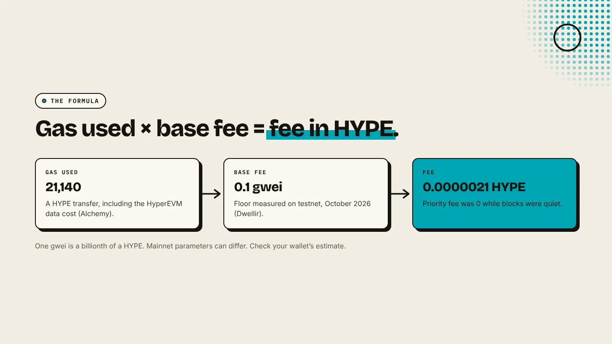
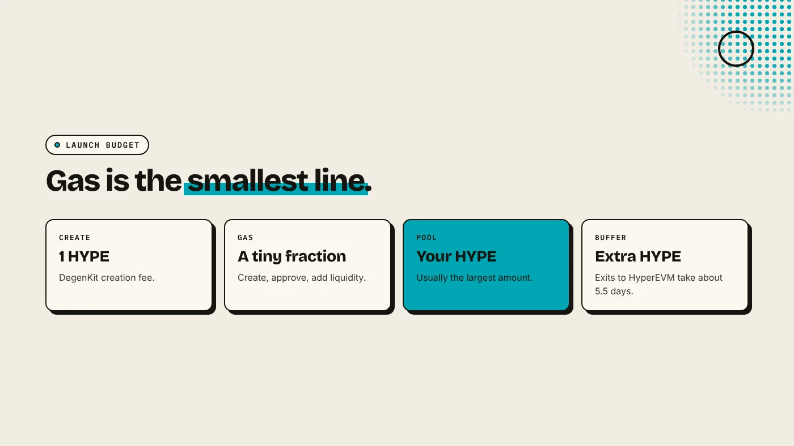

Gas fees on Elysium are paid in HYPE and are very small. Elysium uses an Ethereum-style base fee plus an optional priority fee, and a testnet measurement put the base fee floor at 0.1 gwei. At that rate, a plain HYPE transfer costs about 0.0000021 HYPE. For a token launch, the creation fee and your pool liquidity cost far more than gas.

:::note Key facts
- **Gas token:** HYPE, bridged 1:1 from HyperEVM, with no wrapper (Kinetiq release).
- **Base fee floor:** **0.1 gwei**, measured on testnet in October 2026 (Dwellir). Mainnet parameters can differ.
- **Plain transfer:** about **21,140 gas**, including the cost of posting data to HyperEVM (Alchemy).
- **Ordering:** a single sequencer sorts each block by priority fee, with no privileged lanes (QuickNode).
:::

:::note Not affiliated
DegenKit is not affiliated with Kinetiq, Hyperliquid, Alchemy, QuickNode or Dwellir. Figures are early measurements on a chain that launched on November 9, 2026.
:::

## How are gas fees calculated on Elysium?

Elysium is an Arbitrum Orbit chain, so a fee works like on Ethereum and Arbitrum:

**fee = gas used × (base fee + priority fee)**

- **Gas used** depends on what the transaction does. Alchemy notes that Elysium's Nitro stack adds the cost of posting the transaction to HyperEVM, shown as `gasUsedForL1` in the receipt. That is why a plain transfer uses about 21,140 gas, not Ethereum's 21,000.
- **Base fee** rises with congestion and falls to a floor. Dwellir measured a floor of 0.1 gwei on testnet, and QuickNode's sample `eth_baseFee` response is the same 0.1 gwei.
- **Priority fee** is optional. Dwellir saw it at 0 on testnet because blocks were not full.

## What does a transaction cost?

At the measured 0.1 gwei floor:

| Transaction | Approx. gas | Approx. fee in HYPE |
|---|---|---|
| HYPE transfer | 21,140 | 0.0000021 |
| Token approval | ~50,000 | 0.000005 |
| Uniswap swap | ~150,000 | 0.000015 |

Only the transfer figure is measured (Alchemy). The approval and swap gas figures are typical Ethereum values, so treat those rows as rough guides. Your wallet shows the real estimate before you sign.

Why so low? Elysium uses **AnyTrust** data availability. A committee stores the full data, and only a small certificate is posted to HyperEVM. That avoids paying HyperEVM gas for every byte, at the cost of trusting the committee.

## What does a token launch cost on Elysium?

For a launch, gas is the smallest line:

- **Creation fee:** **1 HYPE** on [DegenKit's Elysium token creator](/launch/elysium/).
- **Gas** for creating the token, approving it and adding liquidity: a tiny fraction of a HYPE at current base fees.
- **Pool liquidity:** the HYPE you pair with your token on Uniswap. This is usually by far the largest amount.

Keep a little extra HYPE on Elysium for later transactions. Bridging back to HyperEVM takes about 5.5 days. See [how to bridge HYPE to Elysium](/blog/bridge-hype-to-elysium/).

## How do Elysium fees compare with HyperEVM?

Both use HYPE for gas and an Ethereum-style fee model. The difference is capacity. HyperEVM's fast blocks hold 3 million gas and its large blocks 30 million. Kinetiq targets 300 million gas per second on Elysium, with 100 ms blocks. More room per second means less competition for space, which keeps the base fee near its floor. See [Elysium vs HyperEVM](/blog/elysium-vs-hyperevm/).

## Do you need a priority fee?

Usually not. The sequencer sorts transactions within a block by priority fee, so a tip only matters when many transactions compete for the same moment, such as the first block after a popular launch. Kinetiq has said a dedicated trading lane and Timeboost are planned, which could change how ordering works.

## What are the risks?

- **Early figures.** The 0.1 gwei floor was measured on testnet. Check your wallet's estimate on mainnet.
- **Congestion spikes.** The base fee rises when demand surges.
- **Single sequencer.** One operator orders transactions at launch.
- **Stuck HYPE.** Exits to HyperEVM take about 5.5 days, so do not bridge only your exact gas.

You can lose money in crypto. This is not financial advice.

## FAQ

### What token pays gas on Elysium?

HYPE. It is the native gas token, bridged 1:1 from HyperEVM.

### Why did my transfer use more than 21,000 gas?

Elysium adds the cost of posting your transaction to HyperEVM, so a plain transfer uses about 21,140 gas.

### How much HYPE do I need to launch a token on Elysium?

1 HYPE for DegenKit's creation fee, a small amount for gas, and the HYPE you want in your pool.

## Sources

- [Alchemy: Elysium API FAQ](https://www.alchemy.com/docs/reference/elysium-api-faq)
- [Dwellir: What is Elysium](https://www.dwellir.com/blog/what-is-elysium)
- [QuickNode: What is Elysium](https://www.quicknode.com/guides/hyperliquid/what-is-elysium)
- [QuickNode: eth_baseFee on Elysium](https://www.quicknode.com/docs/elysium/eth_baseFee)
- [Kinetiq launch release (GlobeNewswire via The Manila Times)](https://www.manilatimes.net/2026/11/09/tmt-newswire/globenewswire/kinetiq-launches-elysium-public-mainnet-a-high-performance-layer-2-built-for-hyperliquid/2465340)

Budget your launch and create the token with the [DegenKit Elysium token creator](/launch/elysium/).
