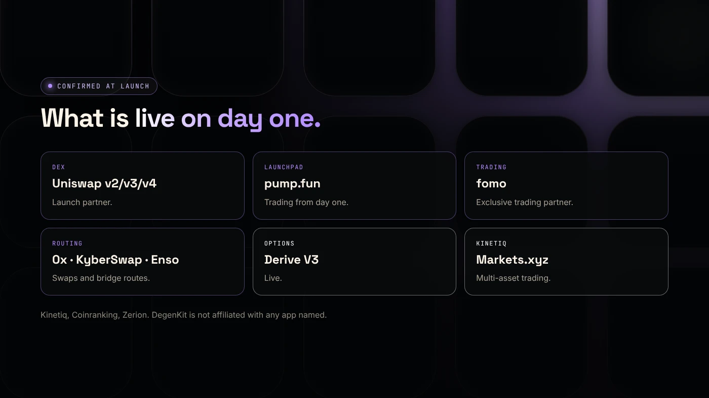
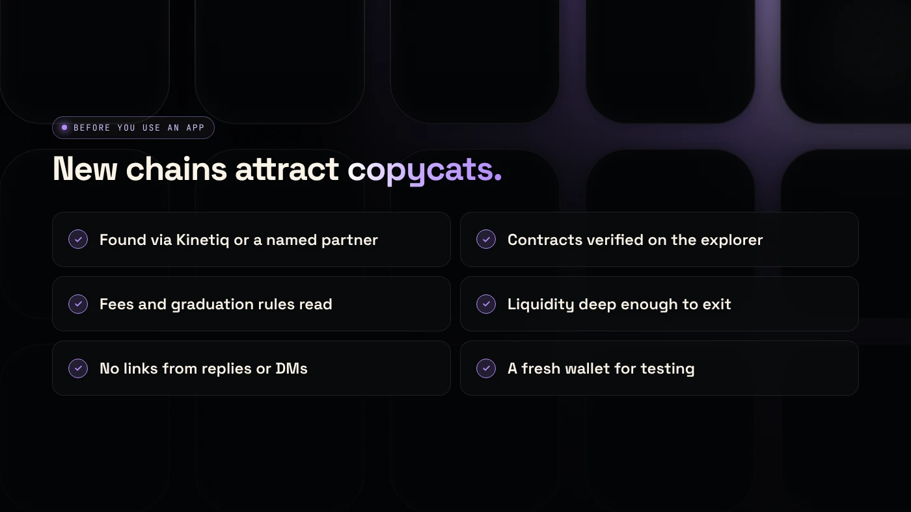

At launch on November 9, 2026, Elysium's confirmed apps included Uniswap v2, v3 and v4, pump.fun, fomo, 0x and KyberSwap routing, Enso, Derive V3 options and Markets.xyz. Third-party sites also list community launchpads, which are not confirmed by Kinetiq and need checking before use.

:::note Key facts
- **DEX:** Uniswap v2, v3 and v4, a launch partner.
- **Launchpad:** pump.fun confirmed trading support from day one.
- **Trading:** fomo is Elysium's exclusive trading partner.
- **Routing and more:** 0x, KyberSwap, Enso, Derive V3 and Markets.xyz by Kinetiq.
- **Unverified:** community launchpads listed on third-party screeners.
:::

:::note Not affiliated
DegenKit is not affiliated with Kinetiq, pump.fun, Uniswap, fomo or any app named here.
:::

## Which apps are confirmed?

From Kinetiq's release, [Coinranking](https://coinranking.com/news/elysium-layer-2-mainnet-launches-november-9-trading-apps) and [Zerion](https://zerion.io/blog/what-is-elysium/):

| App | What it does | Status at launch |
|---|---|---|
| Uniswap v2, v3, v4 | DEX pools and swaps | Live, launch partner |
| pump.fun | Bonding-curve token launchpad | Trading support from day one |
| fomo | Trading app | Exclusive trading partner |
| 0x | Swap routing | Apps on 0x can swap |
| KyberSwap | Aggregator | Ready to operate |
| Enso | Routing, used by the official bridge | Live |
| Derive V3 | Options | Live |
| Markets.xyz | Kinetiq's multi-asset trading | Live |

Zerion also lists day-one wallet support for Elysium.

## What about community launchpads?

The third-party screener [ElyScreener](https://elyscreener.com/learn/elysium-mainnet-day-playbook/) lists several community launchpads and says new coins appear throughout the day. These are **not confirmed by Kinetiq**, and we have not checked their contracts.

Before using any launchpad on a days-old chain:

- Find it through **Kinetiq's official channels** or a named partner, not a reply or DM.
- Check that its contracts are **verified** on the Elysium explorer.
- Read how the curve, fees and graduation work.

## How does pump.fun on Elysium compare to a token creator?

Pump.fun sells a new coin on a bonding curve until it graduates to a pool. A token creator gives the creator the full supply, and the creator adds liquidity on a DEX such as Uniswap. Our explainers on [what pump.fun is](/blog/what-is-pump-fun/) and [launchpad vs token generator](/blog/pons-launchpad-vs-token-generator/) describe the trade-offs on Solana and Robinhood Chain. The same logic applies on Elysium.

## How do you use Uniswap on Elysium?

Uniswap's interface lets you switch networks like on any other chain. Pick Elysium, connect a wallet holding HYPE for gas, and swap or open a position. The same version choices apply as on other Arbitrum-based chains: v2 for simple full-range pools and any fee-on-transfer token, v3 or v4 for range positions. Our [Uniswap v2, v3 or v4 guide](/blog/robinhood-chain-uniswap-v2-v3-v4/) explains the trade-offs, and they carry over to Elysium unchanged. Always check that the token address you trade matches the project's official post.

## What should you watch in the first weeks?

- **Liquidity depth.** ElyScreener's example: with $3,000 of liquidity, a $500 buy moves the price about 50%.
- **Bots in the first block.** Early price spikes may not be buyable.
- **The HyperCore upgrade** planned about four weeks after launch, which could bring new trading apps.

## What are the risks?

- **Unverified apps** and copycat front-ends.
- **Thin liquidity** and fast price moves.
- **New contracts** without long track records.
- **Most new memecoins go to zero,** ElyScreener warns.

You can lose money in crypto. This is not financial advice.

## FAQ

### What DEX is on Elysium?

Uniswap v2, v3 and v4 launched with Elysium as a launch partner. 0x and KyberSwap provide routing.

### Is pump.fun on Elysium?

Yes. Pump.fun confirmed trading support on Elysium from day one, according to Coinranking and Zerion.

### Can I create a token on Elysium?

Yes, with a launchpad, with DegenKit's no-code [Elysium token creator](/launch/elysium/), or by deploying an ERC-20 yourself. See the [Elysium token creator guide](/blog/elysium-token-creator/).

## Sources

- [Coinranking: Elysium mainnet goes live with trading apps](https://coinranking.com/news/elysium-layer-2-mainnet-launches-november-9-trading-apps)
- [Zerion: What is Elysium](https://zerion.io/blog/what-is-elysium/)
- [ElyScreener: Elysium mainnet day playbook](https://elyscreener.com/learn/elysium-mainnet-day-playbook/)
- [Kinetiq launch release (GlobeNewswire via The Manila Times)](https://www.manilatimes.net/2026/11/09/tmt-newswire/globenewswire/kinetiq-launches-elysium-public-mainnet-a-high-performance-layer-2-built-for-hyperliquid/2465340)

To create a token with the full supply in your own wallet, use the [DegenKit Elysium token creator](/launch/elysium/).
