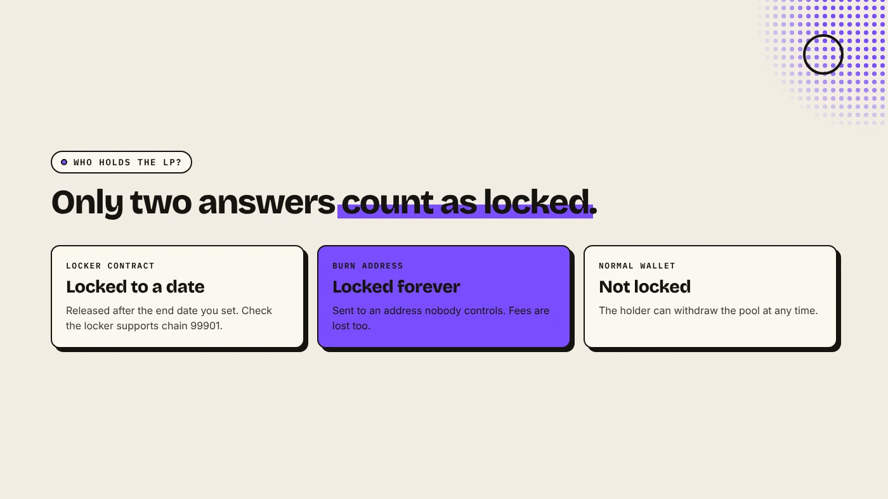
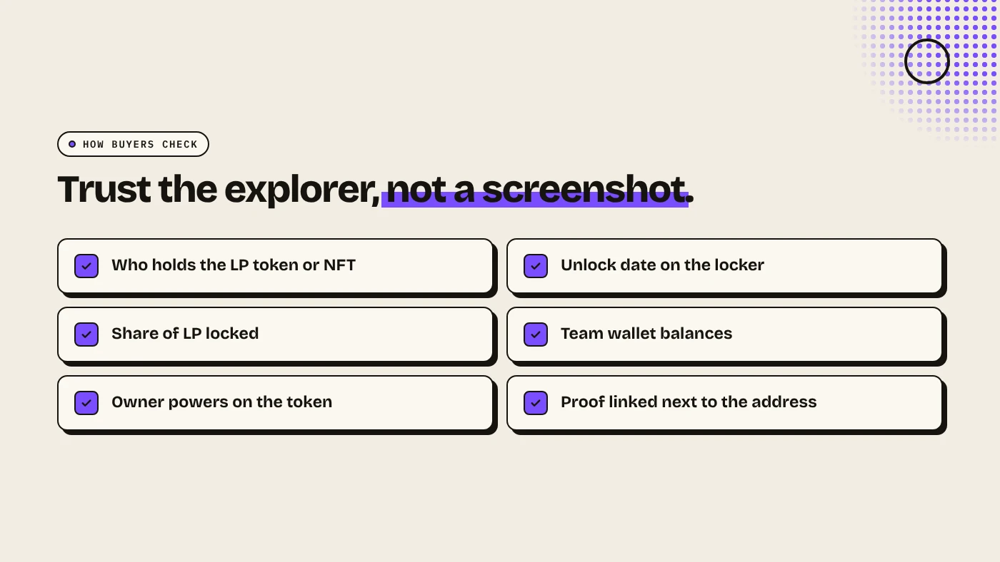

To lock liquidity on Elysium, add your token and HYPE to a Uniswap pool, then send the receipt (an LP token on v2, a position NFT on v3 or v4) to a locker contract with an end date, or to a burn address. Buyers check the lock by seeing who holds the LP on the Elysium explorer.

:::note Key facts
- **Uniswap v2** gives an ERC-20 **LP token**. **v3 and v4** give a **position NFT**.
- **Two ways to lock:** a **time-lock** contract with an end date, or a **burn** to an address nobody controls.
- **Lockers on a new chain:** check that a locker supports Elysium, chain ID **99901**, before you send anything.
- **DegenKit** creates the token. You add liquidity on Uniswap and choose how to lock it.
:::

:::note Not affiliated
DegenKit is not affiliated with Kinetiq, Hyperliquid or Uniswap.
:::

## Why lock liquidity on Elysium?

Whoever holds the LP receipt can withdraw the pool's token and HYPE at any time. If a creator withdraws after people buy, buyers are left with a token they cannot sell. That is a classic rug pull. Locking or burning the receipt removes that option.

On Elysium, it matters more than usual. The chain launched on November 9, 2026, few tools track locks yet, and exits to HyperEVM take about 5.5 days. Buyers have every reason to be cautious. A visible lock answers their first question.

## Lock or burn?

| | Time-lock | Burn |
|---|---|---|
| Can you withdraw later? | After the end date | Never |
| Trading fees | Locker-dependent | Lost with the LP |
| Signal to buyers | Strong until the date | Strongest |
| Needs a third party | Yes, a locker contract | No |

**Burn** suits a meme coin with no plans to move liquidity. **Time-lock** suits a project that may need to migrate or add liquidity later. Check whether a locker supports Elysium before you choose it. On a new chain, not every service has deployed yet.

## How do you lock liquidity for your own token?

1. **Create the token** on [DegenKit's Elysium launcher](/launch/elysium/) for 1 HYPE. The full supply goes to your wallet. See the [Elysium token creator guide](/blog/elysium-token-creator/).
2. **Add liquidity on Uniswap** with your token and HYPE. Use **v2** for a tax token. Result: you receive an LP token (v2) or a position NFT (v3 or v4).
3. **Lock or burn.** For a locker, follow its steps and choose an end date. To burn a v2 LP token, send it to a burn address such as `0x000…dEaD`.
4. **Publish the proof.** Share the lock page or the burn transaction on the Elysium explorer next to your contract address.

Burning is permanent. You give up the pool share and any trading fees it would earn.

## How can buyers check a lock?

1. Open the token on the Elysium explorer and find its Uniswap pool.
2. **v2:** open the pair contract and check its **holders**. LP in a locker or burn address means locked. LP in a normal wallet means it is not locked.
3. **v3 or v4:** find the position NFT and check its **owner**.
4. **Locker:** check the **unlock date** and the share of LP locked.

Our guide to [checking a new Elysium token](/blog/check-new-elysium-token/) covers the other checks, and [reading a token page on Blockscout](/blog/read-token-page-etherscan-blockscout/) shows where to click.

## What can a lock not tell you?

- **It does not cover the supply.** A team can still sell its own tokens into the pool.
- **It expires.** A one-week lock protects buyers for one week.
- **It may be partial.** Only part of the LP may be locked.
- **Owner powers.** A tax token's owner may still change rates until ownership is renounced. See [the Elysium tax token guide](/blog/elysium-tax-token/).

## What are the risks?

- **Locker risk.** A lock depends on the locker contract working as described.
- **Burn is final.** Burned liquidity and its fees cannot be recovered.
- **Fake proof.** Screenshots can be faked. Trust only what the explorer shows.

You can lose money in crypto. This is not financial advice.

## FAQ

### How do I lock liquidity on Elysium?

Add liquidity on Uniswap, then send the LP token or position NFT to a locker that supports Elysium, or to a burn address.

### How do I check if an Elysium token's liquidity is locked?

Find its pool on the Elysium explorer and check who holds the LP token or position NFT.

### Does DegenKit lock liquidity on Elysium?

No. DegenKit creates the token. You add and lock liquidity yourself.

## Sources

- [Uniswap: Token integration issues (v3)](https://developers.uniswap.org/docs/protocols/v3/concepts/unsupported-tokens)
- [Coinranking: Elysium mainnet goes live with trading apps](https://coinranking.com/news/elysium-layer-2-mainnet-launches-november-9-trading-apps)
- [Chainstack: Elysium tooling](https://docs.chainstack.com/docs/elysium-tooling)
- [TokenPost: Elysium launch](https://www.tokenpost.com/news/technology/52986)

Create a token you fully control with the [DegenKit Elysium token creator](/launch/elysium/).
