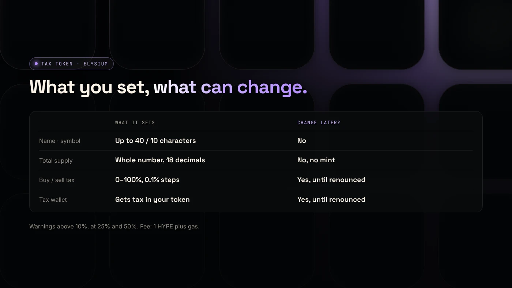
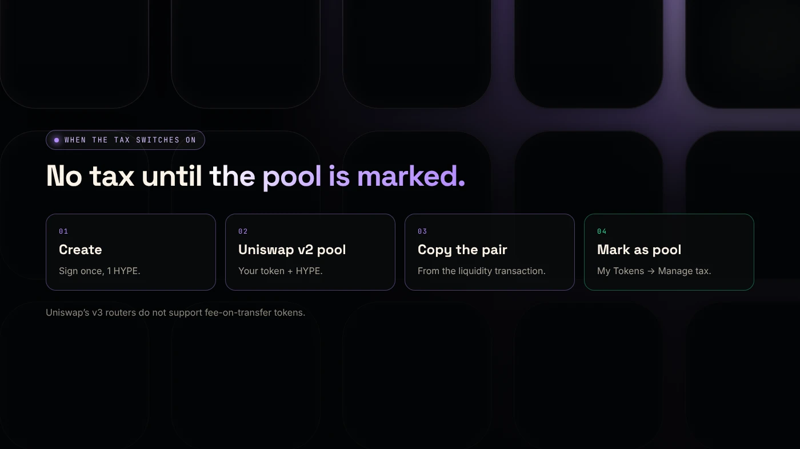

To create an Elysium tax token, use the **Tax Token** tool in DegenKit's Elysium token creator: set a buy and sell rate, choose the wallet that receives the tax, and sign once in HYPE. The tax only starts after you add a Uniswap v2 pool and mark it in **My Tokens**.

:::note Key facts
- **Rates:** any buy and sell tax from **0% to 100%**, in steps of 0.1%. Paid in your token to the tax wallet.
- **Warnings** above 10%, at 25% and at 50%.
- **No** mint function, blacklist, pause or trading switch.
- **Use a Uniswap v2 pool.** Uniswap's v3 routers do not support fee-on-transfer tokens.
- **Fee:** 1 HYPE creation fee plus gas (as of November 2026).
:::

:::note Not affiliated
DegenKit is not affiliated with Kinetiq, Hyperliquid or Uniswap.
:::

## How does a tax token work?

A tax token takes a share of each **buy** and **sell** against a pool and sends it to a **tax wallet**, paid in your token. Wallet-to-wallet transfers are not taxed. The owner can change rates and the tax wallet until they **renounce** ownership.

This is different from Solana's Token-2022 transfer fee, which charges every transfer. See [how buy and sell taxes work](/blog/how-token-buy-sell-tax-works/) for the mechanics.

## How do you create one on Elysium?

1. Open the [Elysium launcher](/launch/elysium/), click **Connect wallet** and approve the switch to chain ID 99901.
2. Choose **Tax Token** in the sidebar.
3. Fill in **Token name**, **Symbol** and **Total supply**. These are permanent.
4. Set **Buy tax** and **Sell tax**. Set one to 0% to switch that side off. Result: warnings appear if a rate passes 10%, 25% or 50%.
5. Enter a **Tax wallet**, or leave it empty to use your own wallet.
6. Check the summary and the **1 HYPE** fee, then sign. Result: the **Contract address** appears.

## Why does the tax need a v2 pool and a mark?

Right after creation, **no trade is taxed**. The contract only taxes trades against pools you have marked.

1. **Add liquidity on Uniswap v2** with your token and HYPE. Uniswap is live on Elysium. Uniswap's documentation says fee-on-transfer tokens "will not function" with its v3 routers ([Uniswap docs](https://developers.uniswap.org/docs/protocols/v3/concepts/unsupported-tokens)), so v2 is the safe choice.
2. **Copy the pair address** from the liquidity transaction on the Elysium explorer.
3. Open **My Tokens → Manage tax**, paste it and choose **Mark as pool**.

From the next trade, buys and sells against that pool are taxed. See [Uniswap v2, v3 or v4](/blog/robinhood-chain-uniswap-v2-v3-v4/). The comparison is written for Robinhood Chain and applies the same way on Elysium.

## What can the owner change later?

From **My Tokens**, the owner wallet can:

- change the **buy and sell rates**,
- change the **tax wallet**,
- **mark or unmark** pools,
- **transfer** or **renounce** ownership.

Renouncing freezes all of these forever. On a days-old chain, buyers often trust a token more once the rates are final. Our guide to [managing a tax token](/blog/manage-tax-token-renounce-ownership/) explains each control.

## What rate should you choose?

Most projects stay at a few percent. Above 10%, buyers tend to avoid a token. At 25% and above, scanners may flag it. At 50% and above, it is practically untradable. Ask one question first: **what will the tax pay for?** If you cannot answer clearly, a plain token from the [Elysium token creator](/blog/elysium-token-creator/) is the better launch.

## What are the risks?

- **Owner power.** While you own the token, you can raise its tax, and buyers know it.
- **Wrong pool type.** A tax token in a v3 pool may fail to trade.
- **Unmarked pool.** Without marking, no tax is collected.
- **New chain.** Elysium is days old, and exits to HyperEVM take about 5.5 days.

You can lose money in crypto. This is not financial advice.

## FAQ

### Is the tax paid in HYPE?

No. It is paid in your token, to the tax wallet.

### Can I create a tax token with 0% tax?

Yes. You can start at 0% and raise the rates later, as long as you still own the token.

### Can I add a tax to a plain token later?

No. A token made with Token Creator has no owner and no tax logic. Choose Tax Token at creation.

## Sources

- [Uniswap: Token integration issues (v3)](https://developers.uniswap.org/docs/protocols/v3/concepts/unsupported-tokens)
- [Kinetiq launch release (GlobeNewswire via The Manila Times)](https://www.manilatimes.net/2026/11/09/tmt-newswire/globenewswire/kinetiq-launches-elysium-public-mainnet-a-high-performance-layer-2-built-for-hyperliquid/2465340)
- [Coinranking: Elysium mainnet goes live with trading apps](https://coinranking.com/news/elysium-layer-2-mainnet-launches-november-9-trading-apps)

To set up a tax token, open **Tax Token** in the [DegenKit Elysium token creator](/launch/elysium/).
