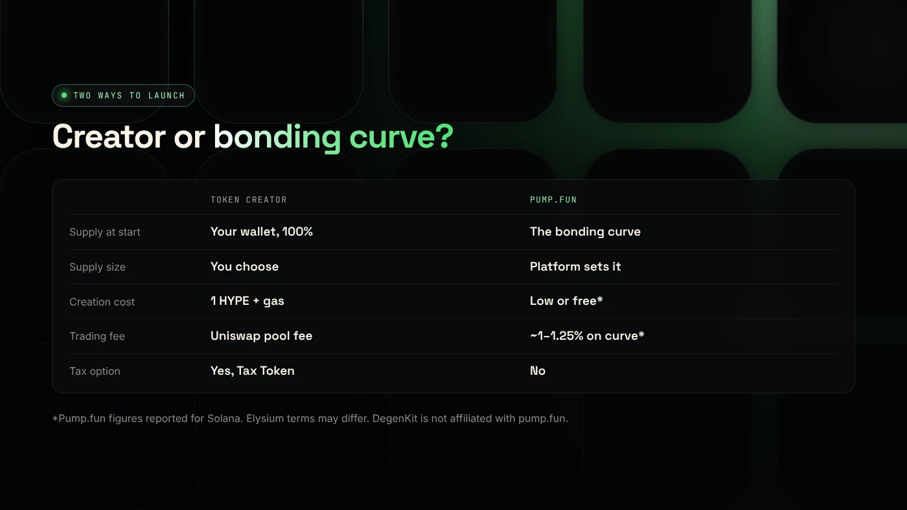
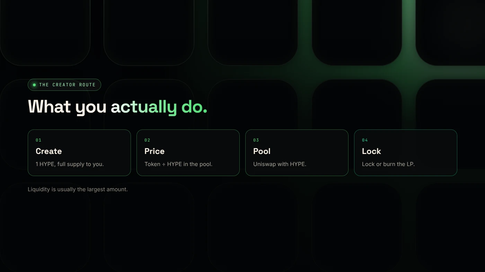

On Elysium, a token creator such as DegenKit's makes an ERC-20 and sends you the full supply, and you decide the pool, starting price and lock. Pump.fun, which supported Elysium from day one, instead sells a new coin on a bonding curve until it graduates to a pool. Choose the creator for control, pump.fun for speed.

:::note Not affiliated
DegenKit is not affiliated with pump.fun, Kinetiq or Hyperliquid. Pump.fun's mechanics below are as reported for Solana in 2026. Its terms on Elysium may differ, so check its site.
:::

:::note Key facts
- **Token creator (DegenKit):** full supply to you, fixed supply, no owner, **1 HYPE** fee, liquidity added by you on Uniswap.
- **Pump.fun:** confirmed trading support on Elysium from day one (Coinranking, Zerion).
- **On Solana**, pump.fun uses a 1 billion supply, graduates at about 85 SOL, and fewer than 2% of coins graduate (crypto.news).
:::

## How does each one work?

**A token creator** deploys a standard ERC-20 from a form. On DegenKit's [Elysium launcher](/launch/elysium/), you set the name, symbol and supply, pay 1 HYPE plus gas, and receive 100% of the supply. You then add liquidity on Uniswap with HYPE at a price you choose. See the [Elysium token creator guide](/blog/elysium-token-creator/).

**Pump.fun** creates a coin and sells it from a **bonding curve**, a formula that raises the price with each buy. On Solana, about 800 million of 1 billion tokens sell on the curve, and the rest form a pool when the coin graduates ([crypto.news](https://crypto.news/how-meme-coins-are-made-bonding-curves-pump-fun-rug-pulls/)). Pump.fun confirmed trading support on Elysium at launch ([Coinranking](https://coinranking.com/news/elysium-layer-2-mainnet-launches-november-9-trading-apps)).

## How do they compare side by side?

| | Elysium token creator (DegenKit) | Pump.fun |
|---|---|---|
| Who holds supply at start | Your wallet, 100% | The bonding curve |
| Supply | You choose | Set by the platform |
| Creation cost | 1 HYPE + gas | Low or free (on Solana) |
| Trading fee | Uniswap pool fee only | About 1–1.25% on the curve (on Solana) |
| Price discovery | Your own Uniswap pool | Curve, then a pool |
| Tax option | Yes, with Tax Token | Not offered |
| Liquidity lock | Your choice: lock or burn LP | LP burned at graduation (on Solana) |
| Owner powers | None (Token Creator) | Set by the platform |

## Which should you choose?

**Choose the token creator if** you want to:

- set your own supply,
- keep 100% at the start for a community allocation or airdrop,
- add a buy and sell tax with [Tax Token](/blog/elysium-tax-token/),
- choose the starting price and pair on Uniswap,
- lock or burn the LP on your own schedule.

**Choose pump.fun if** you want the fastest start with little upfront cost, are happy with platform-set supply and curve pricing, and accept trading fees.

## What does the token creator route cost in full?

- **1 HYPE** creation fee, plus gas.
- **Your liquidity:** the token and HYPE you deposit on Uniswap. This is usually the largest amount.
- **Optional:** a lock service, or gas to burn LP.

Keep extra HYPE on Elysium for later transactions. Bridging out takes about 5.5 days. See [how to bridge HYPE to Elysium](/blog/bridge-hype-to-elysium/).

## What are the risks?

- **On any route,** most new memecoins on a new chain lose value quickly.
- **With a creator,** you are responsible for liquidity. A thin pool swings hard, and unlocked LP can be withdrawn.
- **With a curve,** early bots and bundled buys can take much of the supply.
- **Copycats.** Only the contract address identifies a token.

You can lose money in crypto. This is not financial advice.

## FAQ

### Is pump.fun on Elysium?

Yes. Pump.fun confirmed trading support on Elysium from launch day, November 9, 2026, according to Coinranking and Zerion.

### Which is cheaper, a token creator or pump.fun?

Pump.fun usually costs less up front but charges on trades. A token creator charges once (1 HYPE on DegenKit) and has no platform trading fee.

### Can I move a pump.fun coin to my own pool?

Not before graduation. On a token creator, you control the pool from the start.

## Sources

- [Coinranking: Elysium mainnet goes live with trading apps](https://coinranking.com/news/elysium-layer-2-mainnet-launches-november-9-trading-apps)
- [Zerion: What is Elysium](https://zerion.io/blog/what-is-elysium/)
- [crypto.news: How meme coins are made, bonding curves and pump.fun](https://crypto.news/how-meme-coins-are-made-bonding-curves-pump-fun-rug-pulls/)

For full control of supply and liquidity, use the [DegenKit Elysium token creator](/launch/elysium/).
