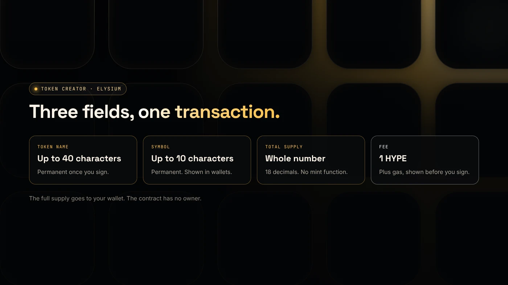
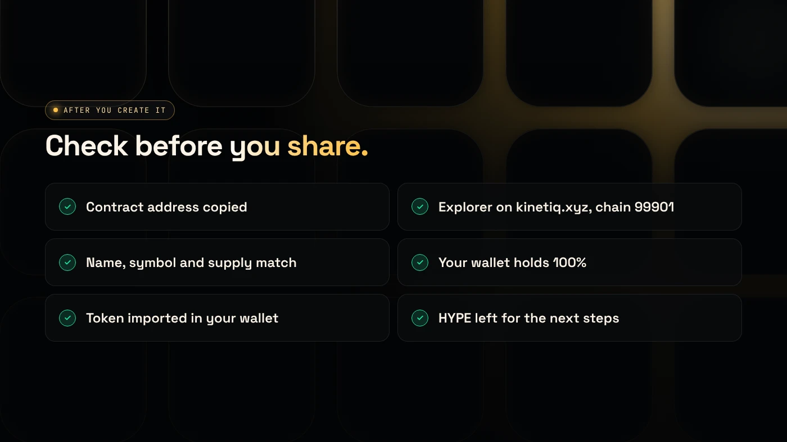

An Elysium token creator makes an ERC-20 token on Elysium from a short form, with no code: you enter a name, symbol and supply, sign one transaction paid in HYPE, and the full supply lands in your wallet. DegenKit's Elysium token creator does this for a 1 HYPE creation fee plus gas.

:::note Key facts
- **Network:** Elysium, Kinetiq's Hyperliquid layer 2, chain ID **99901**, gas in **HYPE**.
- **Token type:** standard ERC-20, **18 decimals**, fixed supply, **no mint function**, no owner.
- **Cost:** **1 HYPE** creation fee plus gas, shown before you sign (as of November 2026).
- **Also available:** Tax Token and My Tokens, the same tools as on Robinhood Chain.
- **Custody:** non-custodial. You sign in your own wallet.
:::

:::note Not affiliated
DegenKit is not affiliated with Kinetiq or Hyperliquid. Elysium launched on November 9, 2026.
:::

## What does an Elysium token creator do?

Elysium is EVM-compatible, so a token there is a normal **ERC-20**, the same standard used on Ethereum and its layer 2s ([EIP-20](https://eips.ethereum.org/EIPS/eip-20)). Wallets, the Elysium explorer and Uniswap, which is live on Elysium, already understand it.

A token creator replaces the Solidity code with a form. Your choices go to a **factory contract**, which deploys the token and sends the full supply to your wallet in one transaction. You do not need Foundry, Hardhat or a compiler.

The creator does not add liquidity. A new token has no price until someone opens a pool. See [how to launch a token on Elysium](/blog/launch-a-token-on-elysium/) for the full sequence.

## What do you need before you start?

- **An EVM wallet** such as MetaMask, Rabby or Zerion.
- **HYPE on Elysium** for the 1 HYPE fee and gas. HYPE on HyperEVM must be bridged first. See [how to bridge HYPE to Elysium](/blog/bridge-hype-to-elysium/).
- **Your details:** name (up to 40 characters), symbol (up to 10 characters) and total supply. These are permanent.

DegenKit asks your wallet to add and switch to Elysium. Check that the prompt says chain ID **99901** and currency **HYPE**. Other chains named "Elysium" use different IDs. See [Elysium chain ID and RPC](/blog/elysium-chain-id-rpc-metamask/).

## How do you create a token on Elysium?

1. Open the [Elysium token creator](/launch/elysium/) and click **Connect wallet**. Result: your address appears.
2. Approve the switch to Elysium (chain ID 99901). Result: your wallet shows your HYPE balance on Elysium.
3. Choose **Token Creator** in the sidebar. Result: the form opens with a default supply of 1,000,000,000.
4. Fill in **Token name**, **Symbol** and **Total supply**. Result: the button changes to **Create token**.
5. Check the summary and the **1 HYPE** fee, click **Create token** and confirm in your wallet. Result: the **Contract address** appears with a copy button.
6. Open the token on the Elysium explorer. Result: your name, symbol, supply and wallet holding 100%.

## Which settings are permanent?

All of them, for a token made with **Token Creator**. The contract has **no owner and no mint function**, so nobody can change the name or symbol, add supply, freeze wallets or pause trading. That includes you and DegenKit. Buyers on a days-old chain look for exactly this.

If you want a buy and sell tax you can adjust, choose **Tax Token** instead. It adds an owner who can change rates until they renounce. See [how to create a tax token on Elysium](/blog/elysium-tax-token/).

## Token creator or launchpad?

Launchpads such as pump.fun, which supports Elysium, sell a new coin on a bonding curve and set the supply for you. A token creator gives you the full supply and lets you choose the pool, starting price and lock. Compare them in [Elysium token creator vs pump.fun](/blog/elysium-token-creator-vs-pump-fun/).

## What should you check after creation?

- The **contract address** you will share.
- **Network:** the explorer is on kinetiq.xyz and shows chain ID 99901.
- **Supply and decimals** match what you entered.
- Your wallet holds **100%**.
- The token is **imported** in your wallet with the contract address.

## What are the common errors?

- **Not enough HYPE:** the fee and gas are paid in HYPE on Elysium, not on HyperEVM or HyperCore.
- **Wrong network prompt:** reject anything that is not chain ID 99901 with HYPE.
- **Token not visible:** import it with the contract address.
- **Typo:** settings cannot change. Create a new token and only share the correct address.

## What are the risks?

- **A new chain.** Elysium is days old, with a single sequencer at launch.
- **Slow exits.** Moving HYPE back to HyperEVM takes about 5.5 days.
- **Copycats.** Names and symbols can be copied. Only the contract address identifies your token.
- **Liquidity is money at risk.** HYPE you put in a pool can lose value.

You can lose money in crypto. This is not financial advice.

## FAQ

### How do I create a token on Elysium?

Connect an EVM wallet to an Elysium token creator, enter a name, symbol and supply, and sign one transaction paid in HYPE. DegenKit's creator charges 1 HYPE plus gas.

### How much does it cost to create a token on Elysium?

On DegenKit, 1 HYPE plus network gas, as of November 2026. Adding liquidity later costs extra gas and the HYPE you deposit.

### Can I create an Elysium token without coding?

Yes. A token creator replaces the code with a form and deploys a standard ERC-20.

## Sources

- [Kinetiq launch release (GlobeNewswire via The Manila Times)](https://www.manilatimes.net/2026/11/09/tmt-newswire/globenewswire/kinetiq-launches-elysium-public-mainnet-a-high-performance-layer-2-built-for-hyperliquid/2465340)
- [Chainstack: Elysium tooling](https://docs.chainstack.com/docs/elysium-tooling)
- [EIP-20: Token Standard](https://eips.ethereum.org/EIPS/eip-20)

To create your token now, open the [DegenKit Elysium token creator](/launch/elysium/).
