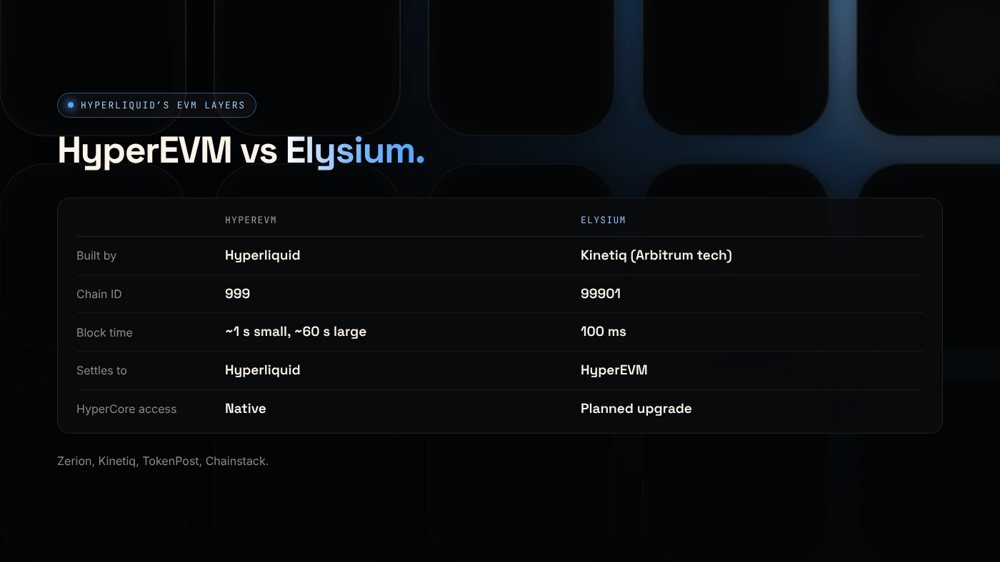
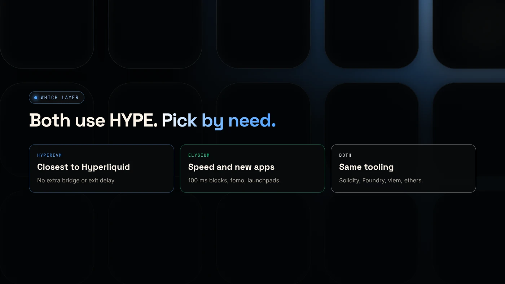

Elysium and HyperEVM both run EVM smart contracts with HYPE as gas, but HyperEVM is Hyperliquid's own EVM layer, while Elysium is a separate layer 2 that settles to HyperEVM and is built for speed. Elysium makes blocks every 100 ms. HyperEVM makes small blocks about every second and large blocks about every minute.

:::note Key facts
- **HyperEVM:** part of Hyperliquid itself. Chain ID **999**.
- **Elysium:** a Kinetiq layer 2 on Arbitrum technology that **settles to HyperEVM**. Chain ID **99901**.
- **Both** use HYPE for gas and run Solidity contracts.
- Kinetiq claims Elysium has **600 times** the throughput of HyperEVM's large blocks.
:::

:::note Not affiliated
DegenKit is not affiliated with Hyperliquid or Kinetiq. DegenKit supports token creation on Elysium.
:::

## How does Hyperliquid fit together?

Hyperliquid has three layers worth knowing:

- **HyperCore:** the order-book trading engine for perpetuals and spot.
- **HyperEVM:** Hyperliquid's EVM layer, where smart contracts run alongside HyperCore.
- **Elysium:** a layer 2 by Kinetiq that **settles to HyperEVM**, adding a faster place to run contracts.

Elysium does not settle to Ethereum. HyperEVM plays that role for it ([Zerion](https://zerion.io/blog/what-is-elysium/)).

## How do they compare?

| | HyperEVM | Elysium |
|---|---|---|
| Built by | Hyperliquid | Kinetiq (Arbitrum tech, operated with Conduit) |
| Chain ID | 999 | 99901 |
| Gas token | HYPE | HYPE (bridged 1:1) |
| Block time | Small ~1 s, large ~60 s | 100 ms |
| Gas per block | 3M small, 30M large | Target 300M gas/second |
| Settles to | Hyperliquid itself | HyperEVM |
| HyperCore access | Native | Planned upgrade about four weeks after launch |
| Exit to parent | — | ~5.5-day challenge period |

Sources: Zerion, [Kinetiq release](https://www.manilatimes.net/2026/11/09/tmt-newswire/globenewswire/kinetiq-launches-elysium-public-mainnet-a-high-performance-layer-2-built-for-hyperliquid/2465340), [TokenPost](https://www.tokenpost.com/news/technology/52986) and [Chainstack](https://docs.chainstack.com/docs/elysium-tooling).

## Why build a separate layer?

HyperEVM's block limits suit many apps but are tight for high-frequency trading. Kinetiq built Elysium for high-frequency trading, market-making AMMs, launchpads, lending and derivatives that need fast, cheap blocks. Its release says contracts will later read HyperCore order books and send trades to users' HyperCore accounts in about 100 ms.

The trade-off is **more trust at launch**: a single sequencer, an AnyTrust data committee, and a challenge period to exit.

## Which should you use?

**Use HyperEVM if** you want the layer closest to Hyperliquid, without a separate bridge or exit delay.

**Use Elysium if** your app or trading needs very fast blocks, or the apps you want, such as fomo or Elysium launchpads, are there.

**What we do not know:** how Elysium's security model will change as Kinetiq adds decentralization steps, and when the HyperCore upgrade will ship exactly.

## How is this like Ethereum layer 2s?

The pattern is familiar. Robinhood Chain and Arbitrum settle to Ethereum. Elysium settles to HyperEVM. All three use Arbitrum technology and a challenge period to exit. Compare in [Elysium vs Robinhood Chain](/blog/elysium-vs-robinhood-chain/) and [Ethereum vs Robinhood Chain](/blog/ethereum-vs-robinhood-chain/).

## What are the risks?

- **New chain** with days of history.
- **Centralized sequencing** at launch.
- **Bridge and exit delays.**
- **Name confusion** with unrelated "Elysium" chains (IDs 1338 and 1339).

You can lose money in crypto. This is not financial advice.

## FAQ

### What is HyperEVM?

Hyperliquid's EVM layer, chain ID 999, where smart contracts run with HYPE as gas next to the HyperCore order books.

### Is Elysium part of Hyperliquid?

It is built by Kinetiq for the Hyperliquid ecosystem and settles to HyperEVM, but it is a separate layer 2.

### Can tokens move between Elysium and HyperEVM?

Yes. Kinetiq says any HyperEVM ERC-20 can bridge to Elysium, and Elysium tokens can bridge back.

## Sources

- [Zerion: What is Elysium](https://zerion.io/blog/what-is-elysium/)
- [Kinetiq launch release (GlobeNewswire via The Manila Times)](https://www.manilatimes.net/2026/11/09/tmt-newswire/globenewswire/kinetiq-launches-elysium-public-mainnet-a-high-performance-layer-2-built-for-hyperliquid/2465340)
- [Chainstack: Elysium tooling](https://docs.chainstack.com/docs/elysium-tooling)
- [TokenPost: Kinetiq launches Elysium mainnet](https://www.tokenpost.com/news/technology/52986)

To create a token on Elysium without code, use the [DegenKit Elysium token creator](/launch/elysium/).
