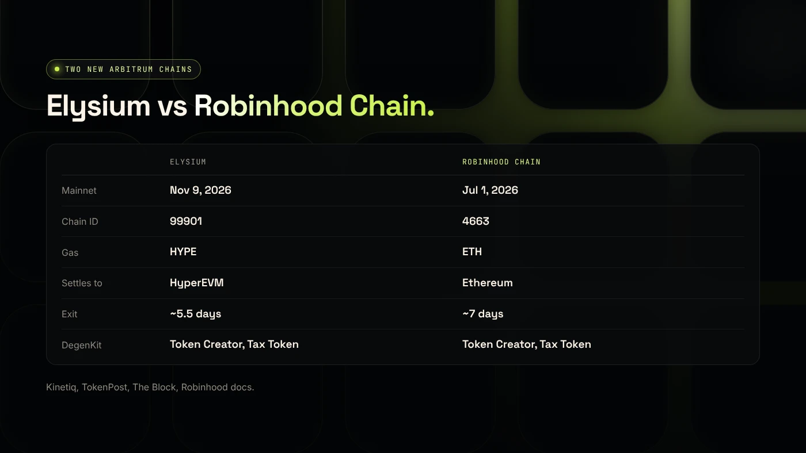
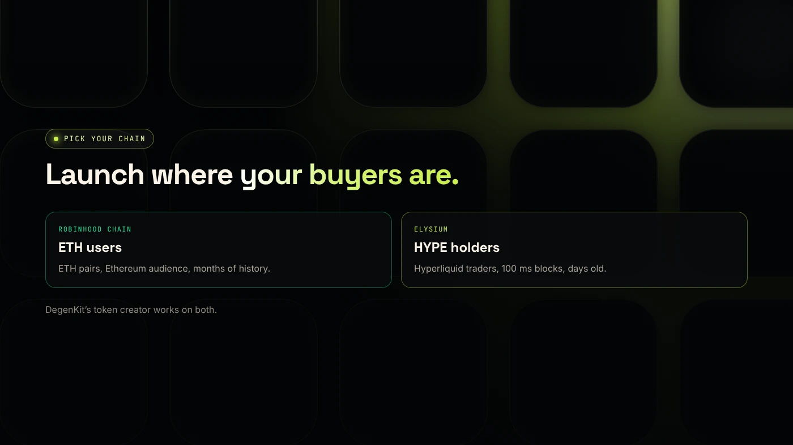

Elysium and Robinhood Chain both launched in 2026 on Arbitrum technology, but they serve different ecosystems: Elysium settles to Hyperliquid's HyperEVM and uses HYPE for gas, while Robinhood Chain settles to Ethereum and uses ETH. DegenKit's token creator supports both, with the same tools.

:::note Key facts
- **Elysium:** live **November 9, 2026**, chain ID **99901**, HYPE gas, 100 ms blocks, settles to HyperEVM.
- **Robinhood Chain:** live **July 1, 2026**, chain ID **4663**, ETH gas, settles to Ethereum.
- **Both:** Arbitrum technology, Uniswap at launch, a challenge period to exit.
- **DegenKit:** Token Creator, Tax Token and My Tokens on both chains. Creation fee on Elysium: **1 HYPE**.
:::

:::note Not affiliated
DegenKit is not affiliated with Kinetiq, Hyperliquid or Robinhood.
:::

## How do they compare?

| | Elysium | Robinhood Chain |
|---|---|---|
| Built by | Kinetiq, operated with Conduit | Robinhood |
| Mainnet | Nov 9, 2026 | Jul 1, 2026 |
| Chain ID | 99901 | 4663 |
| Gas | HYPE | ETH |
| Settles to | HyperEVM | Ethereum |
| Block time | 100 ms | Arbitrum-standard |
| Exit to parent | ~5.5-day challenge | ~7 days (canonical bridge) |
| Main DEX | Uniswap v2, v3, v4 | Uniswap v2, v3, v4 |
| Launchpads | pump.fun, others | Pons and others |
| Special feature | Planned HyperCore access | Tokenized stocks |
| DegenKit support | Token Creator, Tax Token | Token Creator, Tax Token |

Sources: [Kinetiq release](https://www.manilatimes.net/2026/11/09/tmt-newswire/globenewswire/kinetiq-launches-elysium-public-mainnet-a-high-performance-layer-2-built-for-hyperliquid/2465340), [TokenPost](https://www.tokenpost.com/news/technology/52986), [The Block](https://www.theblock.co/news/business/2026-07-01-robinhood-chain-goes-live-mainnet-alongside-24-7-tokenized-stocks-lighter-perps-planned-crypto-agentic-trading-406918) and [Robinhood Chain docs](https://docs.robinhood.com/chain/bridging/).

## What do they have in common?

Both use **Arbitrum technology**, so they share an EVM environment, the same Solidity tooling and an optimistic security model with a challenge period. A standard ERC-20 deploys the same way on both. Both launched with **Uniswap** as the main public DEX, so the same [Uniswap version choice](/blog/robinhood-chain-uniswap-v2-v3-v4/) applies.

## Where do they differ?

- **Ecosystem.** Elysium is built for Hyperliquid traders who hold HYPE. Robinhood Chain connects to Ethereum and Robinhood's users.
- **Speed.** Elysium aims for 100 ms blocks and very high throughput for trading apps.
- **Assets.** Robinhood Chain carries Robinhood's tokenized stocks. Elysium plans contract access to HyperCore order books.
- **Maturity.** Robinhood Chain has four months of history. Elysium has days.

## How do costs compare?

On both chains, gas for a simple transfer or token deployment is small compared with Ethereum mainnet, because both are layer 2s. The bigger costs are elsewhere: the asset you put into a liquidity pool, any launchpad or service fees, and the time and fees of bridging in and out. On Robinhood Chain you budget in ETH. On Elysium you budget in HYPE, whose dollar price moves on its own. Our guide on [bridging ETH to Robinhood Chain](/blog/bridge-eth-to-robinhood-chain/) shows a launch budget you can adapt.

## Which is better for a token launch?

**Choose Robinhood Chain if** you want ETH as the base pair, an Ethereum-connected audience and a few months of track record. Start with the [Robinhood Chain token generator](/blog/token-generator-robinhood-chain/).

**Choose Elysium if** your audience holds HYPE and trades on Hyperliquid, and you accept a days-old chain. Start with the [Elysium token creator guide](/blog/elysium-token-creator/).

**What we do not know:** how Elysium's activity and security model will develop over the coming months.

## What are the risks?

- **New chains** on both sides, with Elysium far newer.
- **Bridge and exit delays** of several days.
- **Thin liquidity** for new tokens on either chain.

You can lose money in crypto. This is not financial advice.

## FAQ

### Is Elysium built on Arbitrum?

Yes. Kinetiq says Elysium is built on the Arbitrum Platform and operated with Conduit, settling to HyperEVM.

### What gas does each chain use?

Elysium uses HYPE. Robinhood Chain uses ETH.

### Can DegenKit create tokens on Elysium?

Yes. The [Elysium launcher](/launch/elysium/) has Token Creator, Tax Token and My Tokens, like Robinhood Chain.

## Sources

- [Kinetiq launch release (GlobeNewswire via The Manila Times)](https://www.manilatimes.net/2026/11/09/tmt-newswire/globenewswire/kinetiq-launches-elysium-public-mainnet-a-high-performance-layer-2-built-for-hyperliquid/2465340)
- [TokenPost: Kinetiq launches Elysium mainnet](https://www.tokenpost.com/news/technology/52986)
- [The Block: Robinhood Chain goes live on mainnet](https://www.theblock.co/news/business/2026-07-01-robinhood-chain-goes-live-mainnet-alongside-24-7-tokenized-stocks-lighter-perps-planned-crypto-agentic-trading-406918)
- [Robinhood Chain docs: Bridging](https://docs.robinhood.com/chain/bridging/)

To launch on Robinhood Chain today, open the [DegenKit Robinhood Chain launcher](/launch/robinhood/).
