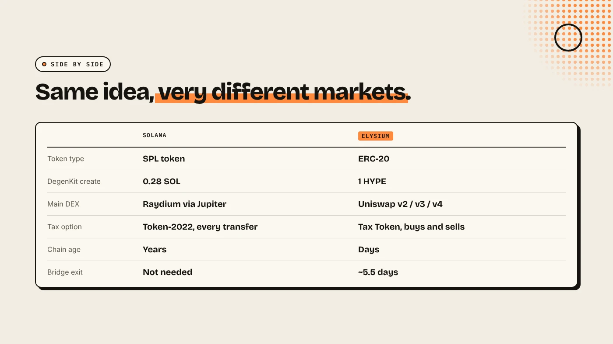
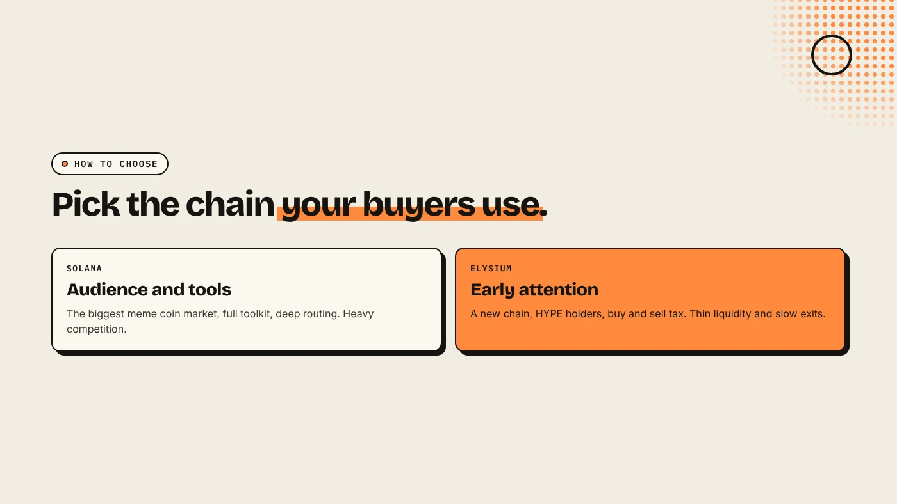

Choose Solana for the largest meme coin audience, the most tools and deep liquidity. Choose Elysium for a new chain with little competition, Hyperliquid's HYPE community and a buy and sell tax option. On DegenKit, a token costs 0.28 SOL on Solana or 1 HYPE on Elysium. The bigger differences are audience, liquidity and how quickly buyers can leave.

:::note Key facts
- **Solana:** SPL tokens, a 5,000 lamport base fee per signature (Solana docs), mature DEXs and pump.fun.
- **Elysium:** ERC-20 tokens, gas in HYPE, **100 ms blocks**, live since **November 9, 2026** (Kinetiq).
- **DegenKit create fee:** **0.28 SOL** on Solana, **1 HYPE** on Elysium.
- **Exit time:** Solana assets stay on Solana. Elysium to HyperEVM takes about **5.5 days**.
:::

:::note Not affiliated
DegenKit is not affiliated with Solana, Kinetiq, Hyperliquid, Raydium, Uniswap or pump.fun.
:::

## How do they compare side by side?

| | Solana | Elysium |
|---|---|---|
| Token type | SPL token | ERC-20 |
| Gas token | SOL | HYPE |
| DegenKit create fee | 0.28 SOL | 1 HYPE |
| Main DEX | Raydium (via Jupiter) | Uniswap v2, v3, v4 |
| Buy and sell tax | Token-2022 fee on every transfer | Tax Token: buys and sells only |
| Bonding-curve launchpad | pump.fun, Raydium LaunchLab | pump.fun |
| Chain age | Years | Days |
| Bridge exit | Not needed | About 5.5 days to HyperEVM |

## Why launch on Solana?

- **Audience.** Solana is where most meme coin traders already are, with wallets, bots and screeners built for it.
- **Tools.** On DegenKit's [Solana launcher](/launch/solana/) you can create, revoke authorities, open a Raydium pool, burn, airdrop and scan in one place.
- **Liquidity.** Jupiter routes across many DEXs, so buyers can reach your pool easily.
- **Competition.** The flip side: thousands of new tokens a day, and only about 1.8% of pump.fun coins graduated in August 2026 (MadeOnSol).

See [how to make a meme coin on Solana](/blog/how-to-make-a-meme-coin-on-solana/).

## Why launch on Elysium?

- **Early attention.** A days-old chain has few tokens, so each launch is easier to see.
- **HYPE holders.** Hyperliquid has a large, active community, and Elysium is a new place for it.
- **Tax option.** DegenKit's Elysium Tax Token taxes only buys and sells against marked pools, not wallet transfers.
- **Speed.** Kinetiq targets 100 ms blocks.

The costs: fewer tools, thin liquidity, a single sequencer at launch, and a 5.5-day exit. See [how to make a meme coin on Elysium](/blog/how-to-make-a-meme-coin-on-elysium/).

## How do you choose?

- **Choose Solana if** you want the biggest audience and the full launch toolkit, and you can stand out in a crowded market.
- **Choose Elysium if** you want to be early on a new chain, already have a HYPE community, or want a buy and sell tax without taxing transfers.
- **Not sure?** Rehearse on a test network first. See [rehearsing a Solana launch on devnet](/blog/rehearse-solana-launch-on-devnet/) and our comparison of [which blockchain to launch a token on](/blog/which-blockchain-to-launch-token/).

## What are the risks?

- **On Solana:** heavy competition, snipers and bundled launches. See [Solana bundlers explained](/blog/solana-bundler-explained/).
- **On Elysium:** a young chain, thin liquidity and slow exits.
- **On both:** most meme coins lose value.

You can lose money in crypto. This is not financial advice.

## FAQ

### Is it cheaper to launch on Solana or Elysium?

On DegenKit, creation is 0.28 SOL on Solana and 1 HYPE on Elysium. Your pool liquidity is usually the larger cost on either chain.

### Can I launch the same token on both?

You can create a token with the same name on each chain, but they are separate tokens with separate supplies and pools.

### Does pump.fun work on Elysium?

Yes. Pump.fun supported Elysium from launch day.

## Sources

- [Solana docs: Fee structure](https://solana.com/docs/core/fees/fee-structure)
- [Kinetiq launch release (GlobeNewswire via The Manila Times)](https://www.manilatimes.net/2026/11/09/tmt-newswire/globenewswire/kinetiq-launches-elysium-public-mainnet-a-high-performance-layer-2-built-for-hyperliquid/2465340)
- [Coinranking: Elysium mainnet goes live with trading apps](https://coinranking.com/news/elysium-layer-2-mainnet-launches-november-9-trading-apps)
- [MadeOnSol: Pump.fun vs PumpSwap vs Raydium](https://madeonsol.com/blog/pump-fun-vs-pumpswap-vs-raydium)
- [TokenPost: Elysium launch](https://www.tokenpost.com/news/technology/52986)

Launch on either chain from the [DegenKit Solana launcher](/launch/solana/) or the [Elysium token creator](/launch/elysium/).
