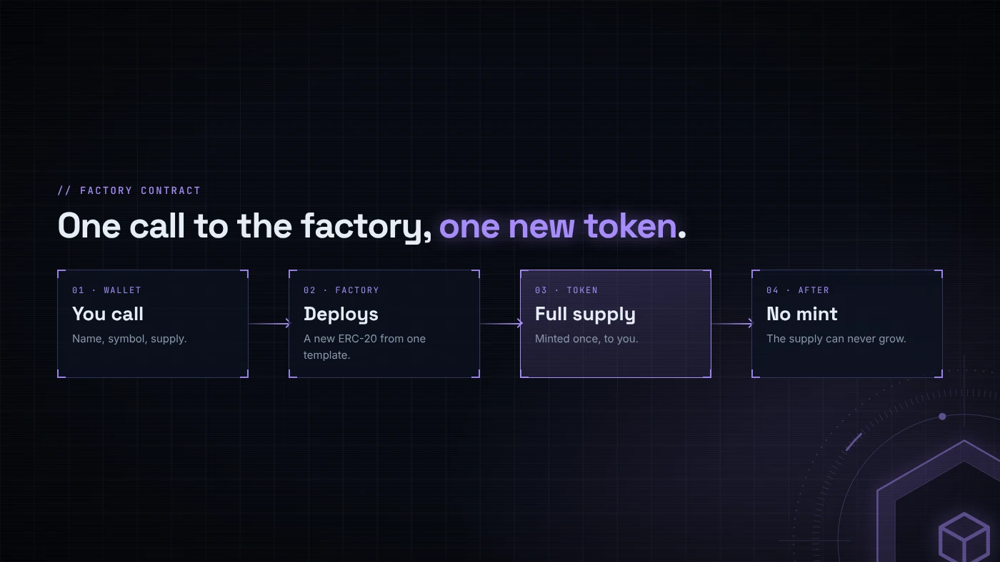
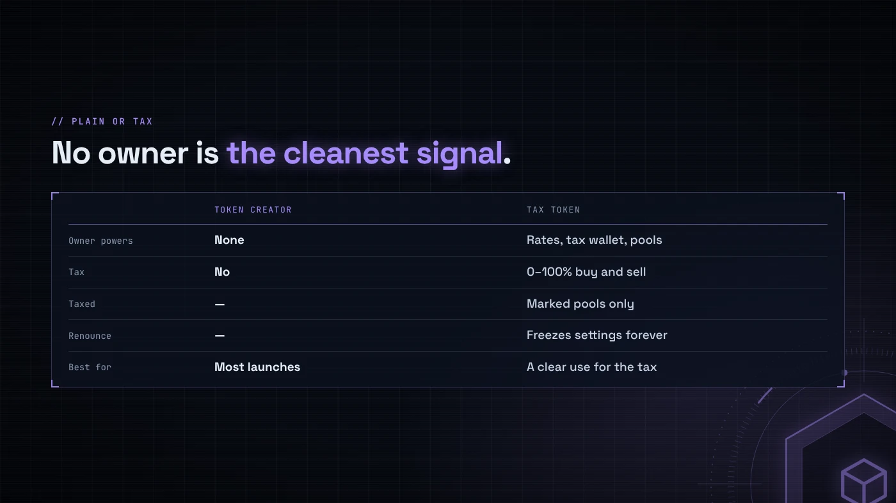

An ERC-20 token generator creates a standard Ethereum-style token through a factory contract. You enter the name, symbol and supply, sign one transaction, and the factory deploys your token with the full supply in your wallet. The same token works on Ethereum, Base, BNB Chain (as BEP-20), Robinhood Chain and Elysium, because all of them run the EVM.

:::note Key facts
- **Networks on DegenKit:** Ethereum, BNB Chain, Base, Robinhood Chain and Elysium.
- **Token:** fixed supply, **18 decimals**, **no mint function**, permanent name and symbol (DegenKit docs).
- **Tax option:** **Tax Token** with buy and sell rates from 0% to 100%, applied only to marked pools.
- **Fee:** read from the factory contract and shown on the form before you sign, plus gas.
:::

## What is a factory contract?

A factory is a smart contract whose job is to create other contracts. When you click create, your wallet calls the factory with your settings. The factory deploys a new ERC-20 with those settings and mints the whole supply to your address in the same transaction. After that, the token has no function that creates more tokens.

This is safer than pasting code you found online. Every token comes from the same reviewed template, and the explorer shows which factory created it.

## Which EVM chain should you pick?

| Network | Gas coin | Token type | Main DEX |
|---|---|---|---|
| Ethereum | ETH | ERC-20 | Uniswap |
| BNB Chain | BNB | BEP-20 | PancakeSwap |
| Base | ETH | ERC-20 | Aerodrome, Uniswap |
| Robinhood Chain | ETH | ERC-20 | Uniswap |
| Elysium | HYPE | ERC-20 | Uniswap |

BNB Chain's docs describe BEP-20 as an extension of the ERC-20 standard, with the same functions. Ethereum gas is the highest. Use the [ETH gas calculator](/tools/eth-gas-calculator/) to estimate it. See [how to launch a token on Base](/blog/how-to-launch-a-token-on-base/) and [how to launch a token on BNB Chain](/blog/how-to-launch-a-token-on-bnb-chain/).

## How do you generate an ERC-20 token?

1. Open the network's page from the [DegenKit launcher](/launch/): Ethereum, BNB Chain, Base, Robinhood Chain or Elysium.
2. Connect MetaMask or another EVM wallet and accept the network switch.
3. Choose **Token Creator** (plain) or **Tax Token**.
4. Enter **name**, **symbol** and **total supply**.
5. Check the summary and the **service fee** read from the factory.
6. Sign. The **contract address** appears when the transaction confirms.

Then add the token to your wallet by its contract address so the balance shows.

## What does the token look like on the explorer?

On Etherscan, BscScan, BaseScan or Blockscout, the token page shows the name, symbol, 18 decimals, total supply and one holder: you. The transaction shows the factory as the contract you called. Our guide to [reading a token page on Etherscan or Blockscout](/blog/read-token-page-etherscan-blockscout/) explains each tab.

## Plain token or tax token?

- **Token Creator:** no owner powers, no tax. The cleanest signal for buyers.
- **Tax Token:** you set buy and sell rates and a tax wallet, and can change them until you renounce ownership. The tax applies only to pools you mark, never to wallet transfers. See [how buy and sell tax works](/blog/how-token-buy-sell-tax-works/) and the [token tax calculator](/tools/token-tax-calculator/).

## What comes next?

Add liquidity on Uniswap or PancakeSwap. See [adding liquidity on Uniswap](/blog/add-liquidity-uniswap-erc20/). Approving the DEX to move your token is a normal step. See [ERC-20 token approvals](/blog/erc20-token-approvals-explained/). For the bigger picture, read the [token generator guide](/blog/token-generator/).

## What are the risks?

- **Gas spikes on Ethereum** can make creation and liquidity expensive.
- **Wrong network** when funding your wallet or sending tokens.
- **Approval scams** that ask you to approve a malicious contract. Check with the [token approval checker](/tools/token-approval-checker/).

You can lose money in crypto. This is not financial advice.

## FAQ

### What is an ERC-20 token generator?

A no-code tool that deploys a standard ERC-20 token for you through a factory contract.

### Can I create a BEP-20 token with an ERC-20 generator?

Yes. On BNB Chain the same kind of token is called BEP-20.

### Can I mint more tokens later?

No. DegenKit's EVM tokens have no mint function. The supply is created once.

### How many decimals does the token have?

18, the standard for ERC-20 tokens.

## Sources

- [DegenKit docs: Token Creator (EVM)](https://degenkit.app/docs/evm-token-creator/)
- [DegenKit docs: Tax Token](https://degenkit.app/docs/tax-token/)
- [DegenKit docs: Fees](https://degenkit.app/docs/fees/)
- [BNB Chain docs: BEP-20](https://docs.bnbchain.org/docs/BEP20)
- [Trust Wallet: BEP-20](https://trustwallet.com/glossary/bep-20)

Generate an ERC-20 or BEP-20 token on the [DegenKit launcher](/launch/).
