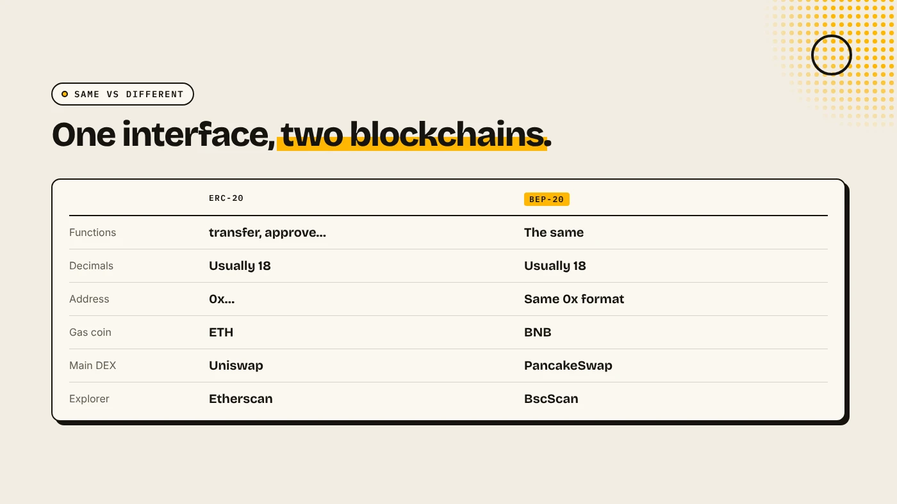
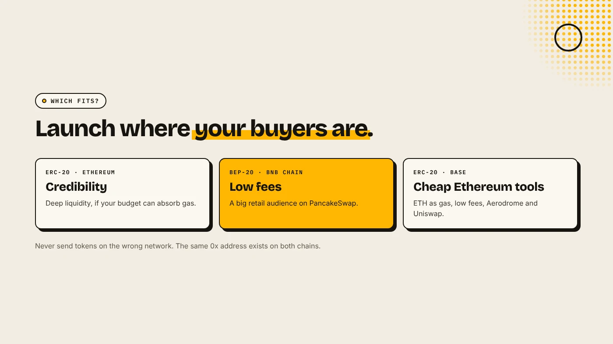

ERC-20 and BEP-20 are the same kind of token on different blockchains. ERC-20 is Ethereum's token standard. BEP-20 is BNB Smart Chain's, built as an extension of ERC-20, so the functions, decimals and 0x addresses work the same way. What differs is the chain: gas is paid in ETH or BNB, fees and DEXs differ, and a token on one chain does not exist on the other.

:::note Key facts
- **BEP-20** "is an extension of the Ethereum ERC-20 token standard" (BNB Chain docs).
- **Gas:** ERC-20 transfers pay in **ETH**, BEP-20 transfers in **BNB** (Trust Wallet).
- **Same interface:** transfer, approve, balanceOf, totalSupply. Most wallets handle both.
- **Base and Robinhood Chain** also use ERC-20, with ETH for gas.
:::

:::note Not affiliated
DegenKit is not affiliated with the Ethereum Foundation, BNB Chain or Trust Wallet.
:::

## What is the same?

A token standard is a shared set of functions that wallets, exchanges and DEXs know how to call. BNB Chain's docs describe BEP-20 as an extension of ERC-20, and both define similar rules for transfers, burning and minting. In practice:

- **Functions:** `transfer`, `approve`, `transferFrom`, `balanceOf` and `totalSupply` work the same.
- **Decimals:** 18 is the usual choice on both. DegenKit's EVM Token Creator uses 18.
- **Addresses:** both chains use the same 0x address format, so one MetaMask account works on both.
- **Tooling:** the same wallets and explorers work, with Etherscan on Ethereum and BscScan on BNB Smart Chain.

This is why DegenKit uses the same token contract design on Ethereum, BNB Chain, Base and Robinhood Chain.

## What is different?

| | ERC-20 (Ethereum) | BEP-20 (BNB Smart Chain) |
|---|---|---|
| Gas coin | ETH | BNB |
| Typical fee | Higher, depends on congestion | Median below $0.01 in mid-2026 |
| Block time | About 12 seconds | 0.45 seconds since January 2026 |
| Main DEX | Uniswap | PancakeSwap |
| Explorer | Etherscan | BscScan |

BNB Chain's Fermi hard fork on January 14, 2026 cut block times to 0.45 seconds (Yahoo Finance). Coin Turk reported in June 2026 that BNB Chain's minimum gas price was cut from 1 gwei to 0.05 gwei, and that median fees had fallen below $0.01. On Ethereum, fees vary widely with congestion. See [Ethereum gas fees explained](/blog/ethereum-gas-fees-explained/).

## What is the costly mistake?

**Sending a token on the wrong network.** The same 0x address exists on both chains, so a wallet will accept the transfer, but the tokens arrive on the network they were sent on. Trust Wallet warns that sending an ERC-20 token to a BEP-20 address, or the reverse, "without a proper bridge can result in lost funds".

Exchanges make this easy to get wrong because they offer withdrawals on several networks. Always check the network before you confirm. Read [how to add a token to MetaMask](/blog/add-token-to-metamask/) to see the right network in your wallet.

## Is a BEP-20 token the same token as its ERC-20 version?

No. Two contracts on two chains are two tokens, even with the same name. Big projects keep a single supply across chains by using bridges. A common example is a "pegged" token on BNB Chain backed by the original on Ethereum. A new token you create on one chain has no version on the other unless you build one.

## Which should you choose for your token?

- **ERC-20 on Ethereum** for maximum credibility and deep liquidity, if your budget can absorb gas. See [creating an ERC-20 token on Ethereum](/blog/create-erc20-token-on-ethereum/).
- **BEP-20 on BNB Chain** for very low fees and a large retail audience on PancakeSwap. See [how to launch a token on BNB Chain](/blog/how-to-launch-a-token-on-bnb-chain/).
- **ERC-20 on Base** for Ethereum-style tooling with low fees. Compare [Base vs BNB Chain](/blog/base-vs-bnb-chain/).

DegenKit makes plain and tax tokens on all of them from the [launcher](/launch/).

## What are the risks?

- **Wrong-network transfers** can be unrecoverable.
- **Look-alike tokens** with the same name exist on every chain. Check the contract address.
- **Bridged tokens** depend on the bridge's security.

You can lose money in crypto. This is not financial advice.

## FAQ

### Is BEP-20 the same as ERC-20?

It uses the same interface and is described by BNB Chain as an extension of ERC-20, but it runs on BNB Smart Chain, not Ethereum.

### Can I use the same MetaMask address for ERC-20 and BEP-20?

Yes. The address is the same. Switch the network to see each chain's balances.

### What happens if I send BEP-20 tokens to an Ethereum address?

They arrive on BNB Smart Chain at that address. If the receiver only checks Ethereum, they will not see them, and an exchange may not credit them.

## Sources

- [BNB Chain docs: BEP-20](https://docs.bnbchain.org/docs/BEP20)
- [Trust Wallet: BEP-20](https://trustwallet.com/glossary/bep-20)
- [Yahoo Finance: BNB Chain hits 0.45s block times with Fermi](https://finance.yahoo.com/news/bnb-chain-hits-0-45s-151727992.html)
- [Coin Turk: BNB transaction fees fall below $0.01](https://en.coin-turk.com/bnb-transaction-fees-fall-below-0-01-after-four-upgrades/)

Create an ERC-20 or BEP-20 token without code on the [DegenKit launcher](/launch/).
