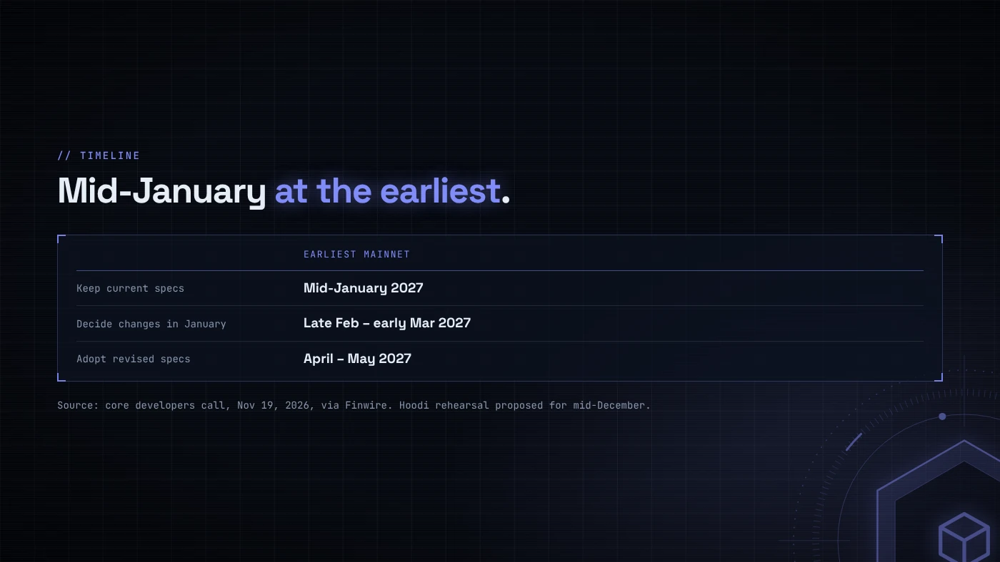
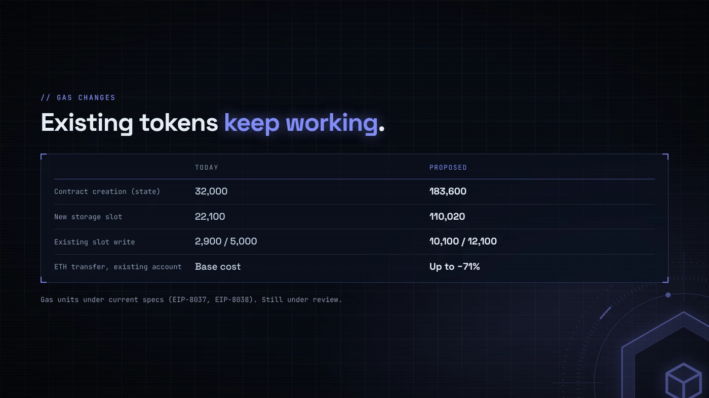

Glamsterdam is Ethereum's next hard fork. It adds enshrined proposer-builder separation (ePBS), block-level access lists for parallel execution, and new gas prices for state. It ran on Sepolia on October 6, 2026, but was paused on November 6 after audits found contracts that could break. Developers now discuss mid-January 2027 at the earliest, and possibly April or May.

:::note Key facts
- **Headline EIPs:** EIP-7732 (**ePBS**), EIP-7928 (**block-level access lists**), plus gas repricing (EIP-8037, EIP-8038 and others).
- **Status:** live on **Sepolia** (Oct 6). Hoodi activation cancelled. Fork **paused Nov 6**. No mainnet date.
- **Audit:** ChainSecurity found **200 issues** (3 high, none critical) in apps affected by the gas changes.
- **Token creators:** contract creation's state charge would rise from **32,000 to 183,600 gas** under EIP-8037 as proposed.
:::

## What is in Glamsterdam?

- **ePBS (EIP-7732):** proposer-builder separation moves into the protocol. Builders post staked bids, the proposer commits to one, and the builder reveals the block afterward. Trusted relays are no longer needed.
- **Block-level access lists (EIP-7928):** every block records which accounts and storage slots it touches, so clients can read and execute in parallel and validate faster.
- **Gas repricing:** state creation and state access get new prices to reflect real hardware cost (EIP-8037, EIP-8038, EIP-2780, EIP-7778).
- **Cross-chain factory (EIP-7997):** a predeployed deterministic factory for identical contract addresses across EVM chains.

## Why is Glamsterdam delayed?

The gas repricing broke assumptions in live contracts. After the Hoodi testnet date of October 26 was cancelled, an investigation found eight assumptions that could break. ChainSecurity's audit, completed November 18, found 200 issues across exchanges, wallets, bridges, staking and governance apps: 3 high, 30 medium, 167 low. Most need configuration changes, but 24 need contract upgrades.

At the November 19 core developers call, the Ethereum Foundation said it had contacted at least 50 affected companies. Chair Ansgar Dietrichs called late January or early February a more realistic window.

## When could it launch?

| Scenario | Earliest mainnet |
|---|---|
| Keep current specs | Mid-January 2027 |
| Decide on changes in January | Late February or early March 2027 |
| Adopt revised specs | April or May 2027 |

A Hoodi rehearsal was tentatively proposed for the week of December 14. A decision was expected at the November 26 consensus-layer call.

## What changes for gas costs?

Per Datawallet's summary of the current specs:

- **Simple ETH transfers** between existing accounts become up to **71% cheaper**, while sends to new accounts pay a surcharge.
- **New storage slots** cost more: from 22,100 to 110,020 gas.
- **Writing to existing slots** rises from 2,900 or 5,000 to 10,100 or 12,100 gas.
- **Contract creation's** state charge rises from 32,000 to 183,600 gas under EIP-8037.

These numbers can still change, because EIP-8037 and EIP-8038 are under review.

## What does Glamsterdam mean for token creators?

- **Deploying a token may cost more gas on Ethereum** if the current specs ship, because creating a contract and its storage gets pricier. Final costs depend on the gas price in gwei. See [Ethereum gas fees explained](/blog/ethereum-gas-fees-explained/) and the [ETH gas calculator](/tools/eth-gas-calculator/).
- **Existing ERC-20 tokens keep working.** Balances and contracts are not migrated.
- **Holders need no action.** Any "Glamsterdam migration" or claim message is a scam.
- **L2s like Base** follow their own upgrade schedules. See [Base Denim upgrade](/blog/base-denim-upgrade/).

## What comes after Glamsterdam?

**Hegota.** Developers are discussing a narrower scope to speed up quantum-resistant cryptography work. Vitalik Buterin endorsed the leanPCS approach. Earlier plans for Hegota included Verkle trees and FOCIL for censorship resistance.

## What are the risks?

- **Spec changes** could break new invariants, as researcher Toni Wahrstätter warned.
- **Gas assumptions** in older contracts, such as fixed gas stipends, may fail after the fork.
- **Scams** around "upgrade" or "claim" messages.

You can lose money in crypto. This is not financial advice.

## FAQ

### When is the Glamsterdam upgrade?

No mainnet date is set. Developers discuss mid-January 2027 at the earliest, and April or May 2027 if specs change.

### Do I need to do anything with my ETH or tokens?

No. Balances and tokens are unaffected.

### Will Glamsterdam make Ethereum cheaper?

Simple ETH transfers between existing accounts get cheaper. Creating new state, including contracts, gets more expensive under the current specs.

## Sources

- [Datawallet: Glamsterdam upgrade explained](https://www.datawallet.com/crypto/ethereum-glamsterdam-upgrade-explained)
- [Finwire: Why Glamsterdam could be delayed to May 2027](https://finwire.io/news/crypto-news/heres-why-ethereums-glamsterdam-upgrade-could-be-delayed-until-may-2027)
- [Decrypt: Ethereum roadmap, Glamsterdam and Hegota](https://decrypt.co/resources/whats-on-ethereum-roadmap-glamsterdam-hegota-beyond)

Create an ERC-20 token on Ethereum with the [DegenKit token generator](/launch/).
