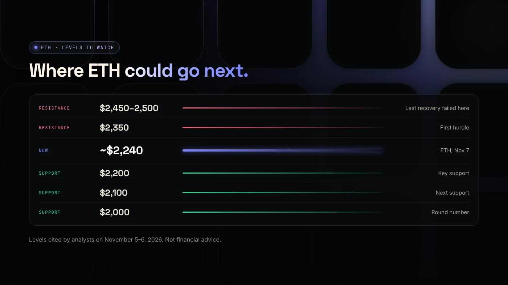
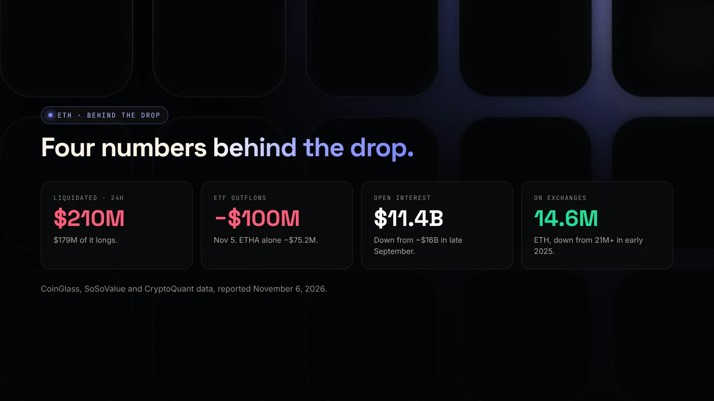

Ethereum had one of its worst weeks of the year. ETH lost more than 8% in a single day on November 6, falling toward **$2,200**, and was trading near **$2,240** on November 7. That's about 55% below its August 2025 high near $4,950.

Here's what pushed it down, the levels traders are watching and what could change the picture.

:::note Figures as of November 6–7, 2026
This is market news, not financial advice. Prices and levels change quickly.
:::

## Why ETH fell

**1. ETF money left.** US spot Ether ETFs had net outflows of nearly $100 million on November 5, led by $75.2 million from BlackRock's ETHA. Another $93.3 million left on November 6 ([crypto.news](https://crypto.news/why-is-ethereum-price-down-today-eth-etf-liquidations), [KuCoin News](https://www.kucoin.com/news/flash/us-spot-bitcoin-etf-sees-411-9m-net-outflow-ethereum-etf-loses-93-3m)).

**2. Leverage unwound.** More than $210 million of ETH positions were liquidated in 24 hours, $179 million of them longs. Open interest in ETH futures dropped to about $11.4 billion, down from about $16 billion in late September.

**3. The upgrade was delayed.** On November 6 the Ethereum Foundation said developers would delay activating the **Glamsterdam** upgrade on the Hoodi test network. Security firm ChainSecurity found that two gas-accounting changes, EIP-8037 and EIP-8038, could break eight assumptions that existing smart contracts rely on. No new date has been set ([KuCoin News](https://www.kucoin.com/news/flash/ethereum-price-drops-6-amid-glamsterdam-upgrade-delay-and-market-sell-off)).

**4. Everything else fell too.** Tech stocks sold off on November 5, and crypto went with them. See [why crypto crashed in early November](/blog/crypto-crash-november-2026/).

## The levels traders are watching

- **Support:** about **$2,200** first, then **$2,100** and **$2,000**. A clean break below $2,200 would put those lower levels in play.
- **Resistance:** about **$2,350**, then the **$2,450–$2,500** zone, where the last recovery attempt failed.
- **Momentum:** the daily RSI was about 38, below neutral but not yet oversold.

These come from the analysis cited by [crypto.news](https://crypto.news/why-is-ethereum-price-down-today-eth-etf-liquidations). They're areas where buyers or sellers have shown up before, not promises.

## What could turn it around

There's one piece of good news in the data. ETH held on centralized exchanges has fallen to about **14.6 million ETH**, from more than 21 million in early 2025. Fewer coins on exchanges usually means fewer coins ready to sell quickly.

Other signals to watch:

- **ETF flows turning positive** for several days in a row.
- **A new Glamsterdam date** once the security review with ChainSecurity and Dedaub is done.
- **Bitcoin holding $75,000.** ETH rarely recovers on its own while Bitcoin is falling.

## What it means for building on Ethereum

Gas on Ethereum is paid in ETH, so a lower ETH price makes the same transaction cheaper in dollars. If you were waiting to [create an ERC-20 token](/blog/create-erc20-token-on-ethereum/), creation costs less in dollar terms now. The trade-off is a quieter market with fewer buyers. Our guide to [launching during a crash](/blog/launching-a-token-in-a-bear-market/) covers that side.

## Wrap up

ETH is near $2,240, with $2,200 as the line most traders are watching and $2,350 as the first hurdle above. ETF flows, the Glamsterdam timeline and Bitcoin will decide the next move. If you're building on Ethereum, [DegenKit's Ethereum launcher](https://degenkit.app/launch/ethereum/) is ready when you are.
