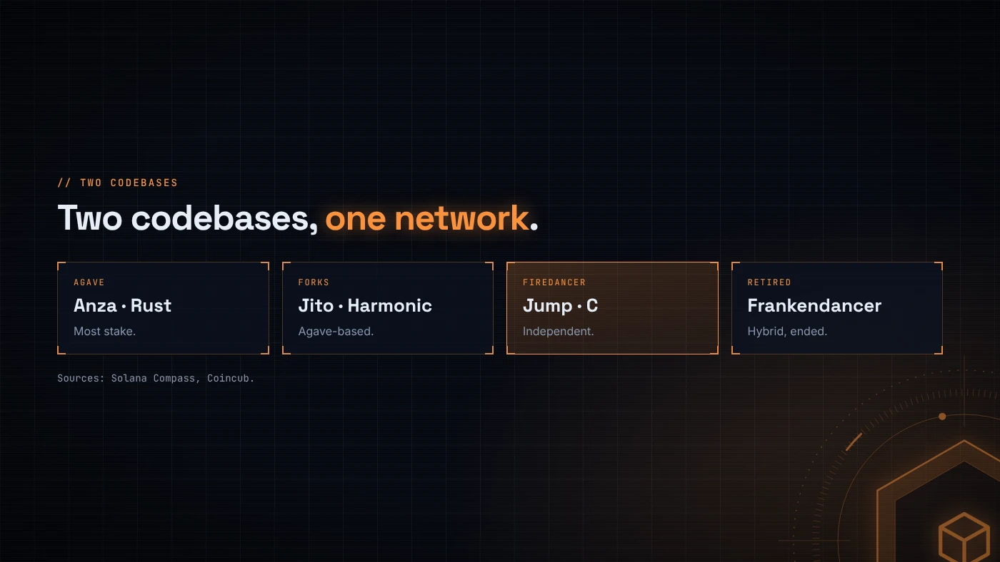
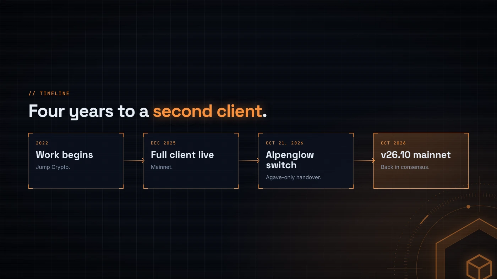

Firedancer is a Solana validator client written from scratch in C by Jump Crypto. It shares no code with Anza's Agave client, so one bug is less likely to stop the whole network. The full client went live on mainnet in December 2025. It sat out the October 2026 switch to Alpenglow, then rejoined consensus with its v26.10 mainnet releases. Users need to do nothing.

:::note Key facts
- **Builder:** Jump Crypto. Led by chief scientist Kevin Bowers. Work began in **2022** (Solana Compass).
- **Full client on mainnet:** **December 12, 2025**, after about 100 days of production testing.
- **Stake before the Alpenglow switch:** about **13%** of active stake (Furlpay count, Oct 15, 2026, via Coincub).
- **Frankendancer,** the hybrid version, lost support after Alpenglow went live.
:::

## What is a validator client?

A validator client is the software that receives transactions, builds blocks, votes and keeps a copy of the ledger. Every validator runs one. If almost everyone runs the same client, one bug can halt or split the network. A second, independent client lowers that risk. Ethereum treats this as a core safety rule.

On Solana, Agave and its forks (Jito-Solana, Harmonic Salsa) have long run the vast majority of stake. Firedancer is the main independent alternative.

## What is the difference between Firedancer and Frankendancer?

- **Frankendancer** was a hybrid. Jump's code received transactions and built blocks, while Agave code executed and voted. At the full client's launch, it ran on more than 26% of validators, per Blockworks figures cited by Solana Compass.
- **Full Firedancer** uses no Agave code.

In September 2026, Jump's team said it would stop supporting Frankendancer after Alpenglow activated, citing maintenance and security overhead, and focus only on the full client.

## What happened at the Alpenglow switch?

Alpenglow replaced TowerBFT on October 21, 2026. See [Solana Alpenglow explained](/blog/solana-alpenglow-explained/). Firedancer and Frankendancer could not perform the migration from TowerBFT, so operators running them moved to Agave-based clients for the handover, per Coincub's summary of Anza's notices.

Then:

- **October 7:** Firedancer v26.10.0 added Alpenglow support on testnet and devnet.
- **October 14:** v26.10.2, a mainnet-ready release, supported all Solana 4.3 features and cut mainnet memory use from 183 to 159 GiB.
- **October 22 changelog:** Firedancer mainnet v26.10.4 "successfully participated in the new Alpenglow consensus".
- **November 6:** validators had to run Agave 4.4.1 or Firedancer 26.10.6 before epoch 1079.

## How fast is Firedancer?

Jump has demonstrated more than 1 million transactions per second on commodity hardware, at Breakpoint 2024. That was a demonstration, not mainnet throughput. On mainnet, Firedancer follows the same block limits as every other client. Its advantage is efficiency: more headroom per machine, faster snapshot loading (about 40 seconds on mainnet with v26.10.2) and lower memory use.

## What hardware does it need?

Per Solana Compass:

| | Minimum | Recommended |
|---|---|---|
| CPU | 24 cores above 2.8 GHz | 32 cores above 3 GHz, AVX-512 |
| Memory | 256 GB | 512 GB ECC |
| Disk | 2 TB NVMe | Separate accounts and ledger disks |
| Network | — | 1 Gbit/s |

## Has Firedancer been audited?

- **Neodyme** audited the Frankendancer hybrid in mid-2024: no critical findings, two high-severity ones.
- **Immunefi** ran an audit competition on the full client from April 9 to May 9, 2026, covering about 636,000 lines of C and C++, with a $1 million reward pool and 537 valid submissions.
- Firedancer launched a bug bounty program in October 2026.

## What does Firedancer mean for token creators?

- **Nothing changes in your token.** SPL tokens work the same on every client.
- **Fewer full-network outages** if one client has a bug, which protects launches and pools.
- **Faster, steadier block production** as more stake moves to efficient clients.

See [upcoming Solana upgrades](/blog/upcoming-solana-upgrades/) for what both clients ship next.

## What are the risks?

- **Client concentration** is still high. Most stake runs Agave-based clients.
- **New code, new bugs.** A young client can fail in ways testnets miss.
- **Upgrade gaps.** Validators that miss a release can fall off the network for a while.

You can lose money in crypto. This is not financial advice.

## FAQ

### What is Firedancer?

A Solana validator client written from scratch in C by Jump Crypto, independent of Anza's Agave client.

### Is Firedancer live on Solana?

Yes. The full client went live in December 2025 and returned to mainnet consensus with its v26.10 releases after the Alpenglow switch.

### Do I need Firedancer to use Solana?

No. It is validator software. Wallets and users are not affected.

## Sources

- [Solana Compass: Firedancer project review](https://solanacompass.com/projects/firedancer)
- [Firedancer v26.10.2 release notes](https://github.com/firedancer-io/firedancer/releases/tag/v26.10.2)
- [Solana Changelog: October 22, 2026](https://solana.com/news/solana-changelog-october-22-2026)
- [Coincub: Alpenglow is live](https://coincub.com/price-prediction/solanas-alpenglow-upgrade-is-live/)

Create an SPL token on Solana with the [DegenKit token generator](/launch/).
