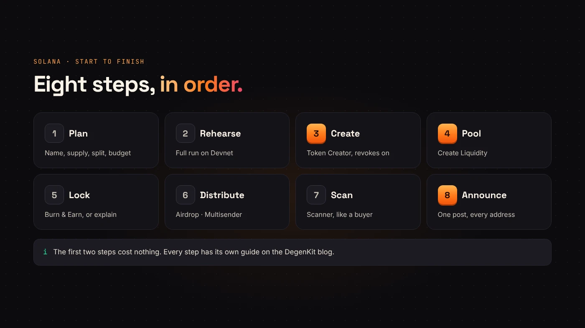
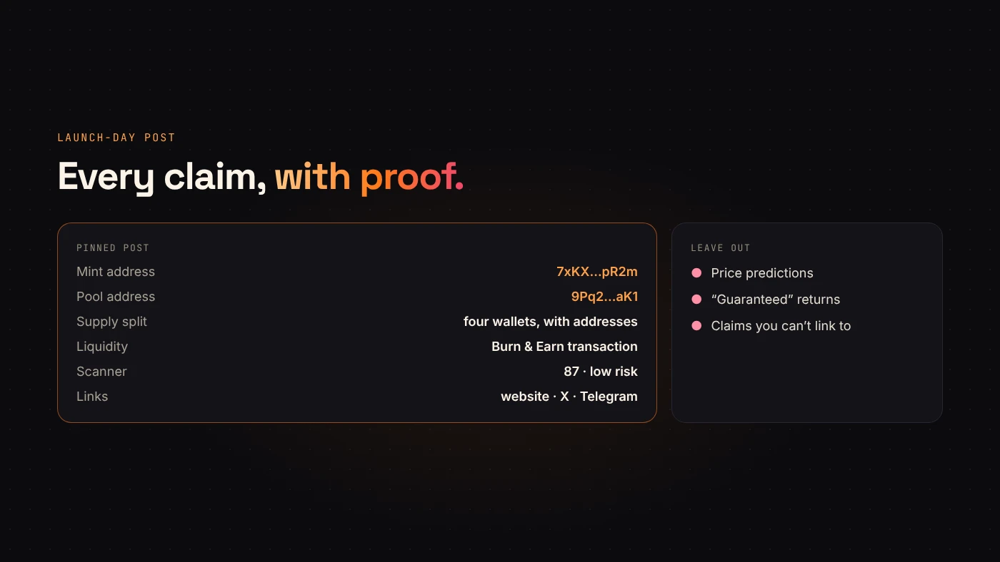

This guide strings together everything a first Solana launch needs, in order. Each step links to a detailed guide if you want to go deeper. Budget an afternoon for the steps and longer for the planning.

## 1. Plan before you touch a form

Decide the things you can't change later:

- **Name, symbol and decimals.** See [choosing decimals, name and symbol](/blog/choosing-decimals-name-and-symbol/).
- **Total supply and who gets what.** See [tokenomics for new tokens](/blog/token-supply-and-allocation/).
- **How much liquidity** you'll add, and in **SOL or USDC**. See [SOL or USDC](/blog/sol-or-usdc-liquidity-pair/).
- **Your budget** for every step. See [DegenKit's fees](/blog/degenkit-fees-explained/).

## 2. Rehearse on Devnet

Switch the launcher to **Devnet**, get test SOL and run the whole plan once. You'll see your starting price and catch typos for free. See [rehearsing on Devnet](/blog/rehearse-solana-launch-on-devnet/).

## 3. Create the token

Back on **Mainnet**, connect your launch wallet and open **Token Creator**. Enter the details, add an image and description, leave **revoke mint** and **revoke freeze** switched on, and sign. The 0.28 SOL service fee is shown before you sign. See [creating a Solana token](/blog/create-solana-token-without-coding/).

## 4. Open the pool

Use **Create Liquidity** to pair your token with SOL or USDC on Raydium. Check the starting price and market cap before you sign. The LP tokens go to your wallet. See [creating a token vs. adding liquidity](/blog/creating-a-token-vs-adding-liquidity/).

## 5. Decide what happens to the liquidity

Buyers will ask whether you can pull it. Either lock it permanently with Raydium's **Burn & Earn**, or explain publicly why it stays unlocked. See [locking liquidity](/blog/lock-liquidity-on-solana-burn-and-earn/).

## 6. Distribute, if you planned to

Send community or contributor allocations with **Airdrop** or **Multisender**, in batches of eight. See [preparing your recipient list](/blog/airdrop-multisender-csv-guide/).

## 7. Scan it like a buyer

Paste your mint into **Scanner**. With authorities revoked and metadata locked, the remaining points depend on holder spread and the pair. See [how Scanner scores tokens](/blog/how-degenkit-scanner-scores-tokens/).

## 8. Announce with proof

Publish one post with:

- the **mint address** and **pool address**;
- the **supply split** and the wallets that hold it;
- the **lock or LP transaction**;
- your Scanner result.

DEX Screener lists the token on its own after the first trade. See [DEX Screener and CoinGecko](/blog/dexscreener-and-coingecko-listing/).

:::tip Keep your launch wallet clean
Use a separate wallet for launching and move LP tokens or the Fee Key to a safer vault afterwards. See [wallet security for creators](/blog/wallet-security-for-token-creators/).
:::

## Questions people ask

### How long does a launch take?

The on-chain steps take minutes each. Planning, rehearsing and writing the announcement take longer, and they matter more.

### Can I launch on an EVM network instead?

Yes. The order is similar: create, add liquidity on a DEX, and for a tax token mark the pool. See [launching on Ethereum](/blog/create-erc20-token-on-ethereum/) or [BNB Chain](/blog/how-to-launch-a-token-on-bnb-chain/).

## Wrap up

Plan, rehearse, create, pool, lock or explain, distribute, scan and announce. Every step has a DegenKit tool and a guide. [Start on the Solana launcher](https://degenkit.app/launch/solana/) when your plan is ready.
