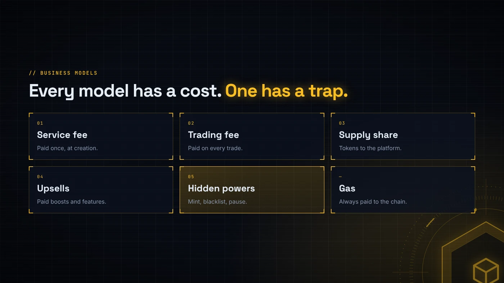
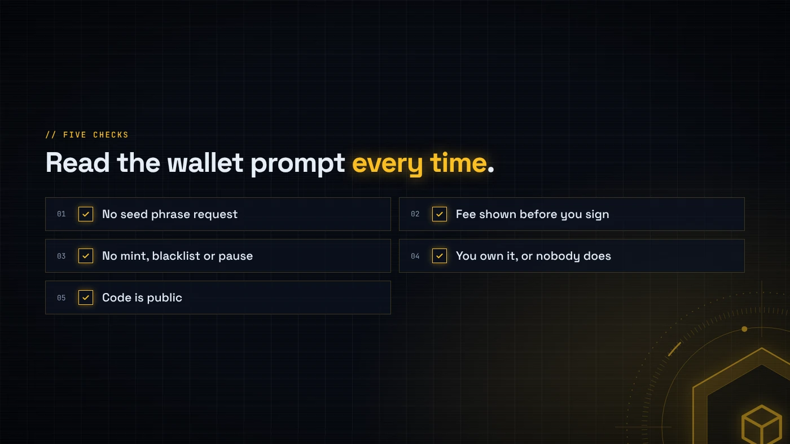

No token generator is truly free on a real blockchain. Every chain charges gas to create a token, and the tool either charges a service fee, takes a cut later, or makes money another way. "Free" is fine when the catch is clear. It is dangerous when it hides owner powers in your token or asks for your seed phrase.

:::note Key facts
- **Gas is never free** on mainnet. Only test networks such as Solana Devnet cost nothing.
- **Common business models:** a service fee, a trading fee, a share of supply, or upsells.
- **DegenKit:** a visible service fee (0.28 SOL on Solana, read from the contract on EVM chains). Some wallets on a free list pay no service fee for creation.
- **Never pay with your keys.** No legitimate generator needs a seed phrase.
:::

## Why can't creating a token be free?

Creating a token writes new data to a blockchain, and every blockchain charges for that:

- **Solana:** a network fee plus refundable-style rent for new accounts. See [Solana fees and rent](/blog/solana-fees-and-rent-explained/).
- **EVM chains:** gas in ETH, BNB or HYPE, which varies with congestion. Ethereum is usually the most expensive. See [Ethereum gas fees](/blog/ethereum-gas-fees-explained/).

A generator can hide the service fee but not the gas. Your wallet always shows the gas before you sign.

## How do "free" token generators make money?

| Model | How you pay | What to check |
|---|---|---|
| Service fee | Once, at creation | Is the fee shown before you sign? |
| Bonding-curve launchpad | A fee on every trade | Who sets the supply and curve? |
| Share of supply | Tokens sent to the platform | How many, and to which wallet? |
| Upsells | Paid "boosts" or features | Are the basics really included? |
| Hidden powers | Owner controls in your token | Can someone mint, blacklist or pause? |

The last row is the dangerous one. Security firms describe hidden mint functions that are renamed, placed behind upgradeable proxies or tied to secret roles (Dedaub). A "free" token with such code is not free. It is a trap for you and your buyers.

## Is a test network token free?

Yes, but it is not a real token. Devnet and testnet tokens have no value and cannot be traded on mainnet. They are useful for rehearsing a launch. See [rehearsing a Solana launch on Devnet](/blog/rehearse-solana-launch-on-devnet/). For Solana specifically, read [can you create a Solana token for free?](/blog/create-solana-token-free/).

## What does DegenKit charge?

- **Solana:** a 0.28 SOL service fee for Token Creator, plus network fees.
- **EVM chains:** a service fee stored in each factory contract and shown on the form, plus gas.
- **Free tools:** the Scanner, Vanity Address and My Tokens on Solana, and the free tools such as the [token tax calculator](/tools/token-tax-calculator/), cost nothing.
- **Free wallets:** some wallets on DegenKit's free list pay no service fee for token creation. Network fees still apply.

See [DegenKit fees explained](/blog/degenkit-fees-explained/) and the [fees page in the docs](/docs/fees/).

## How do you check a "free" generator?

1. **Does it ask for a seed phrase or private key?** Leave immediately.
2. **Is the fee shown before you sign?** Read your wallet's prompt.
3. **What does the token contract contain?** Look for mint, blacklist, pause or fee-change functions on the explorer.
4. **Who owns the token after creation?** It should be you, or nobody.
5. **Is the code public?** Public code can be checked.

Our guide to [whether token generators are safe](/blog/are-token-generators-safe/) covers each check, and the [token generator guide](/blog/token-generator/) explains how a clean generator works.

## What are the risks?

- **Wallet drainers** disguised as free generators.
- **Hidden owner powers** that let the tool's owner mint or block selling.
- **Surprise costs** in the form of trading fees or supply cuts.

You can lose money in crypto. This is not financial advice.

## FAQ

### Is there a free token generator?

Not on mainnet. Gas always applies. Some tools waive their service fee but make money another way.

### What is the cheapest way to create a token?

Solana and BNB Chain usually have the lowest network costs. Compare service fees before you sign.

### Are free token generators safe?

Some are. Check that no seed phrase is requested, fees are shown, and the token has no hidden owner powers.

## Sources

- [Dedaub: Hidden mint functions](https://tokin.dedaub.com/learn/hidden-mint)
- [DegenKit docs: Fees](https://degenkit.app/docs/fees/)
- [DegenKit docs: Security](https://degenkit.app/docs/security/)

See every fee before you sign on the [DegenKit token generator](/launch/).
