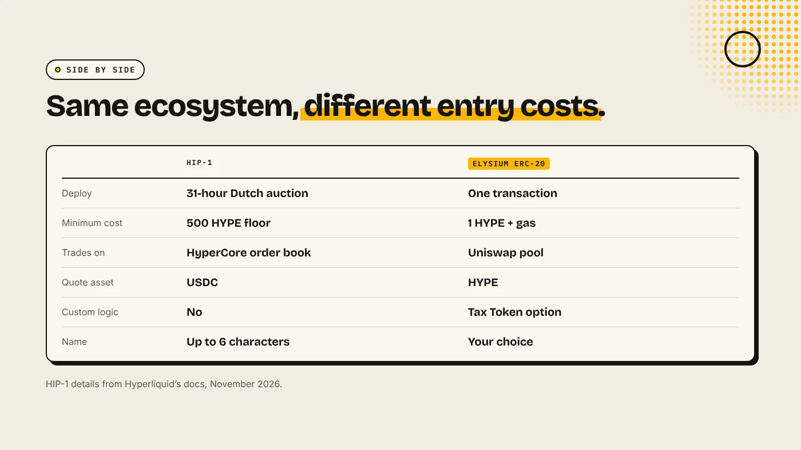

A HIP-1 token is Hyperliquid's native spot token. You win its ticker in a 31-hour Dutch auction paid in HYPE, and it trades on Hyperliquid's order book against USDC. An ERC-20 on Elysium is a smart contract you can create for 1 HYPE on DegenKit and trade on Uniswap against HYPE. HIP-1 costs far more and lists on Hyperliquid itself. Elysium is cheap, fast and open.

:::note Key facts
- **HIP-1 deploy:** a **31-hour Dutch auction**. Gas is paid in **HYPE**, with a floor of **500 HYPE** (Hyperliquid docs).
- **HIP-1 trading:** a native order book on HyperCore, quoted in **USDC**.
- **Elysium ERC-20:** **1 HYPE** plus gas on [DegenKit](/launch/elysium/). Trades in a **Uniswap** pool with HYPE.
- **Ticker:** HIP-1 names are up to **6 characters**. ERC-20 names and symbols are free to choose.
:::

:::note Not affiliated
DegenKit is not affiliated with Hyperliquid or Kinetiq. HIP-1 details are from Hyperliquid's documentation as of November 2026.
:::

## What is a HIP-1 token?

HIP-1 is Hyperliquid's native token standard. Eco describes HIP-1 tokens as "first-class objects in the L1 state" rather than smart contracts. The chain itself handles the balances, supply and trading. Every HIP-1 token gets a spot order book on HyperCore, with USDC as the quote asset.

To deploy one, you first win a **deployment slot** in a permissionless Dutch auction. Hyperliquid's docs say the auction runs for 31 hours with the price falling linearly. Gas is paid in HYPE. It starts at 2 times the last winning price, or at 500 HYPE if the last auction did not complete. Once you win, you set the name (up to 6 characters), decimals, max supply, genesis balances and optional Hyperliquidity, a protocol market-making strategy.

## What is an ERC-20 on Elysium?

Elysium is Kinetiq's layer 2 for Hyperliquid. It launched on November 9, 2026, uses HYPE for gas and runs standard EVM contracts. An ERC-20 there is an ordinary token contract. On DegenKit's Elysium launcher you can create:

- **Token Creator:** a plain ERC-20 with fixed supply and no owner,
- **Tax Token:** an ERC-20 with buy and sell tax.

Both cost 1 HYPE plus gas. You then open a Uniswap pool with HYPE at a price you choose. See the [Elysium token creator guide](/blog/elysium-token-creator/).

## How do they compare side by side?

| | HIP-1 (HyperCore) | ERC-20 on Elysium |
|---|---|---|
| How you deploy | Win a 31-hour Dutch auction | Sign one transaction |
| Minimum cost | 500 HYPE floor (gas) | 1 HYPE on DegenKit + gas |
| Where it trades | Hyperliquid spot order book | Uniswap pool |
| Quote asset | USDC | HYPE (or any pair you choose) |
| Liquidity | Your orders or Hyperliquidity | Your Uniswap deposit |
| Custom logic (tax, etc.) | No | Yes, with Tax Token |
| Name | Up to 6 characters | Your choice |

## Which should you choose?

**Choose HIP-1 if** you want a listing directly on Hyperliquid's spot order book, have a budget of hundreds of HYPE or more for the auction, and are happy with a plain token with no custom logic.

**Choose an Elysium ERC-20 if** you want to launch today for 1 HYPE, prefer an AMM pool you control, want a tax option, or are testing an idea before committing a large budget. For a meme coin, see [how to make a meme coin on Elysium](/blog/how-to-make-a-meme-coin-on-elysium/).

Kinetiq has said HyperCore read and write access for Elysium is planned after launch, which may bring the two closer. For now they are separate routes.

## Can a HIP-1 token have an ERC-20 version?

Yes. Hyperliquid's docs describe linking a HIP-1 token with an ERC-20 on HyperEVM, so transfers to a system address move balances between the two. This is a developer setup, and the docs recommend testing on testnet first. It does not apply to an ERC-20 created on Elysium. See [Elysium vs HyperEVM](/blog/elysium-vs-hyperevm/).

## What are the risks?

- **Auction cost.** HIP-1 gas is spent whether or not the token succeeds.
- **Thin books and thin pools.** Either route can launch with little liquidity.
- **Young chain.** Elysium is days old, and bridging out takes about 5.5 days.
- **Owner powers.** A tax token on Elysium keeps owner controls until renounced.

You can lose money in crypto. This is not financial advice.

## FAQ

### How much does it cost to deploy a HIP-1 token?

The Dutch auction gas is paid in HYPE and does not fall below 500 HYPE, according to Hyperliquid's docs. The price depends on the last auction.

### Can I create an ERC-20 on Elysium without code?

Yes. DegenKit's Elysium token creator makes one from a form for 1 HYPE plus gas.

### Do HIP-1 tokens trade on Uniswap?

Not directly. HIP-1 tokens trade on Hyperliquid's spot order book.

## Sources

- [Hyperliquid docs: HIP-1 native token standard](https://hyperliquid.gitbook.io/hyperliquid-docs/hyperliquid-improvement-proposals-hips/hip-1-native-token-standard)
- [Eco: What is HIP-1](https://eco.com/support/en/articles/15198001-what-is-hip-1-hyperliquid-s-token-standard-explained-2026)
- [Kinetiq launch release (GlobeNewswire via The Manila Times)](https://www.manilatimes.net/2026/11/09/tmt-newswire/globenewswire/kinetiq-launches-elysium-public-mainnet-a-high-performance-layer-2-built-for-hyperliquid/2465340)
- [Coinranking: Elysium mainnet goes live with trading apps](https://coinranking.com/news/elysium-layer-2-mainnet-launches-november-9-trading-apps)

Launch for 1 HYPE with the [DegenKit Elysium token creator](/launch/elysium/).
