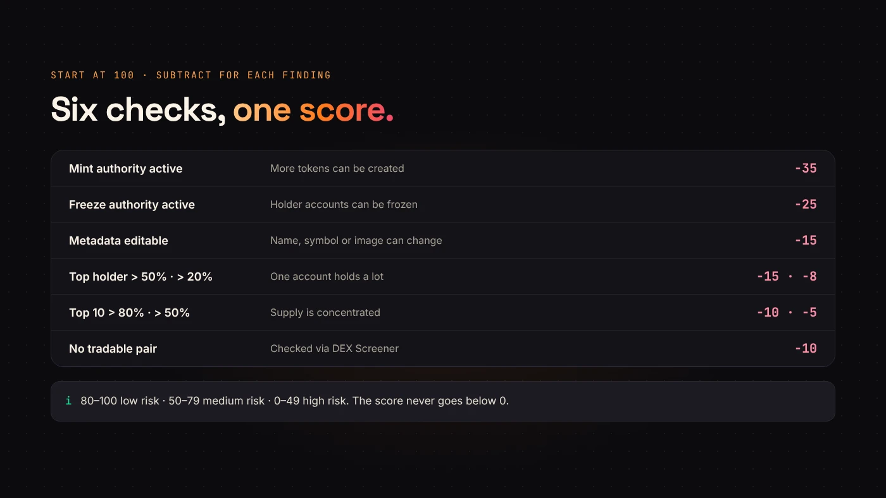
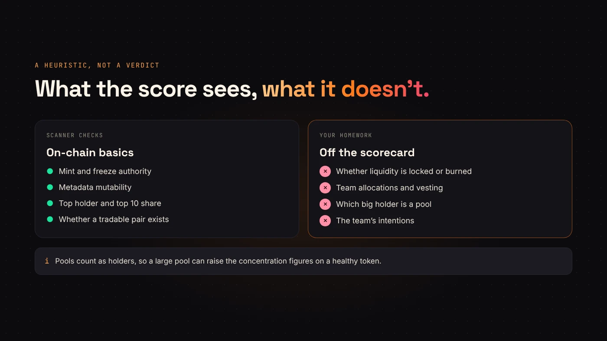

DegenKit's **Scanner** takes a Solana mint address and returns a score from 0 to 100, where higher means fewer red flags. It is a quick first look, not a verdict. This guide explains every point.

## What Scanner reads

When you paste a mint, Scanner reads public data:

- **The mint account** — whether the mint and freeze authority are still set.
- **The metadata account** — whether the name, symbol and image can still be changed.
- **The largest holders** — from Solana's [`getTokenLargestAccounts`](https://solana.com/docs/rpc/http/gettokenlargestaccounts), which returns the largest token accounts.
- **Trading pairs** — a best-effort check with DEX Screener for whether a tradable pair exists and roughly how much liquidity it has.

## How the score is calculated

Every token starts at **100**. Each finding subtracts points:

- **Mint authority still active:** −35. Someone can create more tokens.
- **Freeze authority still active:** −25. Someone can freeze holders' token accounts.
- **Metadata can still be changed:** −15. The name, symbol or image could change after you buy.
- **Top holder above 50% of supply:** −15. Above 20%: −8.
- **Top 10 holders above 80%:** −10. Above 50%: −5.
- **No tradable pair found:** −10.

The score never goes below 0.

## How to read the label

- **80–100: Low risk.**
- **50–79: Medium risk.**
- **0–49: High risk — may be a rug pull.**

A worked example: a token with mint and freeze revoked and locked metadata, where the largest holder has 30% and the top ten hold 60%, scores 100 − 8 − 5 = **87**, low risk. The same token with freeze authority still active scores **62**, medium.

## What the score can't see

Scanner's own note says it plainly: the score is a heuristic based on on-chain authorities and holder distribution. It does **not** verify:

- whether liquidity is **locked or burned**;
- **team allocations** or vesting;
- anyone's **intentions** off-chain.

It also counts every large token account, including **liquidity pools**. A big pool can push the top-holder figures up without anything being wrong. Our [bubblemap guide](/blog/how-to-read-a-holder-bubblemap/) explains how to tell a pool from a person.

:::warning A good score is a start, not a guarantee
A token can score 100 and still have unlocked liquidity or a team that sells. Use the score to decide where to look next.
:::

## For creators: score well by default

Tokens created on DegenKit start with mint and freeze authority revoked and metadata locked, unless you turned those settings off. That removes the 75 points of deductions buyers worry about most. The rest depends on how you distribute the supply and whether you open a pool.

## Questions people ask

### Why did the liquidity line say "unknown"?

The pair check relies on DEX Screener. If it can't be reached, Scanner says so and doesn't subtract points.

### Does Scanner work on Devnet?

Yes. It reads whichever network the launcher is set to.

## Wrap up

Scanner starts at 100 and subtracts for live authorities, editable metadata, concentrated holders and a missing pair. Read the label, then check what it can't see. [Scan a token on DegenKit](https://degenkit.app/launch/solana/).
